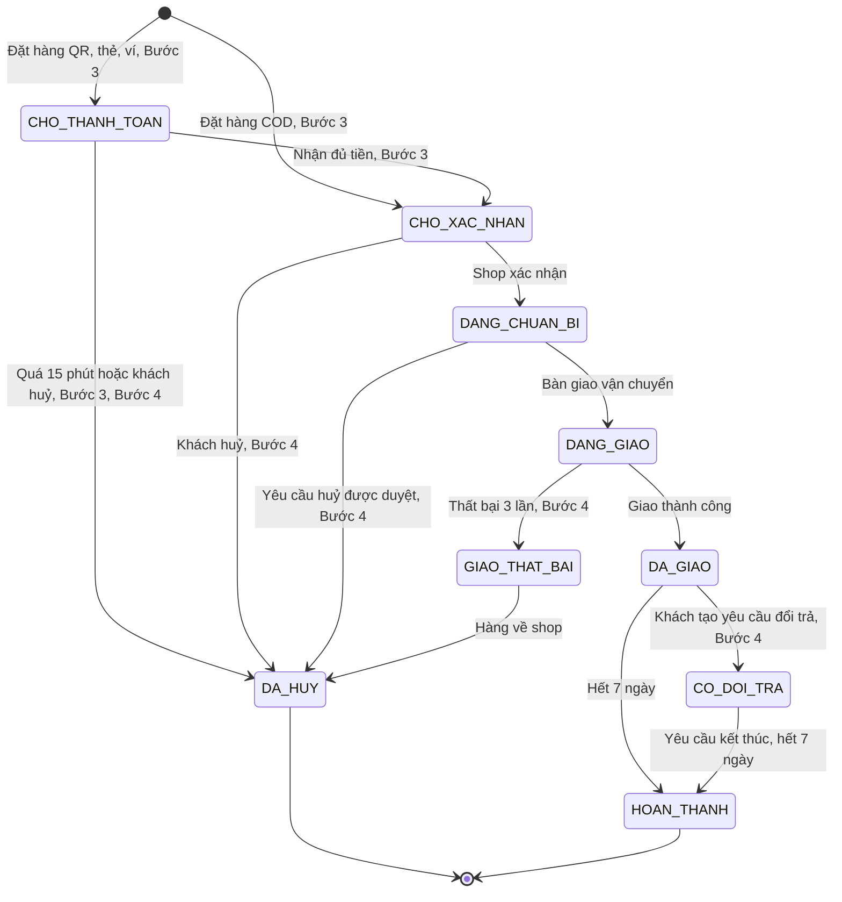
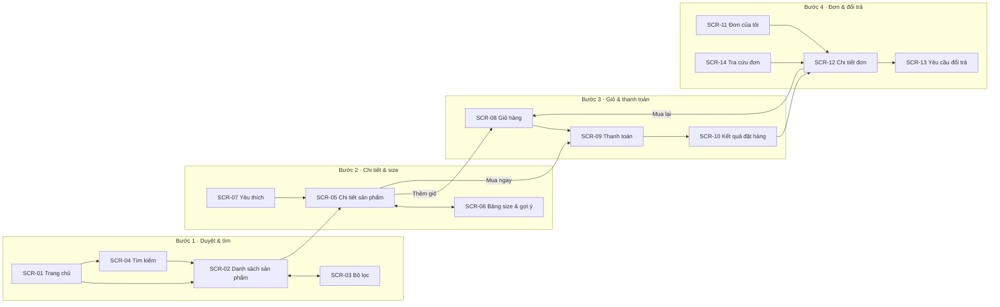

# Đề 3 · Website mua quần áo

> **Mã:** DE03 · **Độ khó:** 3/8 · **Vai trò:** 1 (khách mua: khách vãng lai hoặc thành viên) · **Nền tảng:** Website (desktop và mobile)

Website bán quần áo của một thương hiệu thời trang: khách duyệt và tìm sản phẩm, chọn đúng màu và size, đặt hàng không cần tài khoản, thanh toán khi nhận hàng hoặc chuyển khoản QR, theo dõi đơn và tự đổi size, trả hàng. Đây là đề đầu tiên có **dữ liệu từ máy chủ** (tồn kho, giá, đơn hàng) và **thanh toán**. Đề gồm **1 tính năng**, là **1 luồng** gồm 4 bước và các màn hình; tài liệu gồm 1 PRD và 1 SRS.

## Tính năng

| **Tính năng** | **Luồng** | **PRD** | **SRS** |
| --- | --- | --- | --- |
| Website mua quần áo | Duyệt & tìm sản phẩm → Chi tiết sản phẩm & chọn size → Giỏ hàng & thanh toán → Đơn hàng, huỷ & đổi trả | [PRD](docs/PRD.md) | [SRS](docs/SRS.md) |

## Các bước và màn hình của luồng

| **Bước** | **Tên bước** | **Màn hình** | **Phạm vi** |
| --- | --- | --- | --- |
| Bước 1 | Duyệt & tìm sản phẩm | SCR-01, SCR-02, SCR-03, SCR-04 | Trang chủ, danh mục, lọc size, màu, giá; sắp xếp; tìm kiếm không dấu |
| Bước 2 | Chi tiết sản phẩm & chọn size | SCR-05, SCR-06, SCR-07 | Ảnh theo màu, tồn kho theo biến thể, gợi ý size, thêm giỏ, yêu thích, báo có hàng |
| Bước 3 | Giỏ hàng & thanh toán | SCR-08, SCR-09, SCR-10 | Sửa giỏ, phí giao, mã giảm giá, khách vãng lai, COD, QR, thẻ/ví, giữ hàng |
| Bước 4 | Đơn hàng, huỷ & đổi trả | SCR-11, SCR-12, SCR-13, SCR-14 | Đơn của tôi, tra cứu đơn, theo dõi giao, huỷ, đổi size, trả hàng hoàn tiền |

Luồng: Bước 1 Duyệt & tìm sản phẩm → Bước 2 Chi tiết sản phẩm & chọn size → Bước 3 Giỏ hàng & thanh toán → Bước 4 Đơn hàng, huỷ & đổi trả.

## Vòng đời đơn hàng (dùng chung cả đề)



Các bước của shop (xác nhận, đóng gói, duyệt đổi trả) và đơn vị vận chuyển do hệ thống nội bộ cập nhật; đề chỉ thiết kế **phía khách**.

## Bản đồ màn hình



## Bối cảnh chung

Shop bán chủ yếu qua quảng cáo mạng xã hội; phần lớn khách vào web bằng điện thoại, mua lần đầu và không muốn tạo tài khoản. Hai nỗi lo lớn nhất khi mua quần áo online là **không vừa size** và **mất tiền mà không nhận được hàng như ý**. Bài toán thiết kế chính là giúp khách chọn đúng size, thấy rõ tổng tiền từ sớm, và tin rằng đổi trả là dễ dàng.

| **Nhóm người dùng** | **Nhu cầu chính** |
| --- | --- |
| Khách vào từ quảng cáo, dùng điện thoại | Thấy đúng món đang quảng cáo, mua nhanh không cần tài khoản |
| Khách quen (thành viên) | Địa chỉ đã lưu, xem lại đơn cũ, mua lại |
| Khách lo về size | Gợi ý size, bảng size riêng từng mẫu, đổi size miễn phí |
| Khách quen trả tiền khi nhận hàng | COD, hoặc QR được xác nhận ngay |

Ngoài phạm vi cả đề: app di động, trang quản trị (sản phẩm, đơn, kho, duyệt đổi trả), đánh giá sản phẩm, chat với shop, điểm thưởng và hạng thành viên, trả góp, nhiều kho và nhiều chi nhánh, bán hàng quốc tế.

## Quy ước dùng chung

- Tiền tệ VND, không có số lẻ; định dạng `499.000 ₫`.
- Địa chỉ theo đơn vị hành chính 2 cấp: Tỉnh/Thành phố → Phường/Xã.
- Thành viên đăng nhập bằng số điện thoại và OTP theo luồng chuẩn, không mô tả trong bộ tài liệu này.
- Mã BR, MSG, UC đánh số liên tục trong cả đề: Bước 1 dùng BR-01–10, MSG-01–06, UC-01–02; Bước 2 dùng BR-11–20, MSG-07–13, UC-03–05; Bước 3 dùng BR-21–34, MSG-14–26, UC-06–07; Bước 4 dùng BR-35–46, MSG-27–36, UC-08–10.
- Breakpoint: mobile 360–767 px, tablet 768–1023 px, desktop ≥ 1024 px. Thiết kế mobile trước.

## Danh sách màn hình

| **Mã** | **Màn hình** | **Mô tả chi tiết ở** |
| --- | --- | --- |
| SCR-01 | Trang chủ | Bước 1 |
| SCR-02 | Danh sách sản phẩm (danh mục, kết quả tìm) | Bước 1 |
| SCR-03 | Bộ lọc | Bước 1 |
| SCR-04 | Tìm kiếm | Bước 1 |
| SCR-05 | Chi tiết sản phẩm | Bước 2 |
| SCR-06 | Bảng size & gợi ý size | Bước 2 |
| SCR-07 | Yêu thích | Bước 2 |
| SCR-08 | Giỏ hàng | Bước 3 |
| SCR-09 | Thanh toán | Bước 3 |
| SCR-10 | Kết quả đặt hàng | Bước 3 |
| SCR-11 | Đơn của tôi | Bước 4 |
| SCR-12 | Chi tiết đơn | Bước 4 |
| SCR-13 | Yêu cầu đổi trả | Bước 4 |
| SCR-14 | Tra cứu đơn | Bước 4 |

## Cấu trúc repo

```text
de03-website-mua-quan-ao/
├── README.md
└── docs/
    ├── PRD.md    Bối cảnh, phạm vi, luồng, use case theo từng bước
    └── SRS.md    Quy tắc, trạng thái, use case, màn hình, API, thông báo theo từng bước
```

## Cách dùng bộ tài liệu

1. Đọc README để nắm vòng đời đơn hàng và danh sách màn hình.
2. Đọc PRD để nắm toàn bộ tính năng và luồng (vì sao làm, cho ai, đo bằng gì), rồi đọc SRS theo từng bước của luồng (quy tắc, trạng thái, use case, màn hình, thông báo).
3. Thiết kế **cả mobile và desktop** cho mỗi màn; mobile là ưu tiên.
4. Thiết kế màn hình theo đúng mã SCR, mã MSG trong SRS để dễ đối chiếu khi review.
5. Sơ đồ viết bằng Mermaid, xem trực tiếp trên GitHub hoặc trình xem Markdown có hỗ trợ Mermaid.
