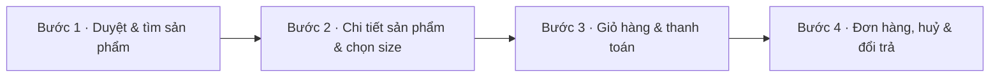
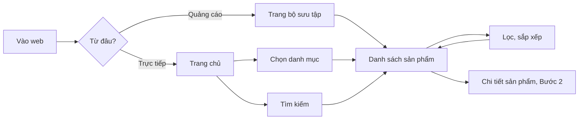
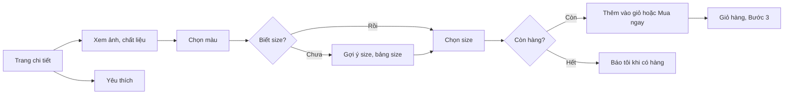
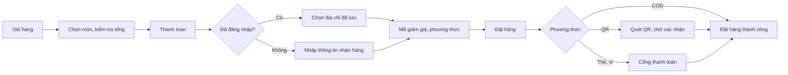
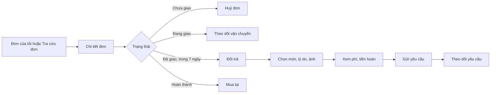

> **Mã:** DE03-PRD · **Trạng thái:** đã chốt · **Người viết:** Design · **SRS:** [SRS.md](SRS.md)

# PRD Website mua quần áo

> Đề gồm **1 tính năng**, là **1 luồng** gồm 4 bước và các màn hình: Duyệt & tìm sản phẩm → Chi tiết sản phẩm & chọn size → Giỏ hàng & thanh toán → Đơn hàng, huỷ & đổi trả. Sơ đồ chung xem [README](../README.md).

## 1. Bối cảnh và vấn đề

### 1.1 Bối cảnh

Website bán quần áo của một thương hiệu thời trang: khách duyệt và tìm sản phẩm, chọn đúng màu và size, đặt hàng không cần tài khoản, thanh toán khi nhận hàng hoặc chuyển khoản QR, theo dõi đơn và tự đổi size, trả hàng. Đây là đề đầu tiên có **dữ liệu từ máy chủ** (tồn kho, giá, đơn hàng) và **thanh toán**.

Shop bán chủ yếu qua quảng cáo mạng xã hội; phần lớn khách vào web bằng điện thoại, mua lần đầu và không muốn tạo tài khoản. Hai nỗi lo lớn nhất khi mua quần áo online là **không vừa size** và **mất tiền mà không nhận được hàng như ý**. Bài toán thiết kế chính là giúp khách chọn đúng size, thấy rõ tổng tiền từ sớm, và tin rằng đổi trả là dễ dàng.

### 1.2 Vấn đề

| **Vấn đề** | **Hệ quả** |
| --- | --- |
| Danh mục chia theo cách shop nghĩ, không theo cách khách tìm | Khách không biết bấm vào đâu |
| Lọc xong vẫn thấy mẫu đã hết size của mình | Khách bấm vào rồi thất vọng, rời trang |
| Tìm "ao so mi trang" (không dấu) không ra kết quả | Khách nghĩ shop không bán |
| Trên điện thoại, bộ lọc che hết sản phẩm, khó đóng | Khách bỏ lọc, cuộn mãi không thấy |
| Không biết món nào đang giảm giá, món nào mới về | Bỏ lỡ món muốn mua |
| Ảnh ít, không thấy chất vải, không thấy dáng khi mặc | Khách không dám mua |
| Bảng size chung cho mọi mẫu, ghi cm khó hiểu | Chọn sai size, đổi trả nhiều |
| Chọn màu xong mới biết size của mình đã hết | Khách bực, rời trang |
| Bấm "Thêm vào giỏ" khi chưa chọn size, không có phản hồi rõ | Khách tưởng đã thêm |
| Món thích nhưng chưa mua ngay thì mất dấu | Mất đơn |
| Bắt tạo tài khoản trước khi đặt | Khách bỏ đi ngay |
| Phí ship chỉ hiện ở bước cuối | Khách thấy bị "giấu phí", bỏ giỏ |
| Form địa chỉ dài, gõ sai tỉnh, phường | Giao chậm, giao thất bại |
| Đặt xong mới biết hết hàng | Shop phải gọi huỷ, khách mất niềm tin |
| Chuyển khoản xong không biết shop đã nhận chưa | Khách nhắn hỏi liên tục, shop xác nhận tay |
| Nhập mã giảm giá lỗi mà không biết vì sao | Khách bực, bỏ giỏ |
| Khách không biết đơn đang ở bước nào | Gọi, nhắn hỏi shop; tổng đài quá tải |
| Muốn huỷ đơn vừa đặt nhầm nhưng không có nút huỷ | Phải nhắn shop, đôi khi hàng đã gửi đi |
| Đổi size phải nhắn tin, gửi ảnh, chờ phản hồi | Mất 2–3 ngày, khách bực |
| Không rõ đổi trả mất phí không, bao lâu nhận tiền | Khách ngại mua |
| Khách vãng lai không có tài khoản để xem đơn | Không tự tra cứu được |

### 1.3 Mục tiêu

- ≥ 60% phiên có xem ít nhất 1 trang chi tiết sản phẩm.
- ≥ 85% lượt tìm kiếm có ít nhất 1 kết quả.
- Trang danh sách hiện sản phẩm đầu tiên ≤ 2 giây trên 4G.
- Tỉ lệ thêm giỏ từ trang chi tiết ≥ 12%.
- Tỉ lệ đổi trả vì sai size giảm từ 45% xuống ≤ 30% tổng yêu cầu đổi trả.
- ≥ 25% khách thêm giỏ có dùng gợi ý size hoặc bảng size.
- Tỉ lệ từ mở trang Thanh toán tới đặt hàng thành công ≥ 55%.
- Thời gian hoàn tất thanh toán của khách vãng lai ≤ 2 phút (trung vị).
- ≥ 95% đơn chuyển khoản QR được xác nhận tự động, không cần nhân viên.
- Giảm 40% cuộc gọi, tin nhắn hỏi "đơn của tôi đâu".
- ≥ 80% yêu cầu đổi trả được khách tự tạo trên web, không qua tổng đài.
- Thời gian từ khi kho nhận hàng trả tới khi hoàn tiền ≤ 3 ngày làm việc.

## 2. Người dùng

| **Nhóm** | **Nhu cầu với tính năng này** |
| --- | --- |
| Khách vào từ quảng cáo | Thấy ngay bộ sưu tập đang quảng cáo, không bị lạc |
| Khách biết mình muốn gì | Tìm nhanh bằng từ khoá, lọc đúng size, màu, khoảng giá |
| Khách lướt xem cho vui | Xem hàng mới, hàng giảm giá, cuộn liên tục |
| Khách size lớn hoặc nhỏ | Chỉ thấy mẫu còn size của mình |
| Khách mua lần đầu | Biết chất vải, dáng mặc, size nào vừa mình |
| Khách quen | Thêm giỏ nhanh, biết size quen của mình còn không |
| Khách lưỡng lự | Lưu lại món thích, được báo khi có hàng lại |
| Khách vãng lai mua lần đầu | Đặt không cần tài khoản, biết tổng tiền sớm, trả khi nhận hàng |
| Thành viên | Dùng lại địa chỉ đã lưu, đặt trong vài chạm; Xem mọi đơn, mua lại nhanh |
| Khách săn mã giảm giá | Biết mã có dùng được không, vì sao không |
| Khách quen chuyển khoản | Quét QR, được xác nhận ngay |
| Khách vãng lai | Tra cứu đơn bằng mã đơn và số điện thoại |
| Khách chọn sai size | Đổi size nhanh, không mất phí |
| Khách nhận hàng lỗi, giao sai | Báo lỗi có ảnh, được hoàn tiền hoặc đổi mới, shop chịu phí |

## 3. Phạm vi

### 3.1 Trong phạm vi (MVP)

**Bước 1 · Duyệt & tìm sản phẩm**

- Trang chủ: banner bộ sưu tập, danh mục nổi bật, Hàng mới về, Đang giảm giá.
- Danh mục 2 cấp: Nữ, Nam, Phụ kiện → loại sản phẩm (Áo thun, Sơ mi, Quần jean…).
- Trang danh sách sản phẩm: lưới thẻ sản phẩm, tải thêm khi cuộn.
- Bộ lọc: size, màu, khoảng giá, chất liệu, kiểu dáng; chỉ còn hàng.
- Sắp xếp: Phù hợp nhất, Mới nhất, Bán chạy, Giá tăng dần, Giá giảm dần.
- Tìm kiếm: gợi ý khi gõ, chấp nhận không dấu, từ khoá phổ biến, tìm gần đây.

**Bước 2 · Chi tiết sản phẩm & chọn size**

- Bộ ảnh theo từng màu, phóng to, video ngắn (nếu có).
- Chọn màu, chọn size; trạng thái còn hàng theo từng biến thể.
- Bảng size riêng theo mẫu và gợi ý size theo chiều cao, cân nặng.
- Thông tin người mẫu (chiều cao, size đang mặc), chất liệu, hướng dẫn giặt.
- Chọn số lượng, Thêm vào giỏ, Mua ngay.
- Yêu thích (trái tim) và trang Yêu thích.
- "Báo tôi khi có hàng" cho size đã hết.
- Sản phẩm tương tự.

**Bước 3 · Giỏ hàng & thanh toán**

- Giỏ hàng: sửa số lượng, đổi size, xoá, chọn món để thanh toán, tạm tính, nhắc mức miễn phí giao.
- Thanh toán một trang: thông tin nhận hàng, phương thức giao, mã giảm giá, phương thức thanh toán, tổng tiền.
- Khách vãng lai đặt hàng không cần tài khoản; thành viên dùng sổ địa chỉ.
- Thanh toán: COD, chuyển khoản QR, thẻ hoặc ví điện tử qua cổng thanh toán.
- Trang đặt hàng thành công, trang chờ thanh toán QR.

**Bước 4 · Đơn hàng, huỷ & đổi trả**

- Đơn của tôi (thành viên), tra cứu đơn (khách vãng lai).
- Chi tiết đơn: trạng thái, mốc thời gian, mã vận đơn, món, số tiền.
- Huỷ đơn trước khi giao cho đơn vị vận chuyển.
- Yêu cầu đổi size, màu hoặc trả hàng hoàn tiền trong 7 ngày kể từ khi nhận.
- Theo dõi yêu cầu đổi trả, hoàn tiền.
- Mua lại đơn cũ.

### 3.2 Ngoài phạm vi

- Tìm bằng hình ảnh → phase sau.
- Gợi ý cá nhân hoá theo lịch sử xem.
- Trang thương hiệu, trang người mẫu, lookbook.
- So sánh sản phẩm.
- Đánh giá, hỏi đáp của khách → phase sau.
- Thử đồ ảo, ảnh 360°.
- Mua kèm theo bộ (set) giảm giá.
- Trả góp, mua trước trả sau.
- Điểm thưởng, hạng thành viên.
- Giao hàng hoả tốc trong 2 giờ, nhận tại cửa hàng → phase sau.
- Xuất hoá đơn VAT.
- Nhiều mã giảm giá cùng lúc.
- Trang quản trị cho nhân viên xử lý đơn và duyệt đổi trả (đề chỉ mô tả kết quả khách thấy).
- Đánh giá sản phẩm sau khi nhận → phase sau.
- Đổi sang mẫu khác giá, bù trừ chênh lệch.
- Chat với nhân viên trong trang đơn.

## 4. Nguyên tắc sản phẩm

### 4.1 Đừng cho khách thấy thứ họ không mua được

Lọc theo size chỉ trả về mẫu **còn hàng size đó**. Mẫu hết sạch hàng xuống cuối danh sách và ghi rõ "Hết hàng".

### 4.2 Tìm theo cách khách gõ

Không dấu, sai chính tả nhẹ, từ đồng nghĩa phổ biến ("quần bò" = "quần jean") đều ra kết quả.

### 4.3 Lọc mà không mất chỗ

Bộ lọc đang chọn hiện thành chip trên đầu danh sách, bỏ từng cái bằng một chạm. Quay lại trang danh sách giữ nguyên lọc và vị trí cuộn.

### 4.4 Giá rõ ngay trên thẻ

Thẻ sản phẩm luôn hiện giá đang bán; có giảm giá thì hiện giá gốc gạch ngang và % giảm.

### 4.5 Size là quyết định khó nhất, giúp khách chắc chắn

Gợi ý size nằm ngay cạnh lựa chọn size, không giấu trong link nhỏ. Thông tin người mẫu luôn hiện.

### 4.6 Hết hàng phải thấy trước khi chọn

Size hết hàng của màu đang chọn bị gạch, vẫn chạm được để đăng ký báo có hàng.

### 4.7 Thêm giỏ có phản hồi rõ

Thêm giỏ thành công hiện giỏ thu gọn với món vừa thêm; chưa chọn size thì chỉ rõ chỗ cần chọn.

### 4.8 Không mất món đã thích

Khách chưa đăng nhập vẫn yêu thích được; đăng nhập thì gộp vào tài khoản.

### 4.9 Không có phí bất ngờ

Phí giao ước tính hiện ngay ở giỏ hàng; tổng tiền luôn hiện ở mọi bước và cập nhật ngay khi khách đổi gì đó.

### 4.10 Không bắt đăng nhập

Khách vãng lai đặt được hàng. Đăng nhập chỉ là lối tắt cho người đã có tài khoản.

### 4.11 Hỏi ít, kiểm tra sớm

Một trang thanh toán, lỗi báo ngay tại ô sai, không đợi bấm Đặt hàng.

### 4.12 Đặt rồi là có hàng

Tồn kho được kiểm tra và giữ tại thời điểm đặt; đã báo đặt thành công thì shop phải có hàng.

### 4.13 Trạng thái nói bằng ngôn ngữ của khách

"Đang giao, dự kiến thứ Năm 21/11" thay cho mã trạng thái kỹ thuật. Mỗi trạng thái nói rõ khách cần làm gì (nếu có).

### 4.14 Khách tự làm được thì không bắt gọi

Huỷ, đổi size, trả hàng đều tự làm trên web. Chỉ cần tổng đài khi ngoại lệ.

### 4.15 Chính sách đọc một lần là hiểu

Trước khi gửi yêu cầu, khách thấy rõ: có mất phí không, nhận lại tiền bao nhiêu, bao lâu.

### 4.16 Công bằng khi lỗi do shop

Hàng lỗi, giao sai → shop chịu mọi phí, không hỏi vặn.

## 5. Quy tắc nghiệp vụ

| **Quy tắc** | **Giá trị** |
| --- | --- |
| Danh mục | 2 cấp; một sản phẩm thuộc 1 danh mục chính, có thể gắn thêm bộ sưu tập |
| Hàng mới về | Sản phẩm mở bán trong 30 ngày gần nhất |
| Mỗi lần tải | 24 sản phẩm (desktop), 12 sản phẩm (mobile) |
| Còn hàng | Ít nhất 1 biến thể (màu × size) có tồn kho > 0 |
| Tìm kiếm | Gợi ý khi gõ ≥ 2 ký tự; tối đa 6 gợi ý từ khoá + 4 sản phẩm |
| Tìm gần đây | Lưu 5 từ khoá trên trình duyệt |
| Biến thể | Sản phẩm × màu × size; mỗi biến thể có mã SKU và tồn kho riêng |
| Sắp hết | Tồn kho biến thể ≤ 5 → hiện "Chỉ còn {n}" |
| Số lượng mỗi lần thêm | 1–10 và không quá tồn kho |
| Gợi ý size | Chiều cao 140–200 cm, cân nặng 35–120 kg; dựa trên bảng size của mẫu |
| Yêu thích | Tối đa 100 sản phẩm |
| Báo có hàng | Gửi email 1 lần khi biến thể có hàng lại; đăng ký hết hạn sau 60 ngày |
| Giới hạn giỏ | Tối đa 10 cái mỗi SKU, 30 dòng sản phẩm |
| Phí giao | Nội thành Hà Nội, TP.HCM 25.000 ₫; tỉnh khác 35.000 ₫ |
| Miễn phí giao | Đơn có tạm tính sau giảm giá từ 499.000 ₫ |
| Mã giảm giá | 1 mã mỗi đơn; giảm %, giảm tiền, hoặc miễn phí giao |
| COD | Đơn có tổng tiền ≤ 5.000.000 ₫ |
| Giữ hàng chờ thanh toán online | 15 phút; quá hạn đơn tự huỷ |
| Giỏ của khách vãng lai | Lưu 30 ngày trên trình duyệt |
| Tự huỷ | Khi đơn chưa được shop xác nhận; đã xác nhận nhưng chưa giao vận chuyển thì gửi yêu cầu huỷ |
| Thời hạn đổi trả | 7 ngày kể từ khi giao thành công |
| Không đổi trả | Đồ lót, đồ bơi, khuyên tai; hàng giảm từ 50% chỉ được đổi size, không trả |
| Điều kiện hàng | Còn tem mác, chưa giặt, chưa sử dụng |
| Phí đổi size | Miễn phí lần đầu mỗi đơn |
| Phí trả hàng do đổi ý | 30.000 ₫, trừ vào tiền hoàn |
| Hàng lỗi, giao sai | Shop chịu phí hai chiều |
| Hoàn tiền | ≤ 3 ngày làm việc sau khi kho nhận hàng trả |

- Danh mục, bộ sưu tập, từ đồng nghĩa do **vận hành shop cấu hình**, không cố định trong code.
- Phí giao, ngưỡng miễn phí, ngưỡng COD là **cấu hình**, không cố định trong code.

## 6. Luồng trải nghiệm

### 6.1 Toàn bộ luồng

### 6.2 Bước 1 · Duyệt & tìm sản phẩm

| **Bước** | **Giai đoạn** | **Trải nghiệm** | **Đầu ra** |
| --- | --- | --- | --- |
| 1 | Vào web | Trang chủ hoặc trang bộ sưu tập theo link quảng cáo | Khách thấy hàng ngay màn đầu |
| 2 | Chọn hướng | Danh mục ở menu, ô tìm kiếm luôn ở header | Danh sách sản phẩm |
| 3 | Thu hẹp | Lọc size, màu, giá; sắp xếp | Danh sách vừa ý |
| 4 | Chọn mẫu | Chạm thẻ sản phẩm | Trang chi tiết (Bước 2) |

### 6.3 Bước 2 · Chi tiết sản phẩm & chọn size

| **Bước** | **Giai đoạn** | **Trải nghiệm** | **Đầu ra** |
| --- | --- | --- | --- |
| 1 | Xem | Ảnh lớn theo màu, giá, chất liệu, người mẫu | Hiểu sản phẩm |
| 2 | Chọn biến thể | Chạm màu → ảnh đổi; size hết bị gạch | Màu, size |
| 3 | Chắc size | Nhập chiều cao, cân nặng → size gợi ý | Size phù hợp |
| 4 | Quyết định | Thêm vào giỏ, Mua ngay, hoặc Yêu thích | Món trong giỏ hoặc danh sách thích |

### 6.4 Bước 3 · Giỏ hàng & thanh toán

| **Bước** | **Giai đoạn** | **Trải nghiệm** | **Đầu ra** |
| --- | --- | --- | --- |
| 1 | Giỏ hàng | Sửa số lượng, size; thấy tạm tính, phí giao ước tính, còn thiếu bao nhiêu để miễn phí giao | Danh sách món sẽ mua |
| 2 | Thông tin nhận hàng | Tên, điện thoại, địa chỉ; thành viên chọn từ sổ địa chỉ | Địa chỉ hợp lệ |
| 3 | Ưu đãi, thanh toán | Mã giảm giá, chọn COD, QR, thẻ, ví | Tổng tiền cuối |
| 4 | Đặt hàng | Bấm "Đặt hàng · {tổng}" | Đơn được tạo |
| 5 | Xác nhận | Mã đơn, thời gian giao dự kiến; QR thì chờ tiền về | Đơn chờ shop xác nhận |

### 6.5 Bước 4 · Đơn hàng, huỷ & đổi trả

| **Bước** | **Giai đoạn** | **Trải nghiệm** | **Đầu ra** |
| --- | --- | --- | --- |
| 1 | Tìm đơn | Thành viên vào Đơn của tôi; khách vãng lai nhập mã đơn + số điện thoại | Chi tiết đơn |
| 2 | Theo dõi | Thanh tiến trình, mốc thời gian, dự kiến giao | Khách yên tâm |
| 3 | Huỷ (nếu cần) | Chọn lý do, xác nhận; thấy tiền hoàn về đâu | Đơn huỷ hoặc yêu cầu huỷ |
| 4 | Đổi trả | Chọn món, đổi size hay trả, lý do, ảnh; xem phí và tiền hoàn | Yêu cầu đổi trả |
| 5 | Kết thúc | Nhận hàng đổi hoặc tiền hoàn | Yêu cầu hoàn tất |

## 7. Use Cases, User Stories và Acceptance Criteria

### Bước 1 · Duyệt & tìm sản phẩm

#### UC1. Duyệt theo danh mục

##### US1.1 Xem trang chủ

User Story: Là khách, tôi muốn thấy ngay hàng mới và hàng giảm giá khi vào web để biết shop có gì hay.

AC01: Trang chủ có banner, danh mục nổi bật, khối Hàng mới về và Đang giảm giá, mỗi khối tối đa 8 sản phẩm và link "Xem tất cả".

AC02: Banner tự chuyển sau 5 giây; khách vuốt hoặc bấm chấm để chuyển tay.

AC03: Khối không có sản phẩm thì ẩn, không hiện khung trống.

##### US1.2 Xem danh sách theo danh mục

User Story: Là khách, tôi muốn xem tất cả áo sơ mi nữ để chọn mẫu ưng ý.

AC01: Menu danh mục 2 cấp; trên mobile mở dạng ngăn kéo.

AC02: Trang danh sách hiện tên danh mục, số sản phẩm, lưới thẻ sản phẩm.

AC03: Cuộn tới cuối tự tải thêm; hết sản phẩm thì hiện "Bạn đã xem hết {n} sản phẩm".

AC04: Bấm Quay lại từ trang chi tiết → về đúng vị trí cuộn cũ.

#### UC2. Lọc và sắp xếp

##### US2.1 Lọc theo size, màu, giá

User Story: Là khách, tôi muốn lọc theo size của mình để chỉ thấy mẫu còn size đó.

AC01: Lọc theo size chỉ trả về sản phẩm còn hàng ở size đã chọn.

AC02: Mỗi giá trị lọc hiện số sản phẩm phù hợp; giá trị cho 0 kết quả bị làm mờ.

AC03: Bộ lọc đang chọn hiện thành chip; bấm × để bỏ, "Xoá tất cả" để bỏ hết.

AC04: Lọc lưu trên URL; chia sẻ link mở ra đúng bộ lọc.

AC05: Trên mobile, bộ lọc mở toàn màn, nút "Xem {n} sản phẩm" ở dưới.

##### US2.2 Sắp xếp

User Story: Là khách, tôi muốn sắp xếp theo giá để tìm món vừa túi tiền.

AC01: 5 cách sắp xếp; mặc định Phù hợp nhất khi tìm kiếm, Mới nhất khi xem danh mục.

AC02: Đổi sắp xếp giữ nguyên bộ lọc, đưa về đầu danh sách.

#### UC3. Tìm kiếm

##### US3.1 Tìm bằng từ khoá

User Story: Là khách, tôi muốn gõ tên món và thấy gợi ý ngay để không phải gõ hết.

AC01: Gõ ≥ 2 ký tự hiện gợi ý từ khoá và sản phẩm; chấp nhận không dấu.

AC02: Ô trống khi focus hiện tìm gần đây và từ khoá phổ biến.

AC03: Không có kết quả → gợi ý từ khoá gần đúng và khối Hàng mới về.

AC04: Kết quả tìm kiếm dùng chung bộ lọc, sắp xếp như danh mục.

### Bước 2 · Chi tiết sản phẩm & chọn size

#### UC4. Xem và chọn biến thể

##### US4.1 Xem sản phẩm

User Story: Là khách, tôi muốn xem nhiều ảnh và thông tin chất liệu để hình dung món đồ.

AC01: Ảnh theo màu đang chọn; desktop hiện cột ảnh, mobile vuốt ngang; chạm để phóng to.

AC02: Hiện tên, giá bán, giá gốc và % giảm (nếu có), mã sản phẩm, chất liệu, hướng dẫn giặt, thông tin người mẫu.

AC03: Sản phẩm ngừng bán → báo rõ và gợi ý sản phẩm tương tự.

##### US4.2 Chọn màu và size

User Story: Là khách, tôi muốn biết size mình cần còn hàng ở màu nào trước khi chọn.

AC01: Đổi màu → ảnh, trạng thái size, giá (nếu khác) đổi theo.

AC02: Size hết hàng ở màu đang chọn bị gạch chéo; chạm vào mở "Báo tôi khi có hàng".

AC03: Biến thể còn ≤ 5 → "Chỉ còn {n}".

AC04: Vào trang từ lọc size ở Bước 1 → chọn sẵn size đó nếu còn hàng.

#### UC5. Chọn size đúng

##### US5.1 Gợi ý size

User Story: Là khách, tôi muốn nhập chiều cao, cân nặng và được gợi ý size để không phải đọc bảng số đo.

AC01: Nhập chiều cao, cân nặng, chọn dáng mặc thích (Ôm, Vừa, Rộng) → hiện size gợi ý và lý do ngắn.

AC02: Ngoài bảng size của mẫu → "Mẫu này có thể không vừa bạn" và không gợi ý.

AC03: Số đo được nhớ trên trình duyệt (và tài khoản nếu đăng nhập) để dùng cho mẫu khác.

AC04: Chạm "Chọn size {x}" → chọn size đó trên trang chi tiết.

##### US5.2 Xem bảng size

AC01: Bảng size riêng của mẫu: vòng ngực, eo, mông, dài áo, theo cm; có hình hướng dẫn đo.

#### UC6. Thêm vào giỏ và mua ngay

##### US6.1 Thêm vào giỏ

User Story: Là khách, tôi muốn thêm món vào giỏ và thấy ngay giỏ đã có món đó.

AC01: Chưa chọn size → không thêm; cuộn tới khu chọn size, viền đỏ, hiện lỗi.

AC02: Thêm thành công → giỏ thu gọn mở, hiện món vừa thêm, số món trên icon giỏ tăng.

AC03: Số lượng trong giỏ vượt tồn kho → báo số còn lại, chỉ thêm tối đa phần còn.

##### US6.2 Mua ngay

AC01: "Mua ngay" thêm món vào giỏ và chuyển thẳng tới trang Thanh toán (Bước 3).

#### UC7. Yêu thích và báo có hàng

AC01: Chạm trái tim trên thẻ hoặc trang chi tiết để thêm, bỏ yêu thích.

AC02: Trang Yêu thích hiện các món, món hết hàng ghi rõ; chạm "Thêm vào giỏ" mở chọn size.

AC03: "Báo tôi khi có hàng" cần email (điền sẵn nếu đã đăng nhập); mỗi biến thể đăng ký 1 lần.

### Bước 3 · Giỏ hàng & thanh toán

#### UC8. Quản lý giỏ hàng

##### US8.1 Xem và sửa giỏ

User Story: Là khách, tôi muốn sửa số lượng, đổi size ngay trong giỏ để không phải quay lại trang sản phẩm.

AC01: Mỗi dòng: ảnh, tên, màu, size, đơn giá, số lượng, thành tiền, nút xoá.

AC02: Đổi size ngay trong dòng; size hết hàng bị gạch.

AC03: Xoá dòng có "Hoàn tác" trong 5 giây.

AC04: Món hết hàng hoặc đổi giá kể từ lúc thêm → đánh dấu rõ, món hết hàng không được chọn để thanh toán.

##### US8.2 Biết tổng tiền sớm

User Story: Là khách, tôi muốn thấy phí giao và mức miễn phí giao ngay trong giỏ để quyết định mua thêm hay không.

AC01: Hiện tạm tính, phí giao ước tính, tổng.

AC02: Chưa đủ ngưỡng → "Mua thêm {x} ₫ để được miễn phí giao" kèm thanh tiến độ.

AC03: Bỏ chọn món thì tổng cập nhật ngay.

#### UC9. Thanh toán

##### US9.1 Đặt hàng không cần tài khoản

User Story: Là khách mua lần đầu, tôi muốn đặt hàng chỉ với tên, số điện thoại và địa chỉ.

AC01: Trang Thanh toán có lựa chọn "Đăng nhập" nhưng không bắt buộc.

AC02: Địa chỉ chọn Tỉnh/Thành phố → Phường/Xã, rồi nhập số nhà, tên đường.

AC03: Lỗi báo ngay khi rời ô (số điện thoại sai, thiếu địa chỉ).

AC04: Sau khi đặt, khách vãng lai được mời tạo tài khoản bằng số điện thoại vừa nhập (không bắt buộc).

##### US9.2 Dùng mã giảm giá

User Story: Là khách, tôi muốn biết mã giảm giá có dùng được không và vì sao không.

AC01: Áp mã thành công → hiện dòng giảm giá và tổng mới.

AC02: Mã không dùng được → nói rõ lý do (hết hạn, chưa đủ giá trị tối thiểu, đã hết lượt…).

AC03: Đổi giỏ khiến mã không còn hợp lệ → tự gỡ mã và báo.

##### US9.3 Chọn phương thức thanh toán

AC01: COD chỉ hiện khi tổng ≤ 5.000.000 ₫; nếu ẩn thì ghi lý do.

AC02: Chuyển khoản QR → sau khi đặt hiện QR có sẵn số tiền và nội dung; tiền về thì tự chuyển sang trang thành công.

AC03: Thẻ hoặc ví → chuyển sang cổng thanh toán; thất bại thì quay về, giữ đơn để thử lại trong thời gian giữ hàng.

##### US9.4 Đặt hàng an toàn

AC01: Bấm Đặt hàng nhiều lần chỉ tạo 1 đơn.

AC02: Hết hàng hoặc đổi giá lúc đặt → báo cụ thể món nào, không tạo đơn.

AC03: Đơn thanh toán online không trả tiền trong 15 phút → tự huỷ, gửi thông báo.

### Bước 4 · Đơn hàng, huỷ & đổi trả

#### UC10. Xem và theo dõi đơn

##### US10.1 Danh sách đơn

User Story: Là thành viên, tôi muốn xem mọi đơn theo trạng thái để biết đơn nào đang giao.

AC01: Tab: Tất cả, Đang xử lý, Đang giao, Đã giao, Đã huỷ, Đổi trả.

AC02: Mỗi đơn: mã đơn, ngày đặt, ảnh món đầu + "và {n} món khác", tổng tiền, trạng thái bằng chữ.

##### US10.2 Tra cứu đơn khi không có tài khoản

User Story: Là khách vãng lai, tôi muốn xem đơn bằng mã đơn và số điện thoại.

AC01: Nhập đúng mã đơn và số điện thoại → mở chi tiết đơn.

AC02: Nhập sai nhiều lần → tạm khoá tra cứu và báo thời gian thử lại.

##### US10.3 Chi tiết đơn

AC01: Thanh tiến trình: Đã đặt → Đã xác nhận → Đang giao → Đã giao.

AC02: Mốc thời gian từng trạng thái, mã vận đơn, link tra cứu của đơn vị vận chuyển.

AC03: Món, giá, giảm giá, phí giao, tổng, phương thức thanh toán, địa chỉ.

AC04: Nút theo trạng thái: Huỷ đơn, Thanh toán lại, Đổi trả, Mua lại.

#### UC11. Huỷ đơn

##### US11.1 Huỷ đơn chưa giao

User Story: Là khách, tôi muốn tự huỷ đơn vừa đặt nhầm.

AC01: Đơn chưa được xác nhận → huỷ ngay sau khi chọn lý do.

AC02: Đơn đã xác nhận, chưa giao vận chuyển → gửi yêu cầu huỷ, shop phản hồi trong 2 giờ làm việc.

AC03: Đơn đã thanh toán → hiện số tiền hoàn và nơi nhận tiền trước khi xác nhận.

AC04: Đơn đang giao trở đi → không có nút huỷ; hướng dẫn từ chối nhận hàng.

#### UC12. Đổi trả

##### US12.1 Đổi size

User Story: Là khách mặc không vừa, tôi muốn đổi size khác của cùng mẫu mà không mất phí.

AC01: Chỉ hiện khi đơn đã giao ≤ 7 ngày và món được phép đổi.

AC02: Chọn size mới; size mới hết hàng thì gợi ý trả hàng hoàn tiền.

AC03: Lần đổi size đầu tiên của đơn miễn phí.

##### US12.2 Trả hàng hoàn tiền

User Story: Là khách, tôi muốn trả món không ưng và biết chính xác nhận lại bao nhiêu tiền.

AC01: Chọn món, số lượng, lý do; lý do lỗi hoặc giao sai bắt buộc có ảnh.

AC02: Trước khi gửi hiện: phí (nếu có), tiền hoàn dự kiến, phương thức nhận tiền.

AC03: Đơn COD → khách nhập tài khoản ngân hàng nhận tiền hoàn.

##### US12.3 Theo dõi yêu cầu

AC01: Trạng thái yêu cầu: Chờ duyệt, Chờ lấy hàng, Đang kiểm tra, Hoàn tất, Từ chối (có lý do).

AC02: Mỗi lần đổi trạng thái gửi SMS (và email nếu có).

## 8. Chỉ số theo dõi

| **Chỉ số** | **Định nghĩa** | **Mục tiêu MVP** |
| --- | --- | --- |
| Tỉ lệ xem chi tiết | Phiên có xem ≥ 1 trang chi tiết / tổng phiên | ≥ 60% |
| Tỉ lệ tìm có kết quả | Lượt tìm có ≥ 1 kết quả / tổng lượt tìm | ≥ 85% |
| Tỉ lệ dùng lọc size | Phiên có lọc size / phiên xem danh sách | Theo dõi |
| Tỉ lệ thoát trang danh sách | Phiên rời web ngay ở trang danh sách | ≤ 40% |
| Thời gian tải | Sản phẩm đầu tiên hiện trên 4G | ≤ 2 giây (p75) |
| Tỉ lệ thêm giỏ | Phiên xem chi tiết có thêm giỏ / phiên xem chi tiết | ≥ 12% |
| Tỉ lệ dùng gợi ý size | Lượt thêm giỏ có dùng gợi ý hoặc bảng size / lượt thêm giỏ | ≥ 25% |
| Tỉ lệ thêm giỏ lỗi chưa chọn size | Lượt bấm thêm khi chưa chọn size / lượt bấm thêm | Theo dõi; cao là dấu hiệu khu chọn size khó thấy |
| Đổi trả vì sai size | Yêu cầu đổi trả lý do sai size / tổng yêu cầu | ≤ 30% |
| Chuyển đổi báo có hàng | Đơn từ email báo có hàng / email đã gửi | Theo dõi |
| Tỉ lệ hoàn tất thanh toán | Đơn đặt thành công / phiên mở trang Thanh toán | ≥ 55% |
| Tỉ lệ bỏ giỏ | Giỏ có món không thành đơn trong 7 ngày / tổng giỏ có món | ≤ 65% |
| Thời gian thanh toán | Từ mở trang Thanh toán tới đặt hàng (khách vãng lai) | ≤ 2 phút (trung vị) |
| Tự động xác nhận QR | Đơn QR tự xác nhận / tổng đơn QR đã nhận tiền | ≥ 95% |
| Tỉ lệ lỗi mã giảm giá | Lượt áp mã lỗi / lượt áp mã | Theo dõi theo lý do |
| Giá trị đơn trung bình | Tổng tiền / số đơn | Theo dõi; kỳ vọng tăng nhờ nhắc miễn phí giao |
| Liên hệ hỏi đơn | Cuộc gọi, tin nhắn hỏi trạng thái đơn / số đơn | Giảm 40% so với trước |
| Tỉ lệ tự tạo đổi trả | Yêu cầu tạo trên web / tổng yêu cầu | ≥ 80% |
| Thời gian hoàn tiền | Kho nhận hàng trả → tiền về khách | ≤ 3 ngày làm việc |
| Tỉ lệ từ chối đổi trả | Yêu cầu bị từ chối / tổng yêu cầu | ≤ 10% |
| Tỉ lệ đổi trả theo lý do | Phân bổ theo lý do | Theo dõi; báo cho Bước 2 về sai size |
| Mua lại | Đơn tạo từ nút Mua lại / tổng đơn | Theo dõi |

## 9. Phụ thuộc và rủi ro

| **Mục** | **Mô tả** | **Hướng xử lý** |
| --- | --- | --- |
| Dữ liệu tồn kho | Tồn kho cập nhật chậm từ kho | Đồng bộ mỗi 5 phút; kiểm tra lại ở bước đặt hàng (Bước 3) |
| Ảnh sản phẩm nặng | Trang chậm trên 4G | Ảnh nhiều kích thước, tải lười |
| Từ đồng nghĩa | Thiếu thì tìm không ra | Vận hành bổ sung theo báo cáo từ khoá 0 kết quả |
| SEO | Trang lọc sinh quá nhiều URL | Chỉ cho máy tìm kiếm đánh chỉ mục trang danh mục gốc |
| Bảng size từng mẫu | Vận hành nhập thiếu hoặc sai | Thiếu bảng size thì ẩn gợi ý, chỉ hiện bảng chung của danh mục |
| Tồn kho lệch | Thấy còn hàng nhưng đặt thì hết | Kiểm tra lại khi thêm giỏ và khi đặt hàng |
| Email báo có hàng | Bị coi là spam | Chỉ gửi đúng 1 lần, có link huỷ đăng ký |
| Cổng thanh toán thẻ, ví | Lỗi, chậm, kết quả về trễ | Đơn giữ `CHO_THANH_TOAN`, đối soát theo thông báo từ cổng |
| Nhận tiền chuyển khoản | Khách chuyển sai số tiền, sai nội dung | Tự khớp theo nội dung; không khớp → hàng đợi vận hành xử lý |
| Dữ liệu địa giới hành chính | Thay đổi sau sắp xếp đơn vị hành chính | Dùng danh mục 2 cấp Tỉnh, Phường/Xã cập nhật từ nguồn chính thức |
| Đơn ảo COD | Đặt bừa, không nhận hàng | Giới hạn COD theo giá trị; theo dõi số điện thoại hoàn hàng nhiều |
| Đơn vị vận chuyển | Trạng thái cập nhật chậm, sai | Đồng bộ qua webhook; hiện "Cập nhật lúc {giờ}" |
| Lạm dụng đổi trả | Mặc rồi trả | Kho kiểm tra tem mác; từ chối có ảnh làm bằng chứng |
| Hoàn tiền COD | Khách nhập sai số tài khoản | Tra tên chủ tài khoản trước khi lưu |
| Tra cứu đơn | Dò mã đơn để xem địa chỉ người khác | Bắt buộc khớp số điện thoại; giới hạn số lần thử |

## 10. Câu hỏi mở

- Dùng tải thêm khi cuộn hay phân trang số? → **Đã chốt:** Tải thêm khi cuộn, tối đa 5 lần tự động; sau đó hiện nút "Xem thêm" để khách vẫn chạm được footer (SRS BR-03).
- Có hiện sản phẩm hết hàng không? → **Đã chốt:** Có, nhưng xếp cuối và ghi "Hết hàng"; khi lọc "Chỉ còn hàng" thì ẩn (SRS BR-04).
- Lọc nhiều size cùng lúc hoạt động thế nào? → **Đã chốt:** Còn hàng ở **ít nhất một** size đã chọn (SRS BR-05).
- Có hiện số lượng còn lại trên thẻ? → **Đã chốt:** Không. Chỉ hiện ở trang chi tiết khi còn ≤ 5 (Bước 2).
- Thêm vào giỏ có giữ hàng không? → **Đã chốt:** Không. Chỉ giữ hàng khi đặt đơn (Bước 3 BR-27).
- Gợi ý size dùng công thức gì? → **Đã chốt:** So số đo ước tính từ chiều cao, cân nặng với bảng size của mẫu, cộng độ rộng theo dáng mặc; không dùng AI ở MVP (SRS BR-14).
- Khi mở trang mà mọi size của màu mặc định đều hết, chọn màu nào? → **Đã chốt:** Chọn màu đầu tiên còn hàng (SRS BR-12).
- Yêu thích của khách vãng lai giữ bao lâu? → **Đã chốt:** 90 ngày trên trình duyệt; đăng nhập thì gộp vào tài khoản (SRS BR-18).
- Có cho thanh toán một phần giỏ không? → **Đã chốt:** Có. Giỏ có ô chọn từng món, mặc định chọn tất cả món còn hàng (SRS BR-22).
- Thời điểm trừ tồn kho? → **Đã chốt:** Khi tạo đơn. COD trừ ngay; online giữ 15 phút rồi nhả nếu không thanh toán (SRS BR-27).
- Khách vãng lai tra cứu đơn bằng gì? → **Đã chốt:** Mã đơn + số điện thoại, xem Bước 4.
- Có hỏi email bắt buộc không? → **Đã chốt:** Không. Email tuỳ chọn để nhận xác nhận đơn; tin nhắn SMS xác nhận gửi theo số điện thoại (SRS BR-28).
- Tính 7 ngày đổi trả từ lúc nào? → **Đã chốt:** Từ thời điểm đơn vị vận chuyển báo giao thành công, tính theo ngày lịch (SRS BR-38).
- Hoàn tiền đơn có mã giảm giá thế nào? → **Đã chốt:** Giảm giá phân bổ theo tỉ lệ giá trị từng món; hoàn theo giá đã trả thực tế của món (SRS BR-43).
- Đổi size có giữ hàng size mới không? → **Đã chốt:** Có, giữ ngay khi yêu cầu được duyệt, tới khi gửi hàng mới (SRS BR-42).
- Khách vãng lai có cần OTP để tra cứu? → **Đã chốt:** Không. Mã đơn + số điện thoại; tạo yêu cầu đổi trả hoặc huỷ thì phải xác thực OTP gửi tới số điện thoại đó (SRS BR-45).
