> **Mã:** DE03-SRS · **Trạng thái:** đã chốt · **Người viết:** Design · **PRD:** [PRD.md](PRD.md)

# UC-DE03 - Website mua quần áo

> SRS này mô tả **1 tính năng**, là **1 luồng** gồm 4 bước: Duyệt & tìm sản phẩm → Chi tiết sản phẩm & chọn size → Giỏ hàng & thanh toán → Đơn hàng, huỷ & đổi trả. Mã BR, MSG, UC, SCR đánh số liên tục trong toàn tài liệu. Sơ đồ chung xem [README](../README.md).

## 1. Tổng quan

| **Mục** | **Nội dung** |
| --- | --- |
| Mục tiêu | Website bán quần áo của một thương hiệu thời trang: khách duyệt và tìm sản phẩm, chọn đúng màu và size, đặt hàng không cần tài khoản, thanh toán khi nhận hàng hoặc chuyển khoản QR, theo dõi đơn và tự đổi size, trả hàng |
| Actor | Khách · Website · Máy chủ · Dịch vụ tìm kiếm · Dịch vụ email · Cổng thanh toán · Ngân hàng nhận tiền · Đơn vị vận chuyển · Nhân viên chăm sóc khách (xử lý ở hệ thống nội bộ) |
| Luồng | Bước 1 Duyệt & tìm sản phẩm → Bước 2 Chi tiết sản phẩm & chọn size → Bước 3 Giỏ hàng & thanh toán → Bước 4 Đơn hàng, huỷ & đổi trả |
| Ngoài phạm vi | App di động, trang quản trị (sản phẩm, đơn, kho, duyệt đổi trả), đánh giá sản phẩm, chat với shop, điểm thưởng và hạng thành viên, trả góp, nhiều kho và nhiều chi nhánh, bán hàng quốc tế |
| Nền tảng | Website (desktop và mobile) |

### Các bước của luồng

| **Bước** | **Mục tiêu** | **Phạm vi** |
| --- | --- | --- |
| Bước 1 · Duyệt & tìm sản phẩm | Khách tìm thấy sản phẩm phù hợp qua trang chủ, danh mục, bộ lọc và tìm kiếm | Trang chủ, menu danh mục, trang danh sách, bộ lọc, sắp xếp, tìm kiếm và gợi ý |
| Bước 2 · Chi tiết sản phẩm & chọn size | Khách hiểu sản phẩm, chọn đúng màu và size, thêm vào giỏ hoặc lưu yêu thích | Ảnh, thông tin, chọn biến thể, tồn kho, gợi ý size, bảng size, thêm giỏ, mua ngay, yêu thích, báo có hàng, sản phẩm tương tự |
| Bước 3 · Giỏ hàng & thanh toán | Khách xem lại giỏ, nhập thông tin nhận hàng, áp mã, chọn phương thức thanh toán và đặt hàng | Giỏ hàng, giỏ thu gọn, trang thanh toán, sổ địa chỉ, phí giao, mã giảm giá, COD, QR, thẻ/ví, tạo đơn, trang kết quả |
| Bước 4 · Đơn hàng, huỷ & đổi trả | Khách xem, theo dõi đơn; tự huỷ đơn; tự tạo và theo dõi yêu cầu đổi size, trả hàng hoàn tiền | Đơn của tôi, tra cứu đơn, chi tiết đơn, huỷ đơn, yêu cầu đổi trả, theo dõi yêu cầu, hoàn tiền, mua lại |

## 2. User Story

| **ID** | **As a** | **I want** | **So that** |
| --- | --- | --- | --- |
| US-01 | Khách | Thấy hàng mới, hàng giảm giá ở trang chủ | Biết shop có gì hay |
| US-02 | Khách | Xem sản phẩm theo danh mục | Chọn trong đúng loại mình cần |
| US-03 | Khách | Lọc theo size, màu, giá | Chỉ thấy mẫu mua được |
| US-04 | Khách | Sắp xếp theo giá, mới nhất, bán chạy | Tìm nhanh món vừa ý |
| US-05 | Khách | Tìm bằng từ khoá, gõ không dấu | Không phải gõ đúng tên |
| US-06 | Khách | Xem ảnh theo màu và thông tin chất liệu | Hình dung món đồ |
| US-07 | Khách | Thấy size nào còn hàng ở màu đang chọn | Không chọn phải size đã hết |
| US-08 | Khách | Được gợi ý size từ chiều cao, cân nặng | Mua đúng size, không phải đổi |
| US-09 | Khách | Thêm vào giỏ và thấy phản hồi rõ | Biết món đã vào giỏ |
| US-10 | Khách | Lưu món yêu thích, được báo khi có hàng | Không mất món muốn mua |
| US-11 | Khách | Sửa số lượng, size, xoá món ngay trong giỏ | Không phải quay lại trang sản phẩm |
| US-12 | Khách | Thấy phí giao và tổng tiền từ sớm | Không bị bất ngờ |
| US-13 | Khách vãng lai | Đặt hàng không cần tài khoản | Mua nhanh |
| US-14 | Thành viên | Chọn địa chỉ đã lưu | Đặt trong vài chạm |
| US-15 | Khách | Biết vì sao mã giảm giá không dùng được | Không bực mình |
| US-16 | Khách | Chuyển khoản QR và được xác nhận tự động | Không phải nhắn hỏi shop |
| US-17 | Thành viên | Xem mọi đơn theo trạng thái | Biết đơn nào đang giao |
| US-18 | Khách vãng lai | Tra cứu đơn bằng mã đơn và số điện thoại | Không cần tài khoản |
| US-19 | Khách | Tự huỷ đơn chưa giao | Không phải gọi shop |
| US-20 | Khách | Đổi size miễn phí | Có đồ vừa người |
| US-21 | Khách | Trả hàng và biết trước tiền hoàn | Yên tâm khi mua |
| US-22 | Khách | Theo dõi yêu cầu đổi trả | Biết bao giờ nhận hàng, nhận tiền |

## 3. Business Rules

| **Mã** | **Quy tắc** |
| --- | --- |
| BR-01 | **Danh mục** 2 cấp: cấp 1 (Nữ, Nam, Phụ kiện), cấp 2 (loại sản phẩm). Danh mục cấp 2 không có sản phẩm đang bán thì ẩn khỏi menu |
| BR-02 | **Thẻ sản phẩm** gồm: ảnh chính (hover desktop đổi sang ảnh thứ 2), tên (tối đa 2 dòng), giá bán, giá gốc gạch ngang và nhãn "-{x}%" nếu giảm, chấm màu (tối đa 5, còn lại "+{n}"), nhãn "Mới" nếu thuộc Hàng mới về, nhãn "Hết hàng" theo BR-04, nút trái tim (Bước 2) |
| BR-03 | **Tải thêm** 24 sản phẩm (desktop) hoặc 12 (mobile) khi cuộn còn cách cuối 600 px; tự động tối đa 5 lần, sau đó hiện nút "Xem thêm" |
| BR-04 | **Hết hàng**: sản phẩm có mọi biến thể tồn kho = 0. Mặc định vẫn hiện nhưng xếp cuối mọi cách sắp xếp; bật "Chỉ còn hàng" thì ẩn |
| BR-05 | **Lọc size**: chọn nhiều size → sản phẩm còn hàng ở ít nhất 1 size đã chọn. Lọc màu tương tự; lọc size + màu → còn hàng ở biến thể có cả màu và size đã chọn |
| BR-06 | **Lọc giá** theo giá đang bán (sau giảm), khoảng mặc định từ giá thấp nhất tới cao nhất của danh sách hiện tại, bước 50.000 ₫. Kết hợp các nhóm lọc theo AND, trong một nhóm theo OR |
| BR-07 | **Số đếm lọc**: mỗi giá trị lọc hiện số sản phẩm phù hợp nếu chọn thêm giá trị đó; = 0 thì làm mờ, không chọn được |
| BR-08 | **Sắp xếp**: Phù hợp nhất (chỉ khi tìm kiếm, mặc định), Mới nhất (mặc định khi xem danh mục), Bán chạy (số lượng bán 30 ngày), Giá tăng dần, Giá giảm dần |
| BR-09 | **Tìm kiếm**: gợi ý khi gõ ≥ 2 ký tự, chờ 300 ms sau lần gõ cuối; không phân biệt dấu, hoa thường; dùng bảng từ đồng nghĩa do vận hành cấu hình; tìm trên tên, danh mục, màu, chất liệu. Từ khoá tối đa 100 ký tự |
| BR-10 | **Trạng thái danh sách** (danh mục, lọc, sắp xếp, từ khoá) lưu trên URL. Quay lại từ trang chi tiết khôi phục danh sách đã tải và vị trí cuộn. Tìm gần đây lưu 5 từ khoá trên trình duyệt, xoá được |
| BR-11 | **Biến thể** = sản phẩm × màu × size, mỗi biến thể có SKU, tồn kho, có thể có giá riêng. Giá hiển thị là giá của biến thể đang chọn; chưa chọn size thì hiện giá thấp nhất của màu, nếu các size khác giá thì ghi "Từ {giá}" |
| BR-12 | **Màu mặc định** khi mở trang: màu từ URL (nếu có) → màu đầu tiên còn hàng → màu đầu tiên. **Size mặc định**: size từ lọc ở Bước 1 nếu còn hàng; ngược lại để trống |
| BR-13 | **Trạng thái size**: `CON_HANG` (tồn > 5), `SAP_HET` (1–5, hiện "Chỉ còn {n}"), `HET_HANG` (0, gạch chéo, chạm mở **SCR-06** phần báo có hàng hoặc popup MSG-10). Tồn kho đọc lại mỗi khi đổi màu |
| BR-14 | **Gợi ý size**: đầu vào chiều cao 140–200 cm, cân nặng 35–120 kg, dáng mặc Ôm / Vừa / Rộng. Hệ thống ước tính số đo cơ thể theo bảng chuẩn của shop, so với bảng size của mẫu, cộng độ rộng theo dáng mặc (Ôm 0 cm, Vừa +2 cm, Rộng +4 cm vòng ngực); chọn size nhỏ nhất vừa mọi số đo. Không có size phù hợp → MSG-09. Mẫu chưa có bảng size → ẩn gợi ý |
| BR-15 | **Số đo đã nhập** lưu trên trình duyệt; đã đăng nhập thì lưu vào hồ sơ. Lần sau mở mẫu khác hiện ngay "Size gợi ý cho bạn: {x}" cạnh khu chọn size |
| BR-16 | **Số lượng** mỗi lần thêm 1–10; tổng số lượng SKU trong giỏ không vượt min(10, tồn kho) (Bước 3 BR-21). Vượt → chỉ thêm phần còn được, MSG-08 |
| BR-17 | **Thêm vào giỏ** yêu cầu đã chọn màu và size; không giữ tồn kho. **Mua ngay** = thêm vào giỏ rồi mở **SCR-09** chỉ với các món đang được tích chọn gồm món này |
| BR-18 | **Yêu thích** theo sản phẩm (không theo size), tối đa 100. Khách vãng lai lưu trên trình duyệt 90 ngày; đăng nhập → gộp vào tài khoản, bỏ trùng, giữ 100 món thêm gần nhất |
| BR-19 | **Báo có hàng** theo biến thể, cần email hợp lệ; mỗi email × biến thể đăng ký 1 lần; gửi 1 email khi tồn kho từ 0 lên > 0; hết hạn sau 60 ngày; email có link huỷ đăng ký |
| BR-20 | **Sản phẩm tương tự**: tối đa 8 sản phẩm cùng danh mục cấp 2, còn hàng, giá trong khoảng ±30%, ưu tiên còn size đang chọn |
| BR-21 | **Giới hạn giỏ**: mỗi SKU 1–min(10, tồn kho); tối đa 30 dòng. Giỏ khách vãng lai gắn `cart_id` trên trình duyệt, hết hạn 30 ngày không hoạt động. Đăng nhập → gộp giỏ trình duyệt vào giỏ tài khoản, cùng SKU thì cộng số lượng (không vượt giới hạn) |
| BR-22 | **Chọn món thanh toán**: mỗi dòng có ô chọn, mặc định chọn mọi dòng còn hàng. Dòng hết hàng không chọn được. Tạm tính, phí giao, tổng chỉ tính trên dòng được chọn. Dòng không chọn vẫn ở lại giỏ sau khi đặt |
| BR-23 | **Kiểm tra lại giỏ** mỗi khi mở **SCR-08**, **SCR-09** và lúc đặt: giá thay đổi kể từ lúc thêm → nhãn "Giá đã thay đổi" và giá mới; tồn kho thấp hơn số lượng → giảm về tồn kho, MSG-15; hết hàng → bỏ chọn, nhãn "Hết hàng" |
| BR-24 | **Phí giao**: nội thành Hà Nội, TP.HCM 25.000 ₫, giao 1–2 ngày; tỉnh khác 35.000 ₫, giao 3–5 ngày. Miễn phí khi tạm tính sau giảm giá ≥ 499.000 ₫. Ở **SCR-08** chưa có địa chỉ thì hiện phí theo địa chỉ mặc định (thành viên) hoặc "Từ 25.000 ₫" |
| BR-25 | **Mã giảm giá**: 1 mã mỗi đơn, không phân biệt hoa thường. Loại: giảm % có trần, giảm số tiền, miễn phí giao. Điều kiện: thời hạn, giá trị đơn tối thiểu, tổng lượt dùng, lượt mỗi khách (theo số điện thoại), danh mục áp dụng, có áp cho hàng đang giảm giá hay không. Giảm giá không vượt tạm tính. Giỏ thay đổi → kiểm tra lại, không còn hợp lệ thì gỡ mã, MSG-19 |
| BR-26 | **Phương thức thanh toán**: COD (tổng ≤ 5.000.000 ₫), Chuyển khoản QR, Thẻ / ví qua cổng thanh toán. Thành viên nhớ phương thức dùng lần trước |
| BR-27 | **Tạo đơn và giữ hàng**: tạo đơn trừ tồn kho ngay. COD → `CHO_XAC_NHAN`. QR, thẻ/ví → `CHO_THANH_TOAN`, giữ hàng 15 phút; hết hạn chưa nhận tiền → `DA_HUY` lý do "Quá hạn thanh toán", trả tồn kho, gửi SMS |
| BR-28 | **Thông tin nhận hàng**: họ tên 2–50 ký tự; số điện thoại di động Việt Nam 10 số bắt đầu bằng 0; địa chỉ 2 cấp Tỉnh/Thành phố → Phường/Xã + số nhà, tên đường 5–200 ký tự; email tuỳ chọn; ghi chú cho shop tối đa 200 ký tự. Xác nhận đơn gửi SMS tới số điện thoại và email nếu có |
| BR-29 | **Sổ địa chỉ** của thành viên tối đa 5 địa chỉ, 1 mặc định; địa chỉ nhập mới có ô "Lưu vào sổ địa chỉ" (bật sẵn) |
| BR-30 | **Tổng tiền** = tạm tính − giảm giá + phí giao (sau miễn phí, giảm phí). Đơn vị VND, không số lẻ. Nút đặt hàng ghi "Đặt hàng · {tổng} ₫" |
| BR-31 | **Đặt hàng** gửi kèm idempotency key cho mỗi lần mở **SCR-09**; bấm nhiều lần hoặc mạng gửi lại chỉ tạo 1 đơn. Mã đơn dạng `DH` + 8 chữ số |
| BR-32 | **Chuyển khoản QR**: QR chuẩn VietQR có sẵn số tài khoản shop, số tiền = tổng, nội dung = mã đơn. Ngân hàng báo có khớp nội dung và đủ số tiền → đơn `CHO_XAC_NHAN` tự động. Thiếu tiền, thừa tiền hoặc sai nội dung → giữ `CHO_THANH_TOAN`, đưa vào hàng đợi vận hành; hết 15 phút không huỷ đơn có giao dịch đang chờ xử lý |
| BR-33 | **Thẻ / ví**: chuyển hướng sang cổng thanh toán với số tiền và mã đơn; kết quả lấy theo thông báo máy chủ–máy chủ từ cổng, không tin kết quả trên URL trả về. Thất bại → về **SCR-10** trạng thái chờ, cho thử lại hoặc đổi sang QR trong thời gian giữ hàng |
| BR-34 | **Đổi phương thức sau khi đặt**: chỉ khi đơn còn `CHO_THANH_TOAN`, giữa QR và thẻ/ví; không đổi sang COD. Thời gian giữ hàng không được gia hạn |
| BR-35 | **Huỷ đơn**: `CHO_THANH_TOAN`, `CHO_XAC_NHAN` → khách huỷ ngay. `DANG_CHUAN_BI` → gửi yêu cầu huỷ, đơn có cờ "Đang yêu cầu huỷ"; shop duyệt hoặc từ chối trong 2 giờ làm việc; đã bàn giao vận chuyển thì từ chối. `DANG_GIAO` trở đi → không huỷ, hiện hướng dẫn từ chối nhận hàng |
| BR-36 | **Lý do huỷ** bắt buộc chọn 1: Đặt nhầm sản phẩm, size · Muốn đổi địa chỉ · Muốn dùng mã giảm giá khác · Tìm được giá tốt hơn · Không còn nhu cầu · Khác (nhập ≤ 200 ký tự). Huỷ thì trả tồn kho; mã giảm giá được trả lại lượt nếu còn hạn |
| BR-37 | **Hoàn tiền khi huỷ** đơn đã thanh toán: thẻ/ví → hoàn về nguồn, 3–7 ngày làm việc tuỳ ngân hàng; QR → hoàn về tài khoản đã chuyển, 1 ngày làm việc. Số tiền = toàn bộ đã trả |
| BR-38 | **Thời hạn đổi trả**: 7 ngày lịch kể từ thời điểm `DA_GIAO`. Hết hạn → đơn `HOAN_THANH`, ẩn nút đổi trả. Đơn có yêu cầu đang mở thì chưa `HOAN_THANH` |
| BR-39 | **Món được đổi trả**: không áp dụng cho đồ lót, đồ bơi, khuyên tai (cờ trên sản phẩm). Món mua khi giảm ≥ 50% chỉ được đổi size. Hàng phải còn tem mác, chưa giặt, chưa sử dụng (kho kiểm tra) |
| BR-40 | **Loại yêu cầu**: Đổi size/màu (cùng mẫu, cùng giá) hoặc Trả hàng hoàn tiền. Lý do: Không vừa size · Không giống ảnh · Sản phẩm lỗi · Giao sai sản phẩm · Đổi ý. Lý do Sản phẩm lỗi, Giao sai bắt buộc 1–5 ảnh, mỗi ảnh ≤ 10 MB, JPG/PNG/HEIC |
| BR-41 | **Phí**: lỗi do shop (Sản phẩm lỗi, Giao sai) → 0 ₫. Đổi size/màu lần đầu mỗi đơn → 0 ₫, từ lần thứ 2 → 30.000 ₫. Trả hàng vì Không vừa size, Không giống ảnh, Đổi ý → 30.000 ₫ trừ vào tiền hoàn |
| BR-42 | **Đổi size/màu**: khi yêu cầu được duyệt, giữ 1 biến thể mới; size mới hết hàng lúc tạo yêu cầu → không chọn được, gợi ý Trả hàng hoàn tiền. Hàng mới gửi đi sau khi kho nhận hàng cũ, trừ lỗi do shop thì gửi ngay |
| BR-43 | **Tiền hoàn** = giá đã trả của món − phí BR-41. Giá đã trả = giá bán − phần giảm giá phân bổ theo tỉ lệ giá trị món trong đơn. Phí giao ban đầu chỉ hoàn khi trả toàn bộ đơn vì lỗi do shop. Hoàn về phương thức gốc; COD → tài khoản ngân hàng khách khai báo (tra tên chủ tài khoản trước khi lưu). Hoàn trong ≤ 3 ngày làm việc kể từ khi kho xác nhận đạt |
| BR-44 | **Phạm vi yêu cầu**: 1 yêu cầu gồm 1 hoặc nhiều món của cùng đơn; mỗi đơn vị sản phẩm chỉ thuộc 1 yêu cầu. Đơn vị vận chuyển đến lấy hàng tại địa chỉ giao ban đầu (đổi được khi tạo yêu cầu) |
| BR-45 | **Tra cứu đơn** (khách vãng lai): mã đơn + số điện thoại đặt hàng phải khớp. Sai 5 lần trong 15 phút từ cùng trình duyệt → khoá 15 phút. Xem chi tiết không cần OTP; huỷ đơn, tạo đổi trả cần OTP 6 số gửi tới số điện thoại đặt hàng, hiệu lực 5 phút. Địa chỉ trên trang tra cứu che bớt (chỉ hiện Phường/Xã, Tỉnh) |
| BR-46 | **Theo dõi vận chuyển**: cập nhật qua webhook đơn vị vận chuyển; hiện mã vận đơn, mốc thời gian, "Cập nhật lúc {giờ}". Giao thất bại 3 lần → `GIAO_THAT_BAI` → hàng hoàn về shop → `DA_HUY`, hoàn tiền nếu đã thanh toán (BR-37) |

## 4. Trạng thái

### 4.1 Bước 1 · Duyệt & tìm sản phẩm

#### Trạng thái trang danh sách

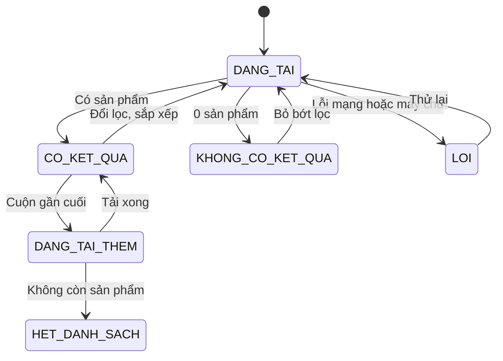

#### Hiển thị theo trạng thái

| **Trạng thái** | **Hiển thị** |
| --- | --- |
| `DANG_TAI` | Skeleton 8 thẻ (desktop) hoặc 4 thẻ (mobile) |
| `CO_KET_QUA` | Lưới thẻ, số sản phẩm, chip lọc |
| `DANG_TAI_THEM` | Spinner dưới lưới |
| `HET_DANH_SACH` | "Bạn đã xem hết {n} sản phẩm" |
| `KHONG_CO_KET_QUA` | MSG-02 hoặc MSG-04, gợi ý bỏ lọc hoặc từ khoá gần đúng |
| `LOI` | MSG-05 kèm nút Thử lại |

### 4.2 Bước 2 · Chi tiết sản phẩm & chọn size

#### Trạng thái nút "Thêm vào giỏ"

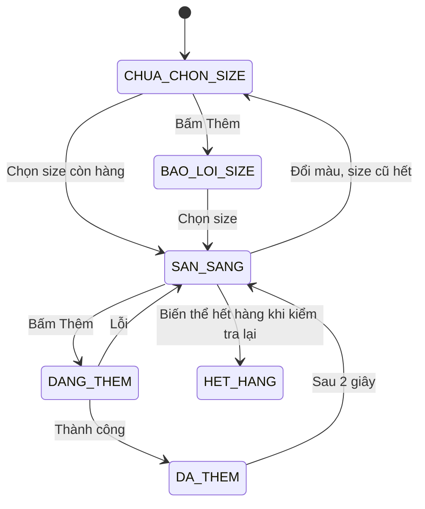

#### Hiển thị nút theo trạng thái

| **Trạng thái** | **Hiển thị** |
| --- | --- |
| `CHUA_CHON_SIZE` | "Thêm vào giỏ" bật; bấm thì chuyển `BAO_LOI_SIZE` |
| `BAO_LOI_SIZE` | Khu size viền đỏ, MSG-07, cuộn tới khu size |
| `SAN_SANG` | "Thêm vào giỏ", "Mua ngay" |
| `DANG_THEM` | Spinner, disabled |
| `DA_THEM` | "✓ Đã thêm" 2 giây; giỏ thu gọn mở |
| `HET_HANG` | "Hết hàng", nút "Báo tôi khi có hàng" thay "Mua ngay" |

### 4.3 Bước 3 · Giỏ hàng & thanh toán

#### Trạng thái đơn trong phạm vi tính năng

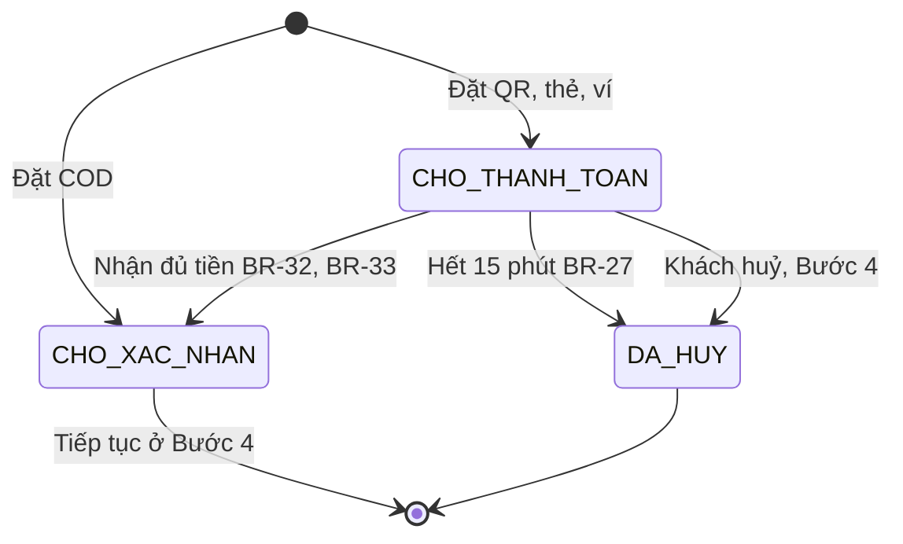

#### Trạng thái thanh toán của đơn online

| **Trạng thái** | **Điều kiện** | **Hiển thị trên SCR-10** |
| --- | --- | --- |
| `CHUA_THANH_TOAN` | Vừa tạo đơn | QR hoặc nút "Thanh toán lại"; đếm ngược thời gian giữ hàng |
| `DA_THANH_TOAN` | Nhận đủ tiền | Chuyển sang "Đặt hàng thành công" |
| `CAN_XU_LY` | Sai số tiền, sai nội dung | MSG-24, số hotline; không đếm ngược nữa |
| `HET_HAN` | Quá 15 phút | MSG-23, nút "Đặt lại giỏ này" |

### 4.4 Bước 4 · Đơn hàng, huỷ & đổi trả

#### Vòng đời đơn (phía khách thấy)

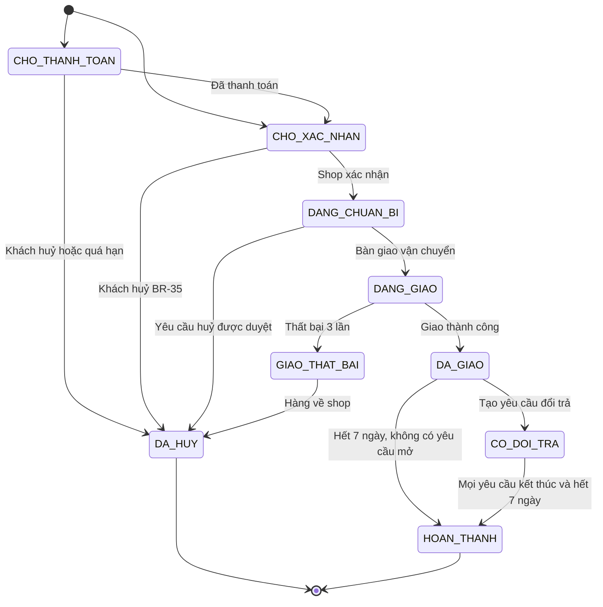

| **Trạng thái** | **Khách thấy** | **Nút** |
| --- | --- | --- |
| `CHO_THANH_TOAN` | Chờ thanh toán · giữ hàng tới {giờ} | Thanh toán lại, Huỷ đơn |
| `CHO_XAC_NHAN` | Đã đặt, chờ shop xác nhận | Huỷ đơn |
| `DANG_CHUAN_BI` | Shop đang đóng gói | Yêu cầu huỷ |
| `DANG_GIAO` | Đang giao · dự kiến {ngày} | Tra cứu vận đơn |
| `GIAO_THAT_BAI` | Giao chưa thành công, hàng đang hoàn về shop | Liên hệ |
| `DA_GIAO` | Đã giao {ngày} · đổi trả tới {ngày} | Đổi trả, Mua lại |
| `CO_DOI_TRA` | Đã giao · có yêu cầu đổi trả | Xem yêu cầu, Mua lại |
| `HOAN_THANH` | Hoàn thành | Mua lại |
| `DA_HUY` | Đã huỷ · lý do · tình trạng hoàn tiền | Mua lại |

#### Vòng đời yêu cầu đổi trả

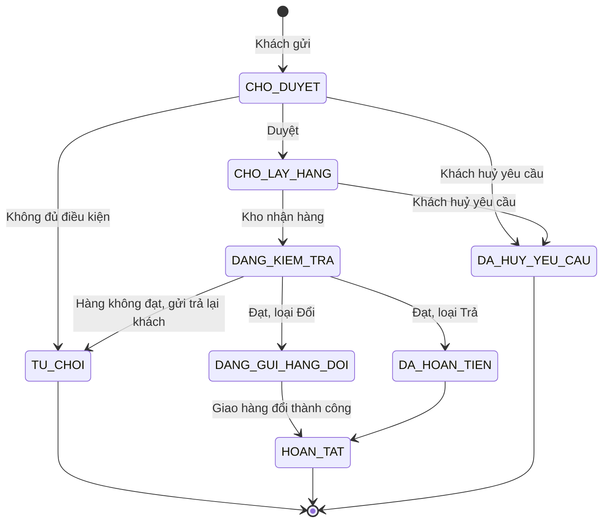

Duyệt yêu cầu trong ≤ 1 ngày làm việc; yêu cầu lỗi do shop có ảnh hợp lệ được duyệt tự động.

## 5. Use Case

### Bước 1 · Duyệt & tìm sản phẩm

#### UC-01 Duyệt danh mục, lọc và sắp xếp

| **Mục** | **Nội dung** |
| --- | --- |
| Tiền điều kiện | Không |
| Hậu điều kiện thành công | Khách thấy danh sách theo lọc và sắp xếp đã chọn; URL phản ánh đúng trạng thái |
| Hậu điều kiện thất bại | Danh sách giữ trạng thái trước đó kèm thông báo lỗi |

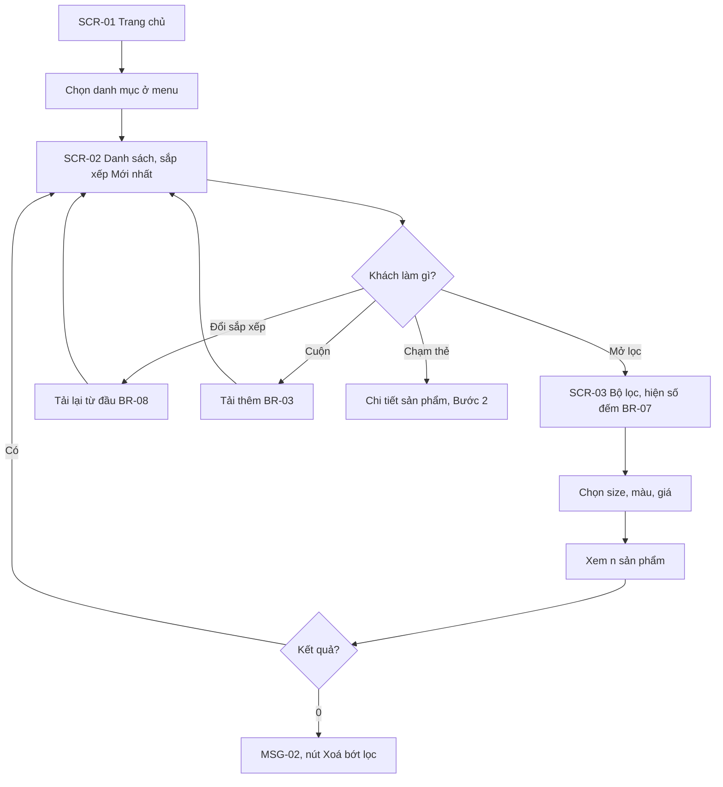

**Luồng chính**

| **Bước** | **Actor** | **Mô tả** |
| --- | --- | --- |
| 1 | Khách | Mở menu, chọn danh mục cấp 2 |
| 2 | Website | Gọi \[ProductList\], hiện **SCR-02** sắp xếp Mới nhất |
| 3 | Khách | Mở bộ lọc, chọn size và khoảng giá |
| 4 | Website | Gọi \[FilterFacets\] cập nhật số đếm; khách bấm "Xem {n} sản phẩm" |
| 5 | Website | Gọi \[ProductList\] với lọc; cập nhật URL, chip lọc, lưới |
| 6 | Khách | Chạm một thẻ sản phẩm → **SCR-05** (Bước 2) |

**Luồng thay thế**

| **Mã** | **Điều kiện** | **Xử lý** |
| --- | --- | --- |
| A1 | Desktop | Bộ lọc là cột trái của **SCR-02**, áp dụng ngay khi chọn, không có nút "Xem {n}" |
| A2 | Bỏ một chip lọc | Tải lại danh sách ngay |
| A3 | Vào từ link có lọc trên URL | Áp dụng lọc từ URL; giá trị không hợp lệ thì bỏ qua |
| A4 | Bật "Chỉ còn hàng" | Ẩn sản phẩm hết hàng (BR-04) |
| A5 | Quay lại từ **SCR-05** | Khôi phục danh sách và vị trí cuộn (BR-10) |

**Luồng lỗi**

| **Mã** | **Điều kiện** | **Xử lý** |
| --- | --- | --- |
| E1 | Lọc ra 0 sản phẩm | MSG-02, nút "Xoá bớt lọc" bỏ lọc chọn sau cùng |
| E2 | Lỗi tải danh sách | MSG-05; giữ danh sách cũ nếu đang tải thêm |
| E3 | Danh mục không còn tồn tại | MSG-06, chuyển về trang chủ |

#### UC-02 Tìm kiếm

| **Mục** | **Nội dung** |
| --- | --- |
| Tiền điều kiện | Không |
| Hậu điều kiện thành công | Hiện **SCR-02** dạng kết quả tìm kiếm; từ khoá lưu vào tìm gần đây |
| Hậu điều kiện thất bại | Ở lại ô tìm kiếm với gợi ý thay thế |

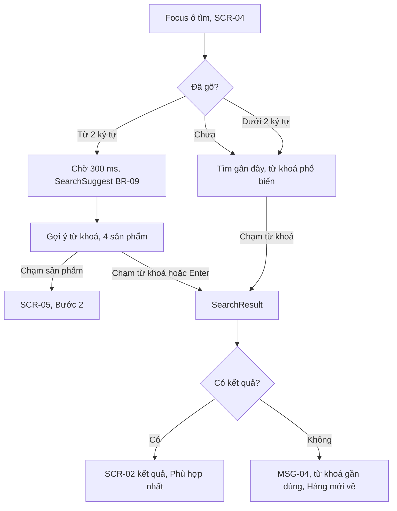

**Luồng chính**

| **Bước** | **Actor** | **Mô tả** |
| --- | --- | --- |
| 1 | Khách | Chạm ô tìm kiếm ở header |
| 2 | Website | Mở **SCR-04** với tìm gần đây và từ khoá phổ biến |
| 3 | Khách | Gõ "ao so mi" |
| 4 | Website | Gọi \[SearchSuggest\]; hiện gợi ý "áo sơ mi nữ", "áo sơ mi nam"… và 4 sản phẩm |
| 5 | Khách | Bấm Enter hoặc chạm một từ khoá |
| 6 | Website | Gọi \[ProductList\] với từ khoá; hiện **SCR-02** tiêu đề "Kết quả cho “{từ khoá}”" và số kết quả |

**Luồng thay thế**

| **Mã** | **Điều kiện** | **Xử lý** |
| --- | --- | --- |
| A1 | Từ khoá trùng tên danh mục | Đưa thẳng về trang danh mục đó, giữ từ khoá trên ô tìm |
| A2 | Xoá một tìm gần đây | Bấm × cạnh từ khoá |
| A3 | Từ khoá chỉ có khoảng trắng | Không tìm, giữ ô tìm |

**Luồng lỗi**

| **Mã** | **Điều kiện** | **Xử lý** |
| --- | --- | --- |
| E1 | 0 kết quả | MSG-04 |
| E2 | Dịch vụ gợi ý lỗi | Ẩn khối gợi ý, Enter vẫn tìm được |
| E3 | Từ khoá > 100 ký tự | MSG-03, cắt còn 100 ký tự |

### Bước 2 · Chi tiết sản phẩm & chọn size

#### UC-03 Chọn biến thể và thêm vào giỏ

| **Mục** | **Nội dung** |
| --- | --- |
| Tiền điều kiện | Sản phẩm đang bán |
| Hậu điều kiện thành công | SKU đã vào giỏ với số lượng đã chọn; icon giỏ cập nhật |
| Hậu điều kiện thất bại | Giỏ không đổi; khách thấy lỗi tại chỗ |

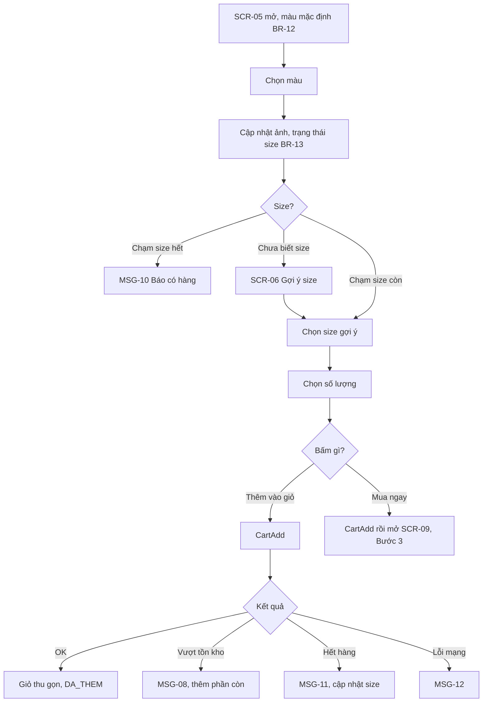

**Luồng chính**

| **Bước** | **Actor** | **Mô tả** |
| --- | --- | --- |
| 1 | Website | Gọi \[ProductDetail\]; hiện **SCR-05** với màu mặc định |
| 2 | Khách | Chọn màu; ảnh và trạng thái size đổi theo |
| 3 | Khách | Chọn size còn hàng, chọn số lượng |
| 4 | Khách | Bấm "Thêm vào giỏ" |
| 5 | Website | Gọi \[CartAdd\] với SKU, số lượng |
| 6 | Máy chủ | Kiểm tra tồn kho (BR-16), cập nhật giỏ |
| 7 | Website | Mở giỏ thu gọn: ảnh, tên, màu, size, số lượng, tạm tính, nút "Xem giỏ hàng" và "Thanh toán" |

**Luồng thay thế**

| **Mã** | **Điều kiện** | **Xử lý** |
| --- | --- | --- |
| A1 | Bấm Thêm khi chưa chọn size | `BAO_LOI_SIZE`, MSG-07 |
| A2 | Bấm Mua ngay | Như bước 5–6 rồi mở **SCR-09** (BR-17) |
| A3 | Đổi màu mà size đang chọn hết ở màu mới | Bỏ chọn size, `CHUA_CHON_SIZE` |
| A4 | Đã có số đo (BR-15) | Hiện "Size gợi ý cho bạn: {x}" cạnh khu size |

**Luồng lỗi**

| **Mã** | **Điều kiện** | **Xử lý** |
| --- | --- | --- |
| E1 | Vượt số lượng cho phép | MSG-08 |
| E2 | Biến thể vừa hết hàng | MSG-11, gạch size đó |
| E3 | Sản phẩm ngừng bán | Trang hiện "Sản phẩm đã ngừng bán" + sản phẩm tương tự; ẩn nút mua |
| E4 | Lỗi mạng | MSG-12, nút trở về `SAN_SANG` |

#### UC-04 Gợi ý size

| **Mục** | **Nội dung** |
| --- | --- |
| Tiền điều kiện | Mẫu có bảng size |
| Hậu điều kiện thành công | Size gợi ý được chọn trên **SCR-05**; số đo được lưu (BR-15) |
| Hậu điều kiện thất bại | Không chọn size; khách xem bảng size |

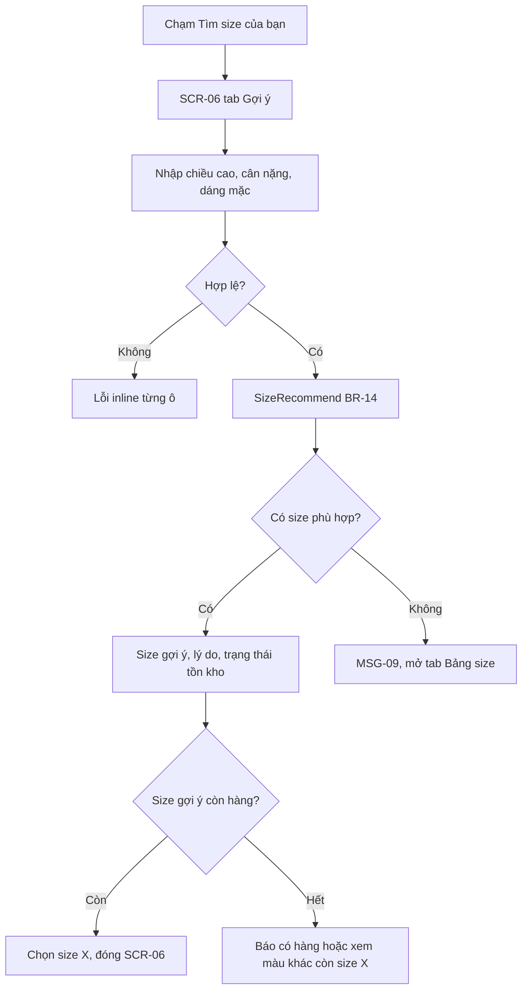

**Luồng chính**

| **Bước** | **Actor** | **Mô tả** |
| --- | --- | --- |
| 1 | Khách | Chạm "Tìm size của bạn" cạnh khu chọn size |
| 2 | Website | Mở **SCR-06** tab Gợi ý; điền sẵn số đo đã lưu |
| 3 | Khách | Nhập chiều cao, cân nặng, chọn dáng mặc; bấm "Xem size" |
| 4 | Website | Gọi \[SizeRecommend\]; hiện "Bạn nên chọn size {x}" và lý do ("Vòng ngực ước tính 88 cm, size M rộng 92 cm") |
| 5 | Khách | Bấm "Chọn size {x}" |
| 6 | Website | Đóng **SCR-06**, chọn size {x} trên **SCR-05** |

**Luồng thay thế**

| **Mã** | **Điều kiện** | **Xử lý** |
| --- | --- | --- |
| A1 | Size gợi ý hết hàng ở màu đang chọn | Liệt kê màu còn size đó; hoặc nút Báo có hàng |
| A2 | Khách mở tab Bảng size | Hiện bảng số đo của mẫu + hình hướng dẫn đo |

**Luồng lỗi**

| **Mã** | **Điều kiện** | **Xử lý** |
| --- | --- | --- |
| E1 | Số đo ngoài khoảng cho phép | Lỗi inline "Chiều cao từ 140 đến 200 cm" |
| E2 | Không có size phù hợp | MSG-09 |
| E3 | \[SizeRecommend\] lỗi | MSG-12; tab Bảng size vẫn dùng được |

#### UC-05 Yêu thích và báo có hàng

**Luồng chính**

| **Bước** | **Actor** | **Mô tả** |
| --- | --- | --- |
| 1 | Khách | Chạm trái tim trên thẻ hoặc **SCR-05** |
| 2 | Website | Đổi trái tim sang tô đậm ngay; gọi \[WishlistToggle\] (đăng nhập) hoặc lưu trình duyệt (BR-18) |
| 3 | Khách | Mở **SCR-07** từ header |
| 4 | Website | Hiện các món yêu thích, giá hiện tại, món hết hàng ghi rõ |

**Luồng thay thế**

| **Mã** | **Điều kiện** | **Xử lý** |
| --- | --- | --- |
| A1 | Đạt 100 món | MSG-13, không thêm |
| A2 | Chạm size hết hàng → "Báo tôi khi có hàng" | Popup nhập email (điền sẵn nếu đăng nhập) → \[RestockSubscribe\] → MSG-10 |
| A3 | "Thêm vào giỏ" ở **SCR-07** | Mở popup chọn màu, size rồi theo UC-03 |
| A4 | Đăng nhập khi đang có yêu thích trên trình duyệt | Gộp theo BR-18 |

### Bước 3 · Giỏ hàng & thanh toán

#### UC-06 Xem và sửa giỏ hàng

| **Mục** | **Nội dung** |
| --- | --- |
| Tiền điều kiện | Giỏ có ít nhất 1 món |
| Hậu điều kiện thành công | Giỏ phản ánh thay đổi; tổng đúng theo dòng được chọn |
| Hậu điều kiện thất bại | Giỏ giữ nguyên với thông báo lỗi |

**Luồng chính**

| **Bước** | **Actor** | **Mô tả** |
| --- | --- | --- |
| 1 | Khách | Mở **SCR-08** từ icon giỏ hoặc giỏ thu gọn |
| 2 | Website | Gọi \[CartGet\]; kiểm tra lại theo BR-23; hiện dòng, tạm tính, phí giao ước tính (BR-24), nhắc miễn phí giao |
| 3 | Khách | Tăng, giảm số lượng; đổi size; bỏ chọn một món |
| 4 | Website | Gọi \[CartUpdate\]; cập nhật tổng ngay |
| 5 | Khách | Bấm "Thanh toán ({n} món)" → **SCR-09** |

**Luồng thay thế**

| **Mã** | **Điều kiện** | **Xử lý** |
| --- | --- | --- |
| A1 | Xoá dòng | Dòng ẩn, snackbar MSG-14 có "Hoàn tác" 5 giây |
| A2 | Đổi size sang size hết hàng | Không cho chọn (gạch) |
| A3 | Đổi size trùng SKU đã có trong giỏ | Gộp 2 dòng, cộng số lượng theo BR-21 |
| A4 | Giỏ rỗng | Empty state + Hàng mới về |
| A5 | Không dòng nào được chọn | Nút Thanh toán disabled, gợi ý "Chọn ít nhất 1 món" |

**Luồng lỗi**

| **Mã** | **Điều kiện** | **Xử lý** |
| --- | --- | --- |
| E1 | Số lượng vượt tồn kho | Giảm về tồn kho, MSG-15 |
| E2 | Lỗi mạng | MSG-26, trả giá trị cũ |

#### UC-07 Thanh toán và đặt hàng

| **Mục** | **Nội dung** |
| --- | --- |
| Tiền điều kiện | Có ít nhất 1 dòng được chọn, còn hàng |
| Hậu điều kiện thành công | Đơn được tạo, tồn kho bị trừ, các dòng đã đặt rời khỏi giỏ; mở **SCR-10** |
| Hậu điều kiện thất bại | Không tạo đơn; ở lại **SCR-09** với lỗi cụ thể |

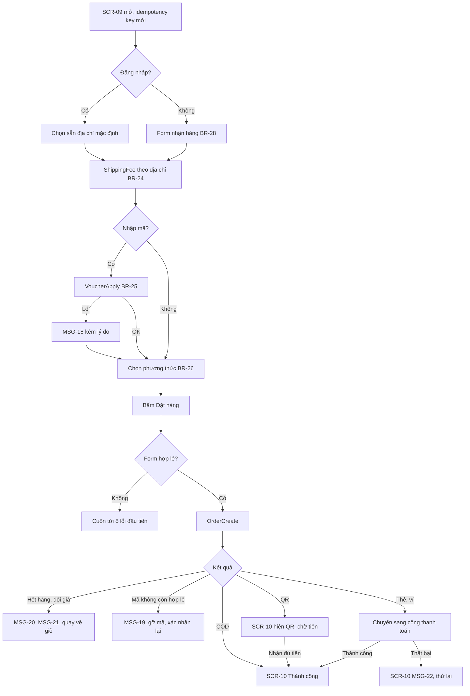

**Luồng chính**

| **Bước** | **Actor** | **Mô tả** |
| --- | --- | --- |
| 1 | Website | Mở **SCR-09** với các dòng được chọn; sinh idempotency key |
| 2 | Khách | Nhập họ tên, số điện thoại, chọn Tỉnh/Thành phố, Phường/Xã, nhập địa chỉ |
| 3 | Website | Kiểm tra từng ô khi rời ô; gọi \[ShippingFee\] khi có Tỉnh; cập nhật tóm tắt đơn |
| 4 | Khách | Nhập mã giảm giá (tuỳ chọn), bấm Áp dụng |
| 5 | Website | Gọi \[VoucherApply\]; hiện dòng giảm giá và tổng mới |
| 6 | Khách | Chọn COD; bấm "Đặt hàng · {tổng} ₫" |
| 7 | Website | Gọi \[OrderCreate\]; nút loading |
| 8 | Máy chủ | Kiểm tra lại giá, tồn kho, mã (BR-23, BR-25); trừ tồn kho; tạo đơn `CHO_XAC_NHAN`; gửi SMS, email |
| 9 | Website | Mở **SCR-10** "Đặt hàng thành công" với mã đơn, thời gian giao dự kiến |

**Luồng thay thế**

| **Mã** | **Điều kiện** | **Xử lý** |
| --- | --- | --- |
| A1 | Thành viên có sổ địa chỉ | Chọn từ danh sách; "Thêm địa chỉ mới" mở form (BR-29) |
| A2 | Đăng nhập ngay trên **SCR-09** | Popup đăng nhập bằng số điện thoại + OTP; xong thì điền sẵn địa chỉ, gộp giỏ (BR-21) |
| A3 | Chọn Chuyển khoản QR | Sau bước 8, đơn `CHO_THANH_TOAN`; **SCR-10** hiện QR, số tiền, nội dung, đếm ngược 15 phút; gọi \[PaymentStatus\] mỗi 5 giây |
| A4 | Chọn Thẻ / ví | Sau bước 8, chuyển sang cổng thanh toán (BR-33) |
| A5 | Tổng > 5.000.000 ₫ | Ẩn COD, ghi chú MSG-17 |
| A6 | Khách vãng lai đặt xong | **SCR-10** có khối "Tạo tài khoản để theo dõi đơn dễ hơn" (tuỳ chọn) |
| A7 | Thanh toán thất bại ở cổng | **SCR-10** trạng thái chờ, MSG-22, nút "Thanh toán lại" và "Đổi sang QR" (BR-34) |

**Luồng lỗi**

| **Mã** | **Điều kiện** | **Xử lý** |
| --- | --- | --- |
| E1 | Thiếu hoặc sai thông tin nhận hàng | Lỗi inline (MSG-16), cuộn tới ô lỗi đầu tiên |
| E2 | Món hết hàng lúc đặt | MSG-20 nêu tên món; không tạo đơn; về **SCR-08** |
| E3 | Giá đổi lúc đặt | MSG-21; cập nhật giá trên **SCR-09**, khách bấm đặt lại |
| E4 | Mã giảm giá hết lượt lúc đặt | MSG-19; gỡ mã, cập nhật tổng, khách bấm đặt lại |
| E5 | Lỗi mạng khi đặt | Gửi lại cùng idempotency key; vẫn lỗi → MSG-26 |
| E6 | Hết 15 phút chưa thanh toán | MSG-23 (BR-27) |
| E7 | Chuyển khoản sai số tiền hoặc nội dung | MSG-24 (BR-32) |

### Bước 4 · Đơn hàng, huỷ & đổi trả

#### UC-08 Xem và tra cứu đơn

| **Mục** | **Nội dung** |
| --- | --- |
| Tiền điều kiện | Thành viên đã đăng nhập, hoặc khách có mã đơn và số điện thoại |
| Hậu điều kiện thành công | Hiện **SCR-12** của đơn |
| Hậu điều kiện thất bại | Ở lại **SCR-14** với thông báo |

**Luồng chính**

| **Bước** | **Actor** | **Mô tả** |
| --- | --- | --- |
| 1 | Thành viên | Mở Tài khoản → **SCR-11** Đơn của tôi |
| 2 | Website | Gọi \[OrderList\]; hiện tab và danh sách đơn mới nhất trước |
| 3 | Thành viên | Chạm một đơn |
| 4 | Website | Gọi \[OrderDetail\]; hiện **SCR-12** với tiến trình, mốc thời gian, nút theo mục 4.1 |

**Luồng thay thế**

| **Mã** | **Điều kiện** | **Xử lý** |
| --- | --- | --- |
| A1 | Khách vãng lai | Footer → "Tra cứu đơn hàng" → **SCR-14**; nhập mã đơn, số điện thoại → \[OrderLookup\] → **SCR-12** (địa chỉ che bớt, BR-45) |
| A2 | Mở từ link trong SMS | Link có token ký số → mở thẳng **SCR-12**, không cần nhập lại |
| A3 | Bấm "Mua lại" | Thêm mọi món còn bán vào giỏ (cùng màu, size; hết hàng thì bỏ qua và báo) → **SCR-08** |

**Luồng lỗi**

| **Mã** | **Điều kiện** | **Xử lý** |
| --- | --- | --- |
| E1 | Mã đơn và số điện thoại không khớp | MSG-27 |
| E2 | Sai 5 lần trong 15 phút | MSG-28 |
| E3 | Lỗi mạng | MSG-36 |

#### UC-09 Huỷ đơn

| **Mục** | **Nội dung** |
| --- | --- |
| Tiền điều kiện | Đơn ở `CHO_THANH_TOAN`, `CHO_XAC_NHAN` hoặc `DANG_CHUAN_BI`; khách vãng lai đã qua OTP |
| Hậu điều kiện thành công | Đơn `DA_HUY` hoặc có cờ "Đang yêu cầu huỷ" |
| Hậu điều kiện thất bại | Đơn giữ nguyên trạng thái |

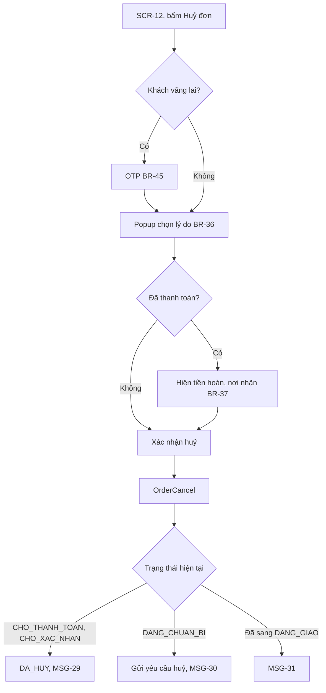

**Luồng chính**

| **Bước** | **Actor** | **Mô tả** |
| --- | --- | --- |
| 1 | Khách | Bấm "Huỷ đơn" ở **SCR-12** |
| 2 | Website | Popup lý do huỷ; nếu đã thanh toán hiện số tiền hoàn và nơi nhận |
| 3 | Khách | Chọn lý do, bấm "Xác nhận huỷ" |
| 4 | Website | Gọi \[OrderCancel\] |
| 5 | Máy chủ | Kiểm tra trạng thái hiện tại (BR-35); huỷ, trả tồn kho, trả lượt mã, tạo lệnh hoàn tiền nếu cần |
| 6 | Website | Cập nhật **SCR-12**: "Đã huỷ", tình trạng hoàn tiền; MSG-29 |

**Luồng thay thế**

| **Mã** | **Điều kiện** | **Xử lý** |
| --- | --- | --- |
| A1 | Đơn `DANG_CHUAN_BI` | Gửi yêu cầu huỷ, MSG-30; kết quả báo qua SMS |
| A2 | Yêu cầu huỷ bị từ chối | Cờ bỏ đi, đơn tiếp tục; SMS kèm lý do |

**Luồng lỗi**

| **Mã** | **Điều kiện** | **Xử lý** |
| --- | --- | --- |
| E1 | Trạng thái đã đổi sang `DANG_GIAO` khi bấm | MSG-31; tải lại **SCR-12** |
| E2 | Lỗi mạng | MSG-36 |

#### UC-10 Tạo yêu cầu đổi trả

| **Mục** | **Nội dung** |
| --- | --- |
| Tiền điều kiện | Đơn `DA_GIAO` hoặc `CO_DOI_TRA`, còn trong 7 ngày (BR-38), có ít nhất 1 món đủ điều kiện (BR-39) |
| Hậu điều kiện thành công | Yêu cầu `CHO_DUYET`; đơn `CO_DOI_TRA`; khách nhận mã yêu cầu |
| Hậu điều kiện thất bại | Không tạo yêu cầu |

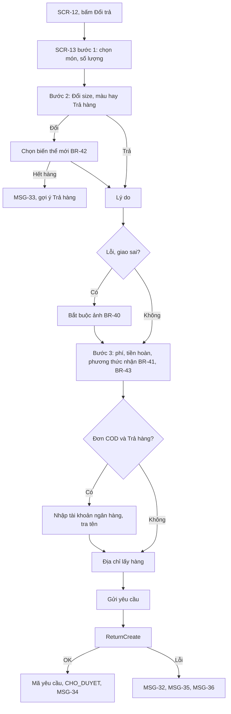

**Luồng chính**

| **Bước** | **Actor** | **Mô tả** |
| --- | --- | --- |
| 1 | Khách | Bấm "Đổi trả" ở **SCR-12** |
| 2 | Website | Mở **SCR-13**; liệt kê món, món không đủ điều kiện làm mờ kèm lý do |
| 3 | Khách | Chọn món, số lượng; chọn Trả hàng hoàn tiền; chọn lý do "Không vừa size" |
| 4 | Website | Gọi \[ReturnQuote\]; hiện phí 30.000 ₫, tiền hoàn dự kiến, nơi nhận tiền, thời gian |
| 5 | Khách | Kiểm tra địa chỉ lấy hàng; bấm "Gửi yêu cầu" |
| 6 | Website | Gọi \[ReturnCreate\] |
| 7 | Máy chủ | Tạo yêu cầu `CHO_DUYET`; đơn `CO_DOI_TRA`; gửi SMS |
| 8 | Website | Hiện mã yêu cầu, các bước tiếp theo, MSG-34 |

**Luồng thay thế**

| **Mã** | **Điều kiện** | **Xử lý** |
| --- | --- | --- |
| A1 | Chọn Đổi size/màu | Chọn biến thể mới; phí theo BR-41; không có tiền hoàn |
| A2 | Lý do lỗi hoặc giao sai | Tải 1–5 ảnh; phí 0 ₫; duyệt tự động (mục 4.2) |
| A3 | Đơn COD, Trả hàng | Nhập ngân hàng, số tài khoản → \[BankAccountVerify\] hiện tên chủ tài khoản để khách xác nhận |
| A4 | Khách huỷ yêu cầu khi còn `CHO_DUYET` hoặc `CHO_LAY_HANG` | Nút "Huỷ yêu cầu" ở **SCR-12**; nhả biến thể đang giữ |
| A5 | Khách vãng lai | OTP trước bước 2 (BR-45) |

**Luồng lỗi**

| **Mã** | **Điều kiện** | **Xử lý** |
| --- | --- | --- |
| E1 | Quá 7 ngày | Nút ẩn; nếu gửi đúng lúc hết hạn → MSG-32 |
| E2 | Size mới hết hàng | MSG-33 |
| E3 | Thiếu ảnh bắt buộc, ảnh sai định dạng hoặc quá 10 MB | Lỗi inline, MSG-35 |
| E4 | Không tra được tên chủ tài khoản | Lỗi inline "Không tìm thấy tài khoản, kiểm tra lại số tài khoản và ngân hàng" |
| E5 | Lỗi mạng | MSG-36; giữ dữ liệu đã nhập |

## 6. Điểm vào

| **Điểm vào** | **Dẫn tới** | **Ghi chú** |
| --- | --- | --- |
| Gõ địa chỉ web | **SCR-01** | |
| Link quảng cáo bộ sưu tập | **SCR-02** lọc theo bộ sưu tập | Tiêu đề là tên bộ sưu tập |
| "Xem tất cả" ở khối trang chủ | **SCR-02** lọc Hàng mới về hoặc Đang giảm giá | |
| Ô tìm kiếm ở header mọi trang | UC-02 | |
| Link chia sẻ trang danh sách | **SCR-02** đúng lọc trên URL | A3 |
| Chạm thẻ sản phẩm (Bước 1) | **SCR-05** | Mang theo size lọc nếu có |
| Gợi ý sản phẩm khi tìm kiếm | **SCR-05** | |
| Email báo có hàng | **SCR-05** chọn sẵn màu, size | |
| Chạm món trong giỏ (Bước 3) hoặc đơn hàng (Bước 4) | **SCR-05** | |
| Icon trái tim ở header | **SCR-07** | |
| Icon giỏ ở header | **SCR-08** | Số món trên icon = tổng số lượng |
| "Xem giỏ hàng" ở giỏ thu gọn (Bước 2) | **SCR-08** | |
| "Thanh toán" ở giỏ thu gọn | **SCR-09** | |
| "Mua ngay" ở **SCR-05** (Bước 2) | **SCR-09** | BR-17 |
| Link trong SMS đơn chờ thanh toán | **SCR-10** của đơn đó | Còn trong thời gian giữ hàng |
| "Mua lại" ở đơn cũ (Bước 4) | **SCR-08** với các món của đơn đó | |
| Tài khoản → Đơn của tôi | **SCR-11** | Thành viên |
| Footer "Tra cứu đơn hàng" | **SCR-14** | Khách vãng lai |
| "Xem đơn hàng" ở **SCR-10** (Bước 3) | **SCR-12** | |
| Link trong SMS, email | **SCR-12** hoặc yêu cầu đổi trả | A2 UC-08 |
| Tab Đổi trả ở **SCR-11** | Danh sách yêu cầu | |

## 7. Mô tả màn hình

<!-- Bước 1 · Duyệt & tìm sản phẩm -->
### SCR-01 Trang chủ

| **#** | **Thành phần** | **Loại** | **Hành vi** |
| --- | --- | --- | --- |
| 1 | Header | Header | Logo, menu danh mục, ô tìm kiếm, Yêu thích (Bước 2), Tài khoản, Giỏ hàng có số món (Bước 3) |
| 2 | Banner | Carousel | Tối đa 5; tự chuyển 5 giây; chạm mở bộ sưu tập |
| 3 | Danh mục nổi bật | Lưới ảnh | 6–8 ô ảnh + tên |
| 4 | Hàng mới về | Dải thẻ | Tối đa 8 thẻ, cuộn ngang trên mobile, "Xem tất cả" |
| 5 | Đang giảm giá | Dải thẻ | Như trên; ẩn nếu không có |
| 6 | Footer | Footer | Chính sách đổi trả, giao hàng, liên hệ, Tra cứu đơn hàng (Bước 4) |

### SCR-02 Danh sách sản phẩm

| **#** | **Thành phần** | **Loại** | **Hành vi** |
| --- | --- | --- | --- |
| 1 | Breadcrumb | Link | Trang chủ › Nữ › Sơ mi |
| 2 | Tiêu đề + số lượng | Text | "Sơ mi nữ · {n} sản phẩm" hoặc "Kết quả cho “{từ khoá}” · {n}" |
| 3 | Nút Lọc (mobile) | Button | Mở **SCR-03**; có số bộ lọc đang chọn |
| 4 | Cột lọc (desktop) | Panel | Như **SCR-03**, áp dụng ngay |
| 5 | Sắp xếp | Dropdown | BR-08 |
| 6 | Chip lọc | Chips | Mỗi lọc 1 chip có ×; "Xoá tất cả" |
| 7 | Lưới sản phẩm | Grid | 4 cột desktop, 2 cột mobile; thẻ theo BR-02 |
| 8 | Tải thêm | Spinner / Button | BR-03 |
| 9 | Trạng thái rỗng, lỗi | Empty state | Mục 4.2 |

### SCR-03 Bộ lọc (mobile)

| **#** | **Thành phần** | **Loại** | **Bắt buộc** | **Validate / hành vi** |
| --- | --- | --- | --- | --- |
| 1 | Size | Chips nhiều chọn | – | XS–XXL, size số (quần 26–34); số đếm BR-07 |
| 2 | Màu | Ô màu nhiều chọn | – | Tên màu khi chạm giữ hoặc hover |
| 3 | Khoảng giá | Slider 2 đầu + 2 ô số | – | BR-06; ô từ ≤ ô đến |
| 4 | Chất liệu | Checkbox | – | Cotton, Linen, Jean, Lụa… |
| 5 | Kiểu dáng | Checkbox | – | Theo danh mục |
| 6 | Chỉ còn hàng | Switch | – | BR-04 |
| 7 | "Đặt lại" | Link | – | Bỏ mọi lọc trong ngăn |
| 8 | "Xem {n} sản phẩm" | Button | – | Áp dụng lọc, đóng ngăn; n = 0 thì disabled kèm MSG-01 |

### SCR-04 Tìm kiếm

| **#** | **Thành phần** | **Loại** | **Hành vi** |
| --- | --- | --- | --- |
| 1 | Ô tìm kiếm | Search input | Placeholder "Tìm áo, quần, váy…"; nút × xoá chữ |
| 2 | Tìm gần đây | List | 5 từ khoá, × để xoá (BR-10) |
| 3 | Từ khoá phổ biến | Chips | Tối đa 8, do vận hành cấu hình |
| 4 | Gợi ý từ khoá | List | Tối đa 6; phần khớp in đậm |
| 5 | Gợi ý sản phẩm | List | Tối đa 4: ảnh nhỏ, tên, giá |

<!-- Bước 2 · Chi tiết sản phẩm & chọn size -->
### SCR-05 Chi tiết sản phẩm

| **#** | **Thành phần** | **Loại** | **Hành vi** |
| --- | --- | --- | --- |
| 1 | Bộ ảnh | Gallery | Theo màu đang chọn; desktop cột ảnh dọc, mobile vuốt ngang có chấm; chạm phóng to toàn màn |
| 2 | Tên, mã sản phẩm | Text | |
| 3 | Giá | Text | BR-11; giá gốc gạch ngang, nhãn "-{x}%" |
| 4 | Chọn màu | Ô màu | Tên màu đang chọn hiện cạnh tiêu đề "Màu: Trắng" |
| 5 | Chọn size | Chips | Trạng thái theo BR-13; "Chỉ còn {n}" dưới size sắp hết |
| 6 | Tìm size của bạn | Link nổi bật | Mở **SCR-06**; có số đo thì hiện size gợi ý (BR-15) |
| 7 | Số lượng | Stepper | 1–10 (BR-16) |
| 8 | "Thêm vào giỏ", "Mua ngay" | Button | Mục 4.2; mobile dính đáy màn hình |
| 9 | Trái tim | Icon toggle | UC-05 |
| 10 | Người mẫu | Text | "Người mẫu cao 165 cm, nặng 50 kg, mặc size S" |
| 11 | Mô tả, chất liệu, giặt ủi | Accordion | Mở sẵn mục Mô tả |
| 12 | Chính sách | Text phụ | "Miễn phí đổi size trong 7 ngày", "Miễn phí giao đơn từ 499.000 ₫" (Bước 3, Bước 4) |
| 13 | Sản phẩm tương tự | Dải thẻ | BR-20 |
| 14 | Giỏ thu gọn | Drawer phải / bottom sheet | Mở sau khi thêm; tự đóng sau 5 giây trên desktop |

### SCR-06 Bảng size & gợi ý size

| **#** | **Thành phần** | **Loại** | **Bắt buộc** | **Validate / hành vi** |
| --- | --- | --- | --- | --- |
| 1 | Tab Gợi ý / Bảng size | Tabs | – | Mặc định Gợi ý nếu mẫu có bảng size |
| 2 | Chiều cao (cm) | Number | Có | 140–200 |
| 3 | Cân nặng (kg) | Number | Có | 35–120 |
| 4 | Dáng mặc | Segmented | Có | Ôm, Vừa (mặc định), Rộng |
| 5 | "Xem size" | Button | – | Disabled khi thiếu ô bắt buộc |
| 6 | Kết quả | Card | – | Size gợi ý, lý do, trạng thái tồn kho; nút "Chọn size {x}" |
| 7 | Bảng size | Table | – | Hàng = size, cột = số đo cm; tô đậm hàng size gợi ý |
| 8 | Hướng dẫn đo | Hình + text | – | Vòng ngực, eo, mông |

### SCR-07 Yêu thích

| **#** | **Thành phần** | **Loại** | **Hành vi** |
| --- | --- | --- | --- |
| 1 | Tiêu đề + số món | Text | "Yêu thích ({n})" |
| 2 | Lưới thẻ | Grid | Thẻ theo Bước 1 BR-02; trái tim tô đậm, chạm để bỏ |
| 3 | "Thêm vào giỏ" trên thẻ | Button | A3 |
| 4 | Nhắc đăng nhập | Banner | Khách vãng lai: "Đăng nhập để giữ danh sách trên mọi thiết bị" |
| 5 | Trạng thái rỗng | Empty state | "Chưa có món yêu thích. Chạm ♡ để lưu món bạn thích" |

<!-- Bước 3 · Giỏ hàng & thanh toán -->
### SCR-08 Giỏ hàng

| **#** | **Thành phần** | **Loại** | **Hành vi** |
| --- | --- | --- | --- |
| 1 | Chọn tất cả | Checkbox | Chọn, bỏ chọn mọi dòng còn hàng |
| 2 | Dòng sản phẩm | List item | Ô chọn, ảnh, tên, "Màu · Size" (chạm để đổi size), đơn giá, stepper số lượng, thành tiền, nút xoá; nhãn "Giá đã thay đổi", "Hết hàng" (BR-23) |
| 3 | Nhắc miễn phí giao | Progress bar | "Mua thêm {x} ₫ để được miễn phí giao"; đủ thì "Bạn được miễn phí giao" |
| 4 | Tóm tắt | Card | Tạm tính, phí giao ước tính, tổng; desktop cột phải, mobile dính đáy |
| 5 | "Thanh toán ({n} món)" | Button | Disabled theo A5 |
| 6 | Trạng thái rỗng | Empty state | "Giỏ hàng đang trống" + Hàng mới về |

### SCR-09 Thanh toán

| **#** | **Thành phần** | **Loại** | **Bắt buộc** | **Validate / hành vi** |
| --- | --- | --- | --- | --- |
| 1 | Đăng nhập | Link | – | "Đã có tài khoản? Đăng nhập" (A2) |
| 2 | Họ tên | Text | Có | 2–50 ký tự |
| 3 | Số điện thoại | Tel | Có | 10 số, bắt đầu bằng 0 |
| 4 | Email | Email | Không | Đúng định dạng nếu nhập |
| 5 | Tỉnh/Thành phố | Select có tìm | Có | Danh mục hành chính 2 cấp |
| 6 | Phường/Xã | Select có tìm | Có | Lọc theo tỉnh đã chọn |
| 7 | Số nhà, tên đường | Text | Có | 5–200 ký tự |
| 8 | Sổ địa chỉ | Radio list | – | Thành viên; thay cho 2–7 |
| 9 | Phương thức giao | Read-only | – | "Giao tiêu chuẩn · {1–2 ngày} · {phí}" |
| 10 | Mã giảm giá | Text + Button | Không | Áp dụng → BR-25; có mã thì hiện chip mã + "Gỡ" |
| 11 | Phương thức thanh toán | Radio list | Có | COD, Chuyển khoản QR, Thẻ / ví (BR-26); COD ẩn theo A5 |
| 12 | Ghi chú cho shop | Textarea | Không | ≤ 200 ký tự |
| 13 | Tóm tắt đơn | Card | – | Ảnh nhỏ từng món, tạm tính, giảm giá, phí giao, tổng |
| 14 | "Đặt hàng · {tổng} ₫" | Button | – | Loading khi gửi; mobile dính đáy |
| 15 | Điều khoản | Text phụ | – | "Bằng việc đặt hàng, bạn đồng ý với Chính sách đổi trả" |

### SCR-10 Kết quả đặt hàng

| **#** | **Thành phần** | **Loại** | **Hành vi** |
| --- | --- | --- | --- |
| 1 | Biểu tượng + tiêu đề | Header | "Đặt hàng thành công" hoặc "Chờ thanh toán" theo mục 4.2 |
| 2 | Mã đơn | Text + Copy | `DH…` |
| 3 | QR chuyển khoản | Image | Chỉ đơn QR chưa thanh toán; kèm ngân hàng, số tài khoản, chủ tài khoản, số tiền, nội dung (mỗi dòng có nút sao chép); nút "Tải ảnh QR" |
| 4 | Đếm ngược | Timer | "Giữ hàng trong {mm:ss}" (BR-27) |
| 5 | Thanh toán lại / Đổi sang QR | Button | Đơn thẻ/ví thất bại (A7) |
| 6 | Thông tin giao | Card | Người nhận, địa chỉ, dự kiến giao |
| 7 | Tạo tài khoản | Card | Khách vãng lai (A6) |
| 8 | "Xem đơn hàng", "Tiếp tục mua sắm" | Button | Mở **SCR-12** (Bước 4) hoặc trang chủ |

<!-- Bước 4 · Đơn hàng, huỷ & đổi trả -->
### SCR-11 Đơn của tôi

| **#** | **Thành phần** | **Loại** | **Hành vi** |
| --- | --- | --- | --- |
| 1 | Tab trạng thái | Tabs | Tất cả, Đang xử lý (`CHO_THANH_TOAN`, `CHO_XAC_NHAN`, `DANG_CHUAN_BI`), Đang giao, Đã giao, Đã huỷ, Đổi trả |
| 2 | Thẻ đơn | Card | Mã đơn, ngày đặt, ảnh món đầu, "và {n} món khác", tổng, trạng thái bằng chữ (mục 4.1) |
| 3 | Nút nhanh | Button | Một nút chính theo trạng thái |
| 4 | Tải thêm | Pagination | 10 đơn mỗi lần |
| 5 | Trạng thái rỗng | Empty state | "Bạn chưa có đơn nào" + "Mua sắm ngay" |

### SCR-12 Chi tiết đơn

| **#** | **Thành phần** | **Loại** | **Hành vi** |
| --- | --- | --- | --- |
| 1 | Trạng thái | Header | Câu trạng thái mục 4.1, dự kiến giao hoặc hạn đổi trả |
| 2 | Tiến trình | Stepper | Đã đặt → Đã xác nhận → Đang giao → Đã giao; huỷ thì hiện bước huỷ màu đỏ |
| 3 | Mốc thời gian | Timeline | Trạng thái đơn và vận chuyển, "Cập nhật lúc {giờ}" (BR-46) |
| 4 | Vận chuyển | Card | Đơn vị, mã vận đơn (sao chép), link tra cứu |
| 5 | Danh sách món | List | Ảnh, tên, màu, size, số lượng, giá đã trả; chạm mở **SCR-05** |
| 6 | Thanh toán | Card | Tạm tính, giảm giá, phí giao, tổng, phương thức, tình trạng hoàn tiền |
| 7 | Nhận hàng | Card | Người nhận, số điện thoại, địa chỉ (che bớt với khách vãng lai) |
| 8 | Yêu cầu đổi trả | Card | Mã, loại, trạng thái mục 4.2, tiền hoàn, nút Huỷ yêu cầu |
| 9 | Nút hành động | Button | Theo mục 4.1 |

### SCR-13 Yêu cầu đổi trả

| **#** | **Thành phần** | **Loại** | **Bắt buộc** | **Validate / hành vi** |
| --- | --- | --- | --- | --- |
| 1 | Bước | Stepper | – | 1 Chọn món · 2 Hình thức & lý do · 3 Xác nhận |
| 2 | Chọn món | Checkbox list + stepper | Có | Món không đủ điều kiện làm mờ kèm lý do (BR-39) |
| 3 | Hình thức | Radio | Có | Đổi size/màu, Trả hàng hoàn tiền; món giảm ≥ 50% chỉ có Đổi |
| 4 | Biến thể mới | Chips màu, size | Có khi Đổi | Hết hàng gạch chéo (BR-42) |
| 5 | Lý do | Radio | Có | BR-40 |
| 6 | Mô tả | Textarea | Không | ≤ 500 ký tự |
| 7 | Ảnh | Upload | Có khi lỗi, giao sai | 1–5 ảnh, ≤ 10 MB |
| 8 | Tóm tắt phí | Card | – | Phí, tiền hoàn dự kiến, nơi nhận tiền, thời gian (BR-41, BR-43) |
| 9 | Tài khoản nhận hoàn | Select ngân hàng + Text | Có khi COD và Trả | Tra tên chủ tài khoản (A3) |
| 10 | Địa chỉ lấy hàng | Card | Có | Mặc định địa chỉ giao; đổi được |
| 11 | Chính sách | Text | – | Tóm tắt điều kiện hàng (còn tem mác, chưa giặt) |
| 12 | "Gửi yêu cầu" | Button | – | Disabled khi thiếu ô bắt buộc |

### SCR-14 Tra cứu đơn

| **#** | **Thành phần** | **Loại** | **Bắt buộc** | **Validate / hành vi** |
| --- | --- | --- | --- | --- |
| 1 | Mã đơn | Text | Có | `DH` + 8 số; không phân biệt hoa thường |
| 2 | Số điện thoại | Tel | Có | 10 số |
| 3 | "Tra cứu" | Button | – | Loading khi gọi; khoá theo BR-45 |
| 4 | Gợi ý | Text | – | "Mã đơn có trong SMS xác nhận" |

## 8. API

### 8.1 Bước 1 · Duyệt & tìm sản phẩm

| **API** | **Request chính** | **Response chính** | **Timeout / retry** |
| --- | --- | --- | --- |
| \[HomeContent\] | – | Banner, danh mục nổi bật, 2 khối sản phẩm | 5s / 1 lần |
| \[CategoryTree\] | – | Cây danh mục BR-01 | 5s / 1 lần; cache 10 phút |
| \[ProductList\] | category hoặc keyword, filters, sort, cursor, page_size | Danh sách thẻ, total, next_cursor | 5s / 1 lần |
| \[FilterFacets\] | category hoặc keyword, filters | Từng giá trị lọc kèm số đếm, khoảng giá | 3s / không retry |
| \[SearchSuggest\] | keyword | Từ khoá gợi ý, 4 sản phẩm | 2s / không retry |

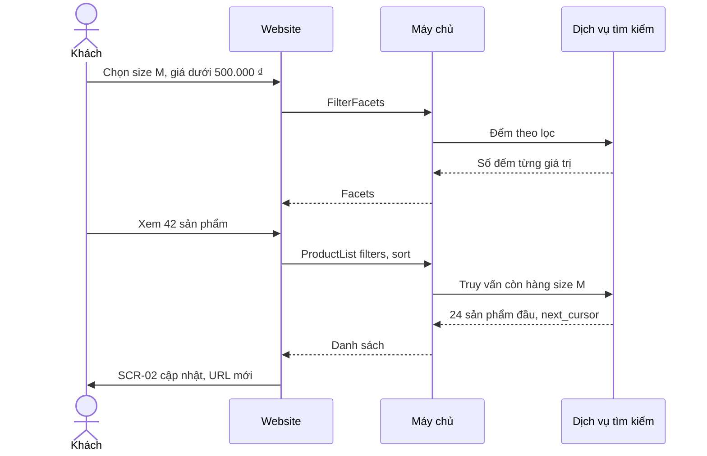

**Map lỗi → thông báo**

| **Nhóm lỗi** | **Message** |
| --- | --- |
| Lọc cho 0 kết quả (mobile, trước khi áp dụng) | MSG-01 |
| Lọc cho 0 kết quả (trên danh sách) | MSG-02 |
| Từ khoá quá dài | MSG-03 |
| Tìm kiếm 0 kết quả | MSG-04 |
| Mất mạng, quá thời gian, lỗi máy chủ | MSG-05 |
| Danh mục không tồn tại | MSG-06 |

### 8.2 Bước 2 · Chi tiết sản phẩm & chọn size

| **API** | **Request chính** | **Response chính** | **Timeout / retry** |
| --- | --- | --- | --- |
| \[ProductDetail\] | product_id | Thông tin, ảnh theo màu, biến thể (SKU, giá, tồn kho), bảng size, người mẫu | 5s / 1 lần |
| \[VariantStock\] | product_id, color | Tồn kho từng size | 3s / 1 lần |
| \[SizeRecommend\] | product_id, height, weight, fit | size, lý do, null nếu không phù hợp | 3s / 1 lần |
| \[CartAdd\] | sku, quantity, cart_id | Giỏ sau khi thêm, quantity_added | 5s / 1 lần |
| \[WishlistToggle\] | product_id | in_wishlist, total | 3s / 1 lần |
| \[RestockSubscribe\] | sku, email | subscribed | 5s / 1 lần |
| \[SimilarProducts\] | product_id, size | Tối đa 8 thẻ | 3s / không retry |

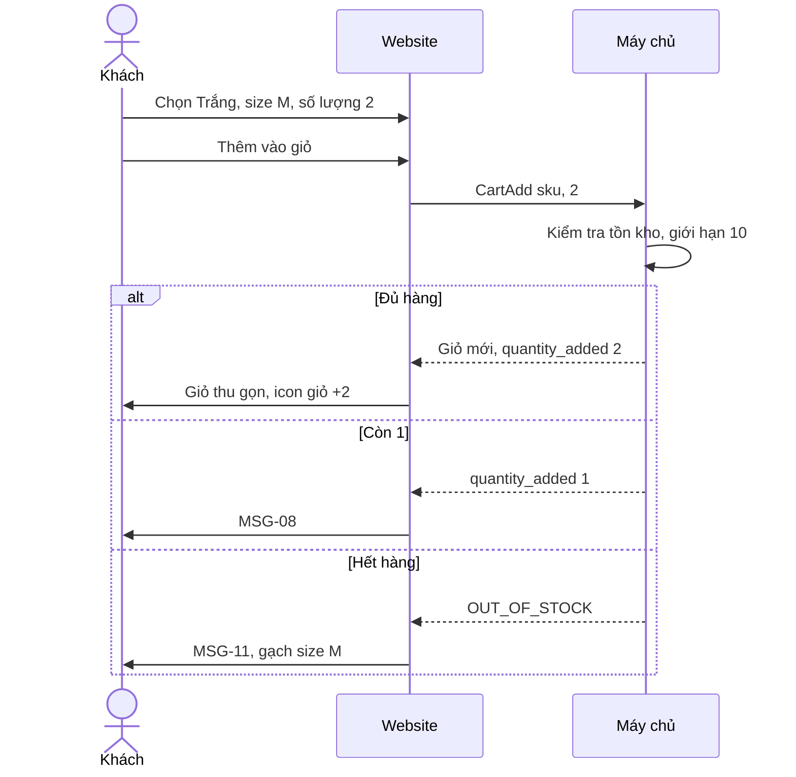

**Map lỗi → thông báo**

| **Nhóm lỗi** | **Message** |
| --- | --- |
| Chưa chọn size | MSG-07 |
| Vượt số lượng cho phép | MSG-08 |
| Không có size phù hợp | MSG-09 |
| Đăng ký báo có hàng thành công | MSG-10 |
| Biến thể hết hàng | MSG-11 |
| Mất mạng, quá thời gian, lỗi máy chủ | MSG-12 |
| Yêu thích đầy | MSG-13 |

### 8.3 Bước 3 · Giỏ hàng & thanh toán

| **API** | **Request chính** | **Response chính** | **Timeout / retry** |
| --- | --- | --- | --- |
| \[CartGet\] | cart_id | Dòng, giá hiện tại, tồn kho, cờ đổi giá, hết hàng | 5s / 1 lần |
| \[CartUpdate\] | cart_id, line_id, sku, quantity, selected | Giỏ mới | 5s / 1 lần |
| \[AdminUnits\] | province_id (tuỳ chọn) | Danh sách tỉnh hoặc phường/xã | 3s / 1 lần; cache 1 ngày |
| \[ShippingFee\] | province_id, subtotal | fee, eta_days | 3s / 1 lần |
| \[VoucherApply\] | code, lines, phone, shipping_fee | discount, free_shipping hoặc mã lỗi | 3s / không retry |
| \[OrderCreate\] | lines, receiver, address, voucher, payment_method, note, idempotency_key | order_id, status, total, payment (QR hoặc redirect_url), hold_expires_at | 10s / gửi lại cùng key |
| \[PaymentStatus\] | order_id | payment_status mục 4.2 | 3s / gọi mỗi 5 giây khi mở **SCR-10** |
| \[PaymentRetry\] | order_id, method | redirect_url hoặc QR mới | 5s / 1 lần |
| \[BankWebhook\] | Ngân hàng → máy chủ: số tiền, nội dung, mã giao dịch | – | Khớp theo BR-32 |

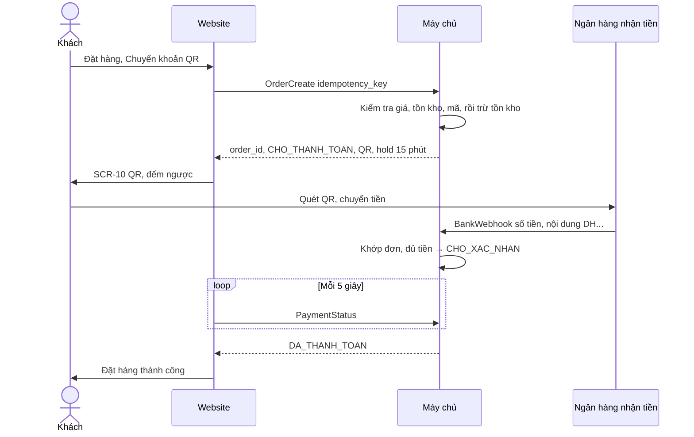

**Map lỗi → thông báo**

| **Nhóm lỗi** | **Message** |
| --- | --- |
| Xoá dòng | MSG-14 |
| Số lượng vượt tồn kho | MSG-15 |
| Thông tin nhận hàng không hợp lệ | MSG-16 |
| COD không khả dụng | MSG-17 |
| Mã giảm giá không dùng được | MSG-18 |
| Mã bị gỡ do giỏ đổi hoặc hết lượt | MSG-19 |
| Hết hàng lúc đặt | MSG-20 |
| Giá đổi lúc đặt | MSG-21 |
| Thanh toán thẻ, ví thất bại | MSG-22 |
| Quá hạn thanh toán | MSG-23 |
| Chuyển khoản cần xử lý | MSG-24 |
| Thanh toán thành công | MSG-25 |
| Mất mạng, quá thời gian, lỗi máy chủ | MSG-26 |

### 8.4 Bước 4 · Đơn hàng, huỷ & đổi trả

| **API** | **Request chính** | **Response chính** | **Timeout / retry** |
| --- | --- | --- | --- |
| \[OrderList\] | status_tab, cursor | Danh sách thẻ đơn | 5s / 1 lần |
| \[OrderDetail\] | order_id hoặc token | Đơn, món, thanh toán, vận chuyển, yêu cầu đổi trả, hành động được phép | 5s / 1 lần |
| \[OrderLookup\] | order_code, phone | token xem đơn hoặc lỗi; số lần còn lại | 5s / không retry |
| \[OtpSend\], \[OtpVerify\] | phone, purpose; otp | Phiên được phép thao tác 15 phút | 5s / không retry |
| \[OrderCancel\] | order_id, reason, note | Trạng thái mới, refund (số tiền, nơi nhận) | 5s / 1 lần, idempotent theo order_id |
| \[ReturnQuote\] | order_id, items, type, reason, new_sku | fee, refund_amount, refund_method, eligible | 3s / 1 lần |
| \[BankAccountVerify\] | bank_code, account_no | account_name | 5s / 1 lần |
| \[ReturnCreate\] | order_id, items, type, reason, note, photos, new_sku, refund_account, pickup_address, idempotency_key | return_id, status | 10s / gửi lại cùng key |
| \[ReturnCancel\] | return_id | status | 5s / 1 lần |
| \[CarrierWebhook\] | Đơn vị vận chuyển → máy chủ: mã vận đơn, trạng thái, thời điểm | – | BR-46 |

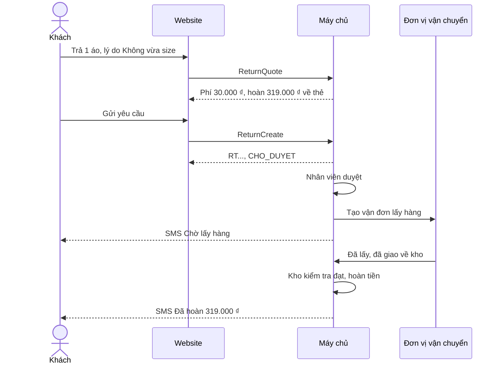

**Map lỗi → thông báo**

| **Nhóm lỗi** | **Message** |
| --- | --- |
| Tra cứu không khớp | MSG-27 |
| Tra cứu bị khoá | MSG-28 |
| Huỷ thành công | MSG-29 |
| Đã gửi yêu cầu huỷ | MSG-30 |
| Đơn đã giao vận chuyển, không huỷ được | MSG-31 |
| Hết hạn đổi trả | MSG-32 |
| Biến thể đổi hết hàng | MSG-33 |
| Gửi yêu cầu đổi trả thành công | MSG-34 |
| Ảnh không hợp lệ | MSG-35 |
| Mất mạng, quá thời gian, lỗi máy chủ | MSG-36 |

## 9. Danh sách thông báo

| **ID** | **Nơi hiện** | **Nội dung (VI)** |
| --- | --- | --- |
| MSG-01 | Inline **SCR-03** | Không có sản phẩm phù hợp. Thử bỏ bớt một vài lựa chọn nhé |
| MSG-02 | Empty state **SCR-02** | Chưa có mẫu nào khớp bộ lọc của bạn. \[Xoá bớt lọc\] |
| MSG-03 | Inline | Từ khoá tối đa 100 ký tự |
| MSG-04 | Empty state **SCR-02** | Không tìm thấy “{từ khoá}”. Bạn có muốn tìm “{gợi ý}”? |
| MSG-05 | Toast | Kết nối không ổn định, vui lòng thử lại. \[Thử lại\] |
| MSG-06 | Toast | Danh mục này không còn tồn tại |
| MSG-07 | Inline khu size | Vui lòng chọn size |
| MSG-08 | Toast | Chỉ thêm được {n} sản phẩm. Mỗi mẫu tối đa {max} cái trong giỏ |
| MSG-09 | Inline **SCR-06** | Mẫu này có thể không vừa bạn. Xem bảng size để kiểm tra kỹ hơn |
| MSG-10 | Toast | Chúng tôi sẽ gửi email cho bạn khi size {size} có hàng lại |
| MSG-11 | Toast | Rất tiếc, size {size} vừa hết hàng |
| MSG-12 | Toast | Kết nối không ổn định, vui lòng thử lại |
| MSG-13 | Toast | Danh sách yêu thích đã đủ 100 món. Bỏ bớt để thêm món mới |
| MSG-14 | Snackbar | Đã xoá {tên sản phẩm} khỏi giỏ. \[Hoàn tác\] |
| MSG-15 | Inline dòng | Chỉ còn {n} sản phẩm, số lượng đã được điều chỉnh |
| MSG-16 | Inline | Lỗi theo từng ô, ví dụ: Số điện thoại cần 10 chữ số, bắt đầu bằng 0 |
| MSG-17 | Inline phương thức | Thanh toán khi nhận hàng áp dụng cho đơn đến 5.000.000 ₫ |
| MSG-18 | Inline mã | Theo lý do: Mã đã hết hạn · Đơn cần tối thiểu {x} ₫ để dùng mã này · Mã đã hết lượt sử dụng · Mã không áp dụng cho sản phẩm đang giảm giá · Mã không tồn tại |
| MSG-19 | Toast | Mã {mã} không còn áp dụng cho đơn này và đã được gỡ |
| MSG-20 | Popup | {tên sản phẩm} size {size} vừa hết hàng. Vui lòng kiểm tra lại giỏ. \[Về giỏ hàng\] |
| MSG-21 | Popup | Giá một số sản phẩm vừa thay đổi. Tổng mới: {tổng} ₫. \[Đặt với giá mới\] \[Xem lại\] |
| MSG-22 | Banner **SCR-10** | Thanh toán chưa thành công. Đơn được giữ tới {giờ}. \[Thanh toán lại\] \[Đổi sang QR\] |
| MSG-23 | Banner **SCR-10** | Đơn {mã đơn} đã huỷ do quá thời gian thanh toán. \[Đặt lại giỏ này\] |
| MSG-24 | Banner **SCR-10** | Chúng tôi đã nhận được chuyển khoản nhưng số tiền hoặc nội dung chưa khớp. Nhân viên sẽ liên hệ bạn trong 2 giờ làm việc. Hotline {số} |
| MSG-25 | Toast | Đã nhận thanh toán cho đơn {mã đơn} |
| MSG-26 | Toast | Kết nối không ổn định, vui lòng thử lại |
| MSG-27 | Inline **SCR-14** | Không tìm thấy đơn với mã và số điện thoại này. Bạn còn {n} lần thử |
| MSG-28 | Inline **SCR-14** | Bạn đã thử quá nhiều lần. Vui lòng thử lại sau {m} phút |
| MSG-29 | Toast | Đã huỷ đơn {mã đơn}. {Nếu đã thanh toán: Tiền hoàn {số tiền} ₫ sẽ về {nơi nhận} trong {thời gian}} |
| MSG-30 | Toast | Đã gửi yêu cầu huỷ. Shop sẽ phản hồi trong 2 giờ làm việc |
| MSG-31 | Popup | Đơn đã được giao cho đơn vị vận chuyển nên không huỷ được nữa. Bạn có thể từ chối nhận hàng khi shipper giao tới |
| MSG-32 | Popup | Đơn đã quá 7 ngày kể từ khi nhận hàng nên không thể đổi trả |
| MSG-33 | Inline | Size {size} màu {màu} đã hết hàng. Bạn có thể chọn trả hàng hoàn tiền |
| MSG-34 | Toast | Đã gửi yêu cầu {mã yêu cầu}. Chúng tôi sẽ duyệt trong 1 ngày làm việc |
| MSG-35 | Inline | Ảnh cần định dạng JPG, PNG hoặc HEIC, tối đa 10 MB, từ 1 đến 5 ảnh |
| MSG-36 | Toast | Kết nối không ổn định, vui lòng thử lại |

## 10. Yêu cầu phi chức năng

| **Mục** | **Yêu cầu** |
| --- | --- |
| Hiệu năng | LCP trang chủ, danh sách ≤ 2,5 giây trên 4G (p75); \[ProductList\] ≤ 500 ms (p95); gợi ý tìm kiếm ≤ 300 ms; Ảnh chính hiện ≤ 2 giây trên 4G; đổi màu cập nhật ảnh và size ≤ 300 ms; \[CartAdd\] ≤ 1 giây (p95); \[OrderCreate\] ≤ 2 giây (p95); xác nhận QR hiện trên **SCR-10** ≤ 10 giây sau khi ngân hàng báo có; \[OrderDetail\] ≤ 1 giây (p95); trạng thái vận chuyển hiện trên web ≤ 5 phút sau khi đơn vị vận chuyển cập nhật |
| Ảnh | Nhiều kích thước theo màn hình, định dạng nén hiện đại, tải lười ngoài màn đầu |
| SEO | Trang danh mục có tiêu đề, mô tả, URL thân thiện; trang lọc gắn canonical về danh mục gốc; URL sản phẩm thân thiện; dữ liệu có cấu trúc giá, tồn kho; mỗi màu có URL tham số riêng, canonical về URL gốc |
| Log / audit | Từ khoá tìm kiếm và số kết quả (để bổ sung từ đồng nghĩa); Mỗi lần gợi ý size: đầu vào, size gợi ý, size khách chọn cuối (để đối chiếu đổi trả); Mỗi đơn: giá từng dòng tại thời điểm đặt, mã giảm giá, phí giao, idempotency key, mọi sự kiện thanh toán; Mọi thay đổi trạng thái đơn và yêu cầu: ai, khi nào, lý do; mọi lệnh hoàn tiền: số tiền, nơi nhận, kết quả |
| Tracking | Xem trang chủ, chạm banner, chọn danh mục, áp lọc (nhóm, giá trị), sắp xếp, tìm kiếm, chạm gợi ý, chạm thẻ (vị trí); Xem trang, đổi màu, chọn size, mở gợi ý size, chọn size gợi ý, thêm giỏ (nguồn), lỗi chưa chọn size, mua ngay, yêu thích, đăng ký báo có hàng; Mở giỏ, sửa giỏ, mở thanh toán, đăng nhập tại thanh toán, áp mã (kết quả, lý do), chọn phương thức, đặt hàng (kết quả), thanh toán (kết quả), hết hạn; Xem đơn, tra cứu (kết quả), huỷ (lý do, kết quả), bắt đầu và gửi đổi trả (loại, lý do), bỏ dở ở bước nào, mua lại |
| Accessibility | Thẻ sản phẩm là một link có nhãn đầy đủ (tên, giá, giảm giá); bộ lọc dùng được bằng bàn phím; ô màu có tên màu dạng chữ; tương phản ≥ 4,5:1; Ảnh có alt mô tả màu, góc chụp; chips size đọc được trạng thái ("Size M, chỉ còn 2"); size hết hàng không chỉ phân biệt bằng gạch chéo mà có nhãn chữ; Form có nhãn rõ, lỗi liên kết với ô và đọc được bằng trình đọc màn hình; QR có thông tin chuyển khoản dạng chữ để sao chép; đếm ngược không là cách duy nhất báo hết hạn; Tiến trình đơn đọc được bằng chữ ("Bước 3 trên 4: Đang giao"); upload ảnh dùng được bằng bàn phím; trạng thái không chỉ phân biệt bằng màu |
| Bảo mật, riêng tư | Số đo cơ thể chỉ người dùng thấy; không dùng cho quảng cáo; xoá được trong hồ sơ; Tra cứu có giới hạn số lần (BR-45); link trong SMS dùng token ký số hết hạn sau 30 ngày; số tài khoản hoàn tiền che bớt khi hiển thị lại |
| Bảo mật | Website không nhận, không lưu số thẻ (cổng thanh toán xử lý); mọi trang thanh toán qua HTTPS; kết quả thanh toán chỉ tin thông báo máy chủ–máy chủ có chữ ký |
| Tính đúng | Không bao giờ bán vượt tồn kho: trừ tồn kho trong giao dịch tạo đơn; giữ hàng hết hạn phải trả tồn kho trong ≤ 1 phút |
| Riêng tư | Số điện thoại, địa chỉ chỉ dùng cho giao hàng và chăm sóc đơn; khách vãng lai không bị tự tạo tài khoản |
| Lưu trữ | Ảnh đổi trả lưu 1 năm; lịch sử đơn lưu theo quy định kế toán |
