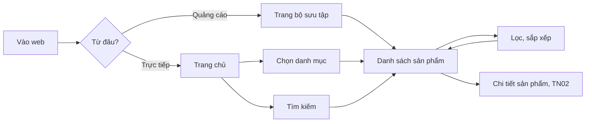

> **Mã:** DE03-TN01-PRD · **Trạng thái:** đã chốt · **Người viết:** Design · **SRS:** [SRS.md](SRS.md)

# PRD Duyệt và tìm sản phẩm (Website mua quần áo)

## 1. Bối cảnh và vấn đề

### 1.1 Bối cảnh

Duyệt và tìm sản phẩm là bước đầu tiên của hành trình mua hàng (xem [README](../../README.md)). Phần lớn khách vào web từ quảng cáo mạng xã hội trên điện thoại, xem vài trang rồi rời đi nếu không thấy món hợp mắt, hợp size và hợp túi tiền. Shop có khoảng 1.500 mẫu, mỗi mẫu nhiều màu và size.

### 1.2 Vấn đề

| **Vấn đề** | **Hệ quả** |
| --- | --- |
| Danh mục chia theo cách shop nghĩ, không theo cách khách tìm | Khách không biết bấm vào đâu |
| Lọc xong vẫn thấy mẫu đã hết size của mình | Khách bấm vào rồi thất vọng, rời trang |
| Tìm "ao so mi trang" (không dấu) không ra kết quả | Khách nghĩ shop không bán |
| Trên điện thoại, bộ lọc che hết sản phẩm, khó đóng | Khách bỏ lọc, cuộn mãi không thấy |
| Không biết món nào đang giảm giá, món nào mới về | Bỏ lỡ món muốn mua |

### 1.3 Mục tiêu

- ≥ 60% phiên có xem ít nhất 1 trang chi tiết sản phẩm.
- ≥ 85% lượt tìm kiếm có ít nhất 1 kết quả.
- Trang danh sách hiện sản phẩm đầu tiên ≤ 2 giây trên 4G.

## 2. Người dùng

| **Nhóm** | **Nhu cầu với tính năng này** |
| --- | --- |
| Khách vào từ quảng cáo | Thấy ngay bộ sưu tập đang quảng cáo, không bị lạc |
| Khách biết mình muốn gì | Tìm nhanh bằng từ khoá, lọc đúng size, màu, khoảng giá |
| Khách lướt xem cho vui | Xem hàng mới, hàng giảm giá, cuộn liên tục |
| Khách size lớn hoặc nhỏ | Chỉ thấy mẫu còn size của mình |

## 3. Phạm vi

### 3.1 Trong phạm vi (MVP)

- Trang chủ: banner bộ sưu tập, danh mục nổi bật, Hàng mới về, Đang giảm giá.
- Danh mục 2 cấp: Nữ, Nam, Phụ kiện → loại sản phẩm (Áo thun, Sơ mi, Quần jean…).
- Trang danh sách sản phẩm: lưới thẻ sản phẩm, tải thêm khi cuộn.
- Bộ lọc: size, màu, khoảng giá, chất liệu, kiểu dáng; chỉ còn hàng.
- Sắp xếp: Phù hợp nhất, Mới nhất, Bán chạy, Giá tăng dần, Giá giảm dần.
- Tìm kiếm: gợi ý khi gõ, chấp nhận không dấu, từ khoá phổ biến, tìm gần đây.

### 3.2 Ngoài phạm vi

- Tìm bằng hình ảnh → phase sau.
- Gợi ý cá nhân hoá theo lịch sử xem.
- Trang thương hiệu, trang người mẫu, lookbook.
- So sánh sản phẩm.

## 4. Nguyên tắc sản phẩm

### 4.1 Đừng cho khách thấy thứ họ không mua được

Lọc theo size chỉ trả về mẫu **còn hàng size đó**. Mẫu hết sạch hàng xuống cuối danh sách và ghi rõ "Hết hàng".

### 4.2 Tìm theo cách khách gõ

Không dấu, sai chính tả nhẹ, từ đồng nghĩa phổ biến ("quần bò" = "quần jean") đều ra kết quả.

### 4.3 Lọc mà không mất chỗ

Bộ lọc đang chọn hiện thành chip trên đầu danh sách, bỏ từng cái bằng một chạm. Quay lại trang danh sách giữ nguyên lọc và vị trí cuộn.

### 4.4 Giá rõ ngay trên thẻ

Thẻ sản phẩm luôn hiện giá đang bán; có giảm giá thì hiện giá gốc gạch ngang và % giảm.

## 5. Quy tắc nghiệp vụ

| **Quy tắc** | **Giá trị** |
| --- | --- |
| Danh mục | 2 cấp; một sản phẩm thuộc 1 danh mục chính, có thể gắn thêm bộ sưu tập |
| Hàng mới về | Sản phẩm mở bán trong 30 ngày gần nhất |
| Mỗi lần tải | 24 sản phẩm (desktop), 12 sản phẩm (mobile) |
| Còn hàng | Ít nhất 1 biến thể (màu × size) có tồn kho > 0 |
| Tìm kiếm | Gợi ý khi gõ ≥ 2 ký tự; tối đa 6 gợi ý từ khoá + 4 sản phẩm |
| Tìm gần đây | Lưu 5 từ khoá trên trình duyệt |

- Danh mục, bộ sưu tập, từ đồng nghĩa do **vận hành shop cấu hình**, không cố định trong code.

## 6. Luồng trải nghiệm

| **Bước** | **Giai đoạn** | **Trải nghiệm** | **Đầu ra** |
| --- | --- | --- | --- |
| 1 | Vào web | Trang chủ hoặc trang bộ sưu tập theo link quảng cáo | Khách thấy hàng ngay màn đầu |
| 2 | Chọn hướng | Danh mục ở menu, ô tìm kiếm luôn ở header | Danh sách sản phẩm |
| 3 | Thu hẹp | Lọc size, màu, giá; sắp xếp | Danh sách vừa ý |
| 4 | Chọn mẫu | Chạm thẻ sản phẩm | Trang chi tiết (TN02) |

## 7. Use Cases, User Stories và Acceptance Criteria

### UC1. Duyệt theo danh mục

#### US1.1 Xem trang chủ

User Story: Là khách, tôi muốn thấy ngay hàng mới và hàng giảm giá khi vào web để biết shop có gì hay.

AC01: Trang chủ có banner, danh mục nổi bật, khối Hàng mới về và Đang giảm giá, mỗi khối tối đa 8 sản phẩm và link "Xem tất cả".

AC02: Banner tự chuyển sau 5 giây; khách vuốt hoặc bấm chấm để chuyển tay.

AC03: Khối không có sản phẩm thì ẩn, không hiện khung trống.

#### US1.2 Xem danh sách theo danh mục

User Story: Là khách, tôi muốn xem tất cả áo sơ mi nữ để chọn mẫu ưng ý.

AC01: Menu danh mục 2 cấp; trên mobile mở dạng ngăn kéo.

AC02: Trang danh sách hiện tên danh mục, số sản phẩm, lưới thẻ sản phẩm.

AC03: Cuộn tới cuối tự tải thêm; hết sản phẩm thì hiện "Bạn đã xem hết {n} sản phẩm".

AC04: Bấm Quay lại từ trang chi tiết → về đúng vị trí cuộn cũ.

### UC2. Lọc và sắp xếp

#### US2.1 Lọc theo size, màu, giá

User Story: Là khách, tôi muốn lọc theo size của mình để chỉ thấy mẫu còn size đó.

AC01: Lọc theo size chỉ trả về sản phẩm còn hàng ở size đã chọn.

AC02: Mỗi giá trị lọc hiện số sản phẩm phù hợp; giá trị cho 0 kết quả bị làm mờ.

AC03: Bộ lọc đang chọn hiện thành chip; bấm × để bỏ, "Xoá tất cả" để bỏ hết.

AC04: Lọc lưu trên URL; chia sẻ link mở ra đúng bộ lọc.

AC05: Trên mobile, bộ lọc mở toàn màn, nút "Xem {n} sản phẩm" ở dưới.

#### US2.2 Sắp xếp

User Story: Là khách, tôi muốn sắp xếp theo giá để tìm món vừa túi tiền.

AC01: 5 cách sắp xếp; mặc định Phù hợp nhất khi tìm kiếm, Mới nhất khi xem danh mục.

AC02: Đổi sắp xếp giữ nguyên bộ lọc, đưa về đầu danh sách.

### UC3. Tìm kiếm

#### US3.1 Tìm bằng từ khoá

User Story: Là khách, tôi muốn gõ tên món và thấy gợi ý ngay để không phải gõ hết.

AC01: Gõ ≥ 2 ký tự hiện gợi ý từ khoá và sản phẩm; chấp nhận không dấu.

AC02: Ô trống khi focus hiện tìm gần đây và từ khoá phổ biến.

AC03: Không có kết quả → gợi ý từ khoá gần đúng và khối Hàng mới về.

AC04: Kết quả tìm kiếm dùng chung bộ lọc, sắp xếp như danh mục.

## 8. Chỉ số theo dõi

| **Chỉ số** | **Định nghĩa** | **Mục tiêu MVP** |
| --- | --- | --- |
| Tỉ lệ xem chi tiết | Phiên có xem ≥ 1 trang chi tiết / tổng phiên | ≥ 60% |
| Tỉ lệ tìm có kết quả | Lượt tìm có ≥ 1 kết quả / tổng lượt tìm | ≥ 85% |
| Tỉ lệ dùng lọc size | Phiên có lọc size / phiên xem danh sách | Theo dõi |
| Tỉ lệ thoát trang danh sách | Phiên rời web ngay ở trang danh sách | ≤ 40% |
| Thời gian tải | Sản phẩm đầu tiên hiện trên 4G | ≤ 2 giây (p75) |

## 9. Phụ thuộc và rủi ro

| **Mục** | **Mô tả** | **Hướng xử lý** |
| --- | --- | --- |
| Dữ liệu tồn kho | Tồn kho cập nhật chậm từ kho | Đồng bộ mỗi 5 phút; kiểm tra lại ở bước đặt hàng (TN03) |
| Ảnh sản phẩm nặng | Trang chậm trên 4G | Ảnh nhiều kích thước, tải lười |
| Từ đồng nghĩa | Thiếu thì tìm không ra | Vận hành bổ sung theo báo cáo từ khoá 0 kết quả |
| SEO | Trang lọc sinh quá nhiều URL | Chỉ cho máy tìm kiếm đánh chỉ mục trang danh mục gốc |

## 10. Câu hỏi mở

> Mọi câu hỏi dưới đây đã được PO chốt ngày 20/11/2026; quyết định ghi sau mỗi câu và đã cập nhật vào SRS.

- Dùng tải thêm khi cuộn hay phân trang số? → **Đã chốt:** Tải thêm khi cuộn, tối đa 5 lần tự động; sau đó hiện nút "Xem thêm" để khách vẫn chạm được footer (SRS BR-03).
- Có hiện sản phẩm hết hàng không? → **Đã chốt:** Có, nhưng xếp cuối và ghi "Hết hàng"; khi lọc "Chỉ còn hàng" thì ẩn (SRS BR-04).
- Lọc nhiều size cùng lúc hoạt động thế nào? → **Đã chốt:** Còn hàng ở **ít nhất một** size đã chọn (SRS BR-05).
- Có hiện số lượng còn lại trên thẻ? → **Đã chốt:** Không. Chỉ hiện ở trang chi tiết khi còn ≤ 5 (SRS TN02).
