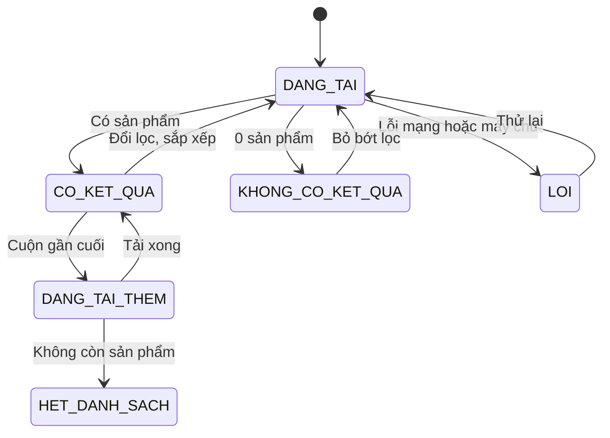
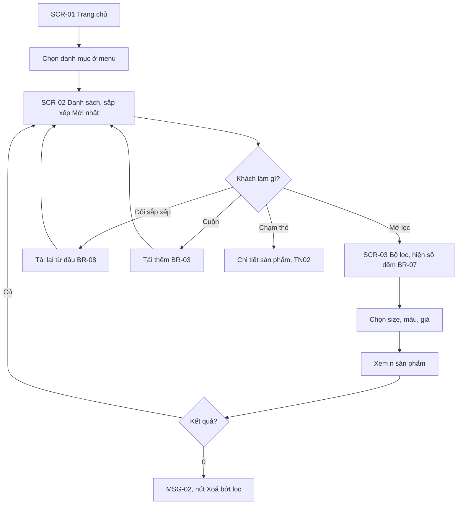
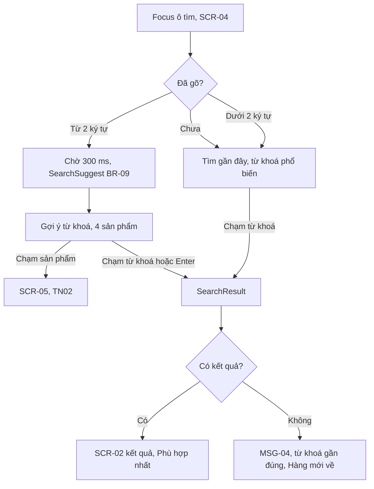
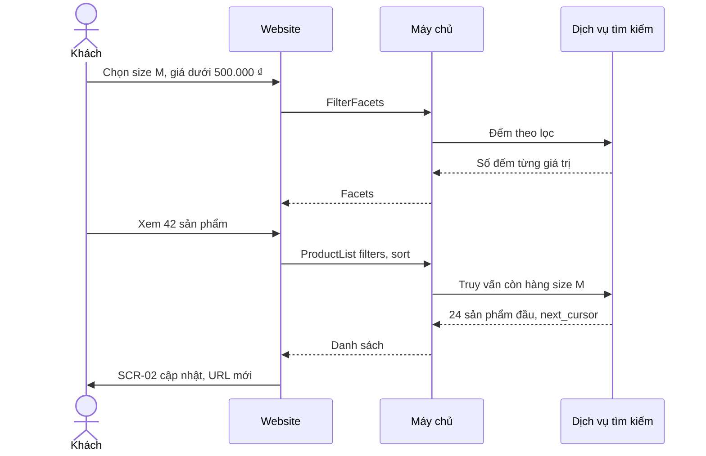

> **Mã:** DE03-TN01-SRS · **Trạng thái:** đã chốt · **Người viết:** Design · **PRD:** [PRD.md](PRD.md)

# UC-DE03-01 - Duyệt và tìm sản phẩm

> SRS này mô tả từ lúc khách vào web đến khi mở trang chi tiết sản phẩm; trang chi tiết xem [SRS TN02](../TN02-chi-tiet-san-pham-chon-size/SRS.md).

## 1. Tổng quan

| **Mục** | **Nội dung** |
| --- | --- |
| Mục tiêu | Khách tìm thấy sản phẩm phù hợp qua trang chủ, danh mục, bộ lọc và tìm kiếm |
| Actor | Khách · Website · Máy chủ · Dịch vụ tìm kiếm |
| Phạm vi | Trang chủ, menu danh mục, trang danh sách, bộ lọc, sắp xếp, tìm kiếm và gợi ý |
| Ngoài phạm vi | Tìm bằng hình, gợi ý cá nhân hoá, so sánh sản phẩm |
| Nền tảng | Website, desktop (≥ 1024 px) và mobile (360–767 px) |

## 2. User Story

| **ID** | **As a** | **I want** | **So that** |
| --- | --- | --- | --- |
| US-01 | Khách | Thấy hàng mới, hàng giảm giá ở trang chủ | Biết shop có gì hay |
| US-02 | Khách | Xem sản phẩm theo danh mục | Chọn trong đúng loại mình cần |
| US-03 | Khách | Lọc theo size, màu, giá | Chỉ thấy mẫu mua được |
| US-04 | Khách | Sắp xếp theo giá, mới nhất, bán chạy | Tìm nhanh món vừa ý |
| US-05 | Khách | Tìm bằng từ khoá, gõ không dấu | Không phải gõ đúng tên |

## 3. Business Rules

| **Mã** | **Quy tắc** |
| --- | --- |
| BR-01 | **Danh mục** 2 cấp: cấp 1 (Nữ, Nam, Phụ kiện), cấp 2 (loại sản phẩm). Danh mục cấp 2 không có sản phẩm đang bán thì ẩn khỏi menu |
| BR-02 | **Thẻ sản phẩm** gồm: ảnh chính (hover desktop đổi sang ảnh thứ 2), tên (tối đa 2 dòng), giá bán, giá gốc gạch ngang và nhãn "-{x}%" nếu giảm, chấm màu (tối đa 5, còn lại "+{n}"), nhãn "Mới" nếu thuộc Hàng mới về, nhãn "Hết hàng" theo BR-04, nút trái tim (TN02) |
| BR-03 | **Tải thêm** 24 sản phẩm (desktop) hoặc 12 (mobile) khi cuộn còn cách cuối 600 px; tự động tối đa 5 lần, sau đó hiện nút "Xem thêm" |
| BR-04 | **Hết hàng**: sản phẩm có mọi biến thể tồn kho = 0. Mặc định vẫn hiện nhưng xếp cuối mọi cách sắp xếp; bật "Chỉ còn hàng" thì ẩn |
| BR-05 | **Lọc size**: chọn nhiều size → sản phẩm còn hàng ở ít nhất 1 size đã chọn. Lọc màu tương tự; lọc size + màu → còn hàng ở biến thể có cả màu và size đã chọn |
| BR-06 | **Lọc giá** theo giá đang bán (sau giảm), khoảng mặc định từ giá thấp nhất tới cao nhất của danh sách hiện tại, bước 50.000 ₫. Kết hợp các nhóm lọc theo AND, trong một nhóm theo OR |
| BR-07 | **Số đếm lọc**: mỗi giá trị lọc hiện số sản phẩm phù hợp nếu chọn thêm giá trị đó; = 0 thì làm mờ, không chọn được |
| BR-08 | **Sắp xếp**: Phù hợp nhất (chỉ khi tìm kiếm, mặc định), Mới nhất (mặc định khi xem danh mục), Bán chạy (số lượng bán 30 ngày), Giá tăng dần, Giá giảm dần |
| BR-09 | **Tìm kiếm**: gợi ý khi gõ ≥ 2 ký tự, chờ 300 ms sau lần gõ cuối; không phân biệt dấu, hoa thường; dùng bảng từ đồng nghĩa do vận hành cấu hình; tìm trên tên, danh mục, màu, chất liệu. Từ khoá tối đa 100 ký tự |
| BR-10 | **Trạng thái danh sách** (danh mục, lọc, sắp xếp, từ khoá) lưu trên URL. Quay lại từ trang chi tiết khôi phục danh sách đã tải và vị trí cuộn. Tìm gần đây lưu 5 từ khoá trên trình duyệt, xoá được |

## 4. Trạng thái

### 4.1 Trạng thái trang danh sách

### 4.2 Hiển thị theo trạng thái

| **Trạng thái** | **Hiển thị** |
| --- | --- |
| `DANG_TAI` | Skeleton 8 thẻ (desktop) hoặc 4 thẻ (mobile) |
| `CO_KET_QUA` | Lưới thẻ, số sản phẩm, chip lọc |
| `DANG_TAI_THEM` | Spinner dưới lưới |
| `HET_DANH_SACH` | "Bạn đã xem hết {n} sản phẩm" |
| `KHONG_CO_KET_QUA` | MSG-02 hoặc MSG-04, gợi ý bỏ lọc hoặc từ khoá gần đúng |
| `LOI` | MSG-05 kèm nút Thử lại |

## 5. Use Case

### UC-01 Duyệt danh mục, lọc và sắp xếp

| **Mục** | **Nội dung** |
| --- | --- |
| Tiền điều kiện | Không |
| Hậu điều kiện thành công | Khách thấy danh sách theo lọc và sắp xếp đã chọn; URL phản ánh đúng trạng thái |
| Hậu điều kiện thất bại | Danh sách giữ trạng thái trước đó kèm thông báo lỗi |

**Luồng chính**

| **Bước** | **Actor** | **Mô tả** |
| --- | --- | --- |
| 1 | Khách | Mở menu, chọn danh mục cấp 2 |
| 2 | Website | Gọi \[ProductList\], hiện **SCR-02** sắp xếp Mới nhất |
| 3 | Khách | Mở bộ lọc, chọn size và khoảng giá |
| 4 | Website | Gọi \[FilterFacets\] cập nhật số đếm; khách bấm "Xem {n} sản phẩm" |
| 5 | Website | Gọi \[ProductList\] với lọc; cập nhật URL, chip lọc, lưới |
| 6 | Khách | Chạm một thẻ sản phẩm → **SCR-05** (TN02) |

**Luồng thay thế**

| **Mã** | **Điều kiện** | **Xử lý** |
| --- | --- | --- |
| A1 | Desktop | Bộ lọc là cột trái của **SCR-02**, áp dụng ngay khi chọn, không có nút "Xem {n}" |
| A2 | Bỏ một chip lọc | Tải lại danh sách ngay |
| A3 | Vào từ link có lọc trên URL | Áp dụng lọc từ URL; giá trị không hợp lệ thì bỏ qua |
| A4 | Bật "Chỉ còn hàng" | Ẩn sản phẩm hết hàng (BR-04) |
| A5 | Quay lại từ **SCR-05** | Khôi phục danh sách và vị trí cuộn (BR-10) |

**Luồng lỗi**

| **Mã** | **Điều kiện** | **Xử lý** |
| --- | --- | --- |
| E1 | Lọc ra 0 sản phẩm | MSG-02, nút "Xoá bớt lọc" bỏ lọc chọn sau cùng |
| E2 | Lỗi tải danh sách | MSG-05; giữ danh sách cũ nếu đang tải thêm |
| E3 | Danh mục không còn tồn tại | MSG-06, chuyển về trang chủ |

### UC-02 Tìm kiếm

| **Mục** | **Nội dung** |
| --- | --- |
| Tiền điều kiện | Không |
| Hậu điều kiện thành công | Hiện **SCR-02** dạng kết quả tìm kiếm; từ khoá lưu vào tìm gần đây |
| Hậu điều kiện thất bại | Ở lại ô tìm kiếm với gợi ý thay thế |

**Luồng chính**

| **Bước** | **Actor** | **Mô tả** |
| --- | --- | --- |
| 1 | Khách | Chạm ô tìm kiếm ở header |
| 2 | Website | Mở **SCR-04** với tìm gần đây và từ khoá phổ biến |
| 3 | Khách | Gõ "ao so mi" |
| 4 | Website | Gọi \[SearchSuggest\]; hiện gợi ý "áo sơ mi nữ", "áo sơ mi nam"… và 4 sản phẩm |
| 5 | Khách | Bấm Enter hoặc chạm một từ khoá |
| 6 | Website | Gọi \[ProductList\] với từ khoá; hiện **SCR-02** tiêu đề "Kết quả cho “{từ khoá}”" và số kết quả |

**Luồng thay thế**

| **Mã** | **Điều kiện** | **Xử lý** |
| --- | --- | --- |
| A1 | Từ khoá trùng tên danh mục | Đưa thẳng về trang danh mục đó, giữ từ khoá trên ô tìm |
| A2 | Xoá một tìm gần đây | Bấm × cạnh từ khoá |
| A3 | Từ khoá chỉ có khoảng trắng | Không tìm, giữ ô tìm |

**Luồng lỗi**

| **Mã** | **Điều kiện** | **Xử lý** |
| --- | --- | --- |
| E1 | 0 kết quả | MSG-04 |
| E2 | Dịch vụ gợi ý lỗi | Ẩn khối gợi ý, Enter vẫn tìm được |
| E3 | Từ khoá > 100 ký tự | MSG-03, cắt còn 100 ký tự |

## 6. Điểm vào

| **Điểm vào** | **Dẫn tới** | **Ghi chú** |
| --- | --- | --- |
| Gõ địa chỉ web | **SCR-01** | |
| Link quảng cáo bộ sưu tập | **SCR-02** lọc theo bộ sưu tập | Tiêu đề là tên bộ sưu tập |
| "Xem tất cả" ở khối trang chủ | **SCR-02** lọc Hàng mới về hoặc Đang giảm giá | |
| Ô tìm kiếm ở header mọi trang | UC-02 | |
| Link chia sẻ trang danh sách | **SCR-02** đúng lọc trên URL | A3 |

## 7. Mô tả màn hình

### SCR-01 Trang chủ

| **#** | **Thành phần** | **Loại** | **Hành vi** |
| --- | --- | --- | --- |
| 1 | Header | Header | Logo, menu danh mục, ô tìm kiếm, Yêu thích (TN02), Tài khoản, Giỏ hàng có số món (TN03) |
| 2 | Banner | Carousel | Tối đa 5; tự chuyển 5 giây; chạm mở bộ sưu tập |
| 3 | Danh mục nổi bật | Lưới ảnh | 6–8 ô ảnh + tên |
| 4 | Hàng mới về | Dải thẻ | Tối đa 8 thẻ, cuộn ngang trên mobile, "Xem tất cả" |
| 5 | Đang giảm giá | Dải thẻ | Như trên; ẩn nếu không có |
| 6 | Footer | Footer | Chính sách đổi trả, giao hàng, liên hệ, Tra cứu đơn hàng (TN04) |

### SCR-02 Danh sách sản phẩm

| **#** | **Thành phần** | **Loại** | **Hành vi** |
| --- | --- | --- | --- |
| 1 | Breadcrumb | Link | Trang chủ › Nữ › Sơ mi |
| 2 | Tiêu đề + số lượng | Text | "Sơ mi nữ · {n} sản phẩm" hoặc "Kết quả cho “{từ khoá}” · {n}" |
| 3 | Nút Lọc (mobile) | Button | Mở **SCR-03**; có số bộ lọc đang chọn |
| 4 | Cột lọc (desktop) | Panel | Như **SCR-03**, áp dụng ngay |
| 5 | Sắp xếp | Dropdown | BR-08 |
| 6 | Chip lọc | Chips | Mỗi lọc 1 chip có ×; "Xoá tất cả" |
| 7 | Lưới sản phẩm | Grid | 4 cột desktop, 2 cột mobile; thẻ theo BR-02 |
| 8 | Tải thêm | Spinner / Button | BR-03 |
| 9 | Trạng thái rỗng, lỗi | Empty state | Mục 4.2 |

### SCR-03 Bộ lọc (mobile)

| **#** | **Thành phần** | **Loại** | **Bắt buộc** | **Validate / hành vi** |
| --- | --- | --- | --- | --- |
| 1 | Size | Chips nhiều chọn | – | XS–XXL, size số (quần 26–34); số đếm BR-07 |
| 2 | Màu | Ô màu nhiều chọn | – | Tên màu khi chạm giữ hoặc hover |
| 3 | Khoảng giá | Slider 2 đầu + 2 ô số | – | BR-06; ô từ ≤ ô đến |
| 4 | Chất liệu | Checkbox | – | Cotton, Linen, Jean, Lụa… |
| 5 | Kiểu dáng | Checkbox | – | Theo danh mục |
| 6 | Chỉ còn hàng | Switch | – | BR-04 |
| 7 | "Đặt lại" | Link | – | Bỏ mọi lọc trong ngăn |
| 8 | "Xem {n} sản phẩm" | Button | – | Áp dụng lọc, đóng ngăn; n = 0 thì disabled kèm MSG-01 |

### SCR-04 Tìm kiếm

| **#** | **Thành phần** | **Loại** | **Hành vi** |
| --- | --- | --- | --- |
| 1 | Ô tìm kiếm | Search input | Placeholder "Tìm áo, quần, váy…"; nút × xoá chữ |
| 2 | Tìm gần đây | List | 5 từ khoá, × để xoá (BR-10) |
| 3 | Từ khoá phổ biến | Chips | Tối đa 8, do vận hành cấu hình |
| 4 | Gợi ý từ khoá | List | Tối đa 6; phần khớp in đậm |
| 5 | Gợi ý sản phẩm | List | Tối đa 4: ảnh nhỏ, tên, giá |

## 8. API

| **API** | **Request chính** | **Response chính** | **Timeout / retry** |
| --- | --- | --- | --- |
| \[HomeContent\] | – | Banner, danh mục nổi bật, 2 khối sản phẩm | 5s / 1 lần |
| \[CategoryTree\] | – | Cây danh mục BR-01 | 5s / 1 lần; cache 10 phút |
| \[ProductList\] | category hoặc keyword, filters, sort, cursor, page_size | Danh sách thẻ, total, next_cursor | 5s / 1 lần |
| \[FilterFacets\] | category hoặc keyword, filters | Từng giá trị lọc kèm số đếm, khoảng giá | 3s / không retry |
| \[SearchSuggest\] | keyword | Từ khoá gợi ý, 4 sản phẩm | 2s / không retry |

**Map lỗi → thông báo**

| **Nhóm lỗi** | **Message** |
| --- | --- |
| Lọc cho 0 kết quả (mobile, trước khi áp dụng) | MSG-01 |
| Lọc cho 0 kết quả (trên danh sách) | MSG-02 |
| Từ khoá quá dài | MSG-03 |
| Tìm kiếm 0 kết quả | MSG-04 |
| Mất mạng, quá thời gian, lỗi máy chủ | MSG-05 |
| Danh mục không tồn tại | MSG-06 |

## 9. Danh sách thông báo

| **ID** | **Nơi hiện** | **Nội dung (VI)** |
| --- | --- | --- |
| MSG-01 | Inline **SCR-03** | Không có sản phẩm phù hợp. Thử bỏ bớt một vài lựa chọn nhé |
| MSG-02 | Empty state **SCR-02** | Chưa có mẫu nào khớp bộ lọc của bạn. \[Xoá bớt lọc\] |
| MSG-03 | Inline | Từ khoá tối đa 100 ký tự |
| MSG-04 | Empty state **SCR-02** | Không tìm thấy “{từ khoá}”. Bạn có muốn tìm “{gợi ý}”? |
| MSG-05 | Toast | Kết nối không ổn định, vui lòng thử lại. \[Thử lại\] |
| MSG-06 | Toast | Danh mục này không còn tồn tại |

## 10. Yêu cầu phi chức năng

| **Mục** | **Yêu cầu** |
| --- | --- |
| Hiệu năng | LCP trang chủ, danh sách ≤ 2,5 giây trên 4G (p75); \[ProductList\] ≤ 500 ms (p95); gợi ý tìm kiếm ≤ 300 ms |
| Ảnh | Nhiều kích thước theo màn hình, định dạng nén hiện đại, tải lười ngoài màn đầu |
| SEO | Trang danh mục có tiêu đề, mô tả, URL thân thiện; trang lọc gắn canonical về danh mục gốc |
| Log / audit | Từ khoá tìm kiếm và số kết quả (để bổ sung từ đồng nghĩa) |
| Tracking | Xem trang chủ, chạm banner, chọn danh mục, áp lọc (nhóm, giá trị), sắp xếp, tìm kiếm, chạm gợi ý, chạm thẻ (vị trí) |
| Accessibility | Thẻ sản phẩm là một link có nhãn đầy đủ (tên, giá, giảm giá); bộ lọc dùng được bằng bàn phím; ô màu có tên màu dạng chữ; tương phản ≥ 4,5:1 |
