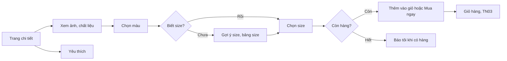

> **Mã:** DE03-TN02-PRD · **Trạng thái:** đã chốt · **Người viết:** Design · **SRS:** [SRS.md](SRS.md)

# PRD Chi tiết sản phẩm và chọn size (Website mua quần áo)

## 1. Bối cảnh và vấn đề

### 1.1 Bối cảnh

Trang chi tiết là nơi khách quyết định có bỏ vào giỏ hay không (xem [README](../../README.md)). Mua quần áo online khác mua đồ điện tử: khách không sờ được vải, không thử được size. Gần một nửa yêu cầu đổi trả của shop là do **sai size**, và mỗi lần đổi trả shop mất phí ship hai chiều.

### 1.2 Vấn đề

| **Vấn đề** | **Hệ quả** |
| --- | --- |
| Ảnh ít, không thấy chất vải, không thấy dáng khi mặc | Khách không dám mua |
| Bảng size chung cho mọi mẫu, ghi cm khó hiểu | Chọn sai size, đổi trả nhiều |
| Chọn màu xong mới biết size của mình đã hết | Khách bực, rời trang |
| Bấm "Thêm vào giỏ" khi chưa chọn size, không có phản hồi rõ | Khách tưởng đã thêm |
| Món thích nhưng chưa mua ngay thì mất dấu | Mất đơn |

### 1.3 Mục tiêu

- Tỉ lệ thêm giỏ từ trang chi tiết ≥ 12%.
- Tỉ lệ đổi trả vì sai size giảm từ 45% xuống ≤ 30% tổng yêu cầu đổi trả.
- ≥ 25% khách thêm giỏ có dùng gợi ý size hoặc bảng size.

## 2. Người dùng

| **Nhóm** | **Nhu cầu với tính năng này** |
| --- | --- |
| Khách mua lần đầu | Biết chất vải, dáng mặc, size nào vừa mình |
| Khách quen | Thêm giỏ nhanh, biết size quen của mình còn không |
| Khách lưỡng lự | Lưu lại món thích, được báo khi có hàng lại |

## 3. Phạm vi

### 3.1 Trong phạm vi (MVP)

- Bộ ảnh theo từng màu, phóng to, video ngắn (nếu có).
- Chọn màu, chọn size; trạng thái còn hàng theo từng biến thể.
- Bảng size riêng theo mẫu và gợi ý size theo chiều cao, cân nặng.
- Thông tin người mẫu (chiều cao, size đang mặc), chất liệu, hướng dẫn giặt.
- Chọn số lượng, Thêm vào giỏ, Mua ngay.
- Yêu thích (trái tim) và trang Yêu thích.
- "Báo tôi khi có hàng" cho size đã hết.
- Sản phẩm tương tự.

### 3.2 Ngoài phạm vi

- Đánh giá, hỏi đáp của khách → phase sau.
- Thử đồ ảo, ảnh 360°.
- Mua kèm theo bộ (set) giảm giá.

## 4. Nguyên tắc sản phẩm

### 4.1 Size là quyết định khó nhất, giúp khách chắc chắn

Gợi ý size nằm ngay cạnh lựa chọn size, không giấu trong link nhỏ. Thông tin người mẫu luôn hiện.

### 4.2 Hết hàng phải thấy trước khi chọn

Size hết hàng của màu đang chọn bị gạch, vẫn chạm được để đăng ký báo có hàng.

### 4.3 Thêm giỏ có phản hồi rõ

Thêm giỏ thành công hiện giỏ thu gọn với món vừa thêm; chưa chọn size thì chỉ rõ chỗ cần chọn.

### 4.4 Không mất món đã thích

Khách chưa đăng nhập vẫn yêu thích được; đăng nhập thì gộp vào tài khoản.

## 5. Quy tắc nghiệp vụ

| **Quy tắc** | **Giá trị** |
| --- | --- |
| Biến thể | Sản phẩm × màu × size; mỗi biến thể có mã SKU và tồn kho riêng |
| Sắp hết | Tồn kho biến thể ≤ 5 → hiện "Chỉ còn {n}" |
| Số lượng mỗi lần thêm | 1–10 và không quá tồn kho |
| Gợi ý size | Chiều cao 140–200 cm, cân nặng 35–120 kg; dựa trên bảng size của mẫu |
| Yêu thích | Tối đa 100 sản phẩm |
| Báo có hàng | Gửi email 1 lần khi biến thể có hàng lại; đăng ký hết hạn sau 60 ngày |

## 6. Luồng trải nghiệm

| **Bước** | **Giai đoạn** | **Trải nghiệm** | **Đầu ra** |
| --- | --- | --- | --- |
| 1 | Xem | Ảnh lớn theo màu, giá, chất liệu, người mẫu | Hiểu sản phẩm |
| 2 | Chọn biến thể | Chạm màu → ảnh đổi; size hết bị gạch | Màu, size |
| 3 | Chắc size | Nhập chiều cao, cân nặng → size gợi ý | Size phù hợp |
| 4 | Quyết định | Thêm vào giỏ, Mua ngay, hoặc Yêu thích | Món trong giỏ hoặc danh sách thích |

## 7. Use Cases, User Stories và Acceptance Criteria

### UC1. Xem và chọn biến thể

#### US1.1 Xem sản phẩm

User Story: Là khách, tôi muốn xem nhiều ảnh và thông tin chất liệu để hình dung món đồ.

AC01: Ảnh theo màu đang chọn; desktop hiện cột ảnh, mobile vuốt ngang; chạm để phóng to.

AC02: Hiện tên, giá bán, giá gốc và % giảm (nếu có), mã sản phẩm, chất liệu, hướng dẫn giặt, thông tin người mẫu.

AC03: Sản phẩm ngừng bán → báo rõ và gợi ý sản phẩm tương tự.

#### US1.2 Chọn màu và size

User Story: Là khách, tôi muốn biết size mình cần còn hàng ở màu nào trước khi chọn.

AC01: Đổi màu → ảnh, trạng thái size, giá (nếu khác) đổi theo.

AC02: Size hết hàng ở màu đang chọn bị gạch chéo; chạm vào mở "Báo tôi khi có hàng".

AC03: Biến thể còn ≤ 5 → "Chỉ còn {n}".

AC04: Vào trang từ lọc size ở TN01 → chọn sẵn size đó nếu còn hàng.

### UC2. Chọn size đúng

#### US2.1 Gợi ý size

User Story: Là khách, tôi muốn nhập chiều cao, cân nặng và được gợi ý size để không phải đọc bảng số đo.

AC01: Nhập chiều cao, cân nặng, chọn dáng mặc thích (Ôm, Vừa, Rộng) → hiện size gợi ý và lý do ngắn.

AC02: Ngoài bảng size của mẫu → "Mẫu này có thể không vừa bạn" và không gợi ý.

AC03: Số đo được nhớ trên trình duyệt (và tài khoản nếu đăng nhập) để dùng cho mẫu khác.

AC04: Chạm "Chọn size {x}" → chọn size đó trên trang chi tiết.

#### US2.2 Xem bảng size

AC01: Bảng size riêng của mẫu: vòng ngực, eo, mông, dài áo, theo cm; có hình hướng dẫn đo.

### UC3. Thêm vào giỏ và mua ngay

#### US3.1 Thêm vào giỏ

User Story: Là khách, tôi muốn thêm món vào giỏ và thấy ngay giỏ đã có món đó.

AC01: Chưa chọn size → không thêm; cuộn tới khu chọn size, viền đỏ, hiện lỗi.

AC02: Thêm thành công → giỏ thu gọn mở, hiện món vừa thêm, số món trên icon giỏ tăng.

AC03: Số lượng trong giỏ vượt tồn kho → báo số còn lại, chỉ thêm tối đa phần còn.

#### US3.2 Mua ngay

AC01: "Mua ngay" thêm món vào giỏ và chuyển thẳng tới trang Thanh toán (TN03).

### UC4. Yêu thích và báo có hàng

AC01: Chạm trái tim trên thẻ hoặc trang chi tiết để thêm, bỏ yêu thích.

AC02: Trang Yêu thích hiện các món, món hết hàng ghi rõ; chạm "Thêm vào giỏ" mở chọn size.

AC03: "Báo tôi khi có hàng" cần email (điền sẵn nếu đã đăng nhập); mỗi biến thể đăng ký 1 lần.

## 8. Chỉ số theo dõi

| **Chỉ số** | **Định nghĩa** | **Mục tiêu MVP** |
| --- | --- | --- |
| Tỉ lệ thêm giỏ | Phiên xem chi tiết có thêm giỏ / phiên xem chi tiết | ≥ 12% |
| Tỉ lệ dùng gợi ý size | Lượt thêm giỏ có dùng gợi ý hoặc bảng size / lượt thêm giỏ | ≥ 25% |
| Tỉ lệ thêm giỏ lỗi chưa chọn size | Lượt bấm thêm khi chưa chọn size / lượt bấm thêm | Theo dõi; cao là dấu hiệu khu chọn size khó thấy |
| Đổi trả vì sai size | Yêu cầu đổi trả lý do sai size / tổng yêu cầu | ≤ 30% |
| Chuyển đổi báo có hàng | Đơn từ email báo có hàng / email đã gửi | Theo dõi |

## 9. Phụ thuộc và rủi ro

| **Mục** | **Mô tả** | **Hướng xử lý** |
| --- | --- | --- |
| Bảng size từng mẫu | Vận hành nhập thiếu hoặc sai | Thiếu bảng size thì ẩn gợi ý, chỉ hiện bảng chung của danh mục |
| Tồn kho lệch | Thấy còn hàng nhưng đặt thì hết | Kiểm tra lại khi thêm giỏ và khi đặt hàng |
| Email báo có hàng | Bị coi là spam | Chỉ gửi đúng 1 lần, có link huỷ đăng ký |

## 10. Câu hỏi mở

> Mọi câu hỏi dưới đây đã được PO chốt ngày 20/11/2026; quyết định ghi sau mỗi câu và đã cập nhật vào SRS.

- Thêm vào giỏ có giữ hàng không? → **Đã chốt:** Không. Chỉ giữ hàng khi đặt đơn (SRS TN03 BR-27).
- Gợi ý size dùng công thức gì? → **Đã chốt:** So số đo ước tính từ chiều cao, cân nặng với bảng size của mẫu, cộng độ rộng theo dáng mặc; không dùng AI ở MVP (SRS BR-14).
- Khi mở trang mà mọi size của màu mặc định đều hết, chọn màu nào? → **Đã chốt:** Chọn màu đầu tiên còn hàng (SRS BR-12).
- Yêu thích của khách vãng lai giữ bao lâu? → **Đã chốt:** 90 ngày trên trình duyệt; đăng nhập thì gộp vào tài khoản (SRS BR-18).
