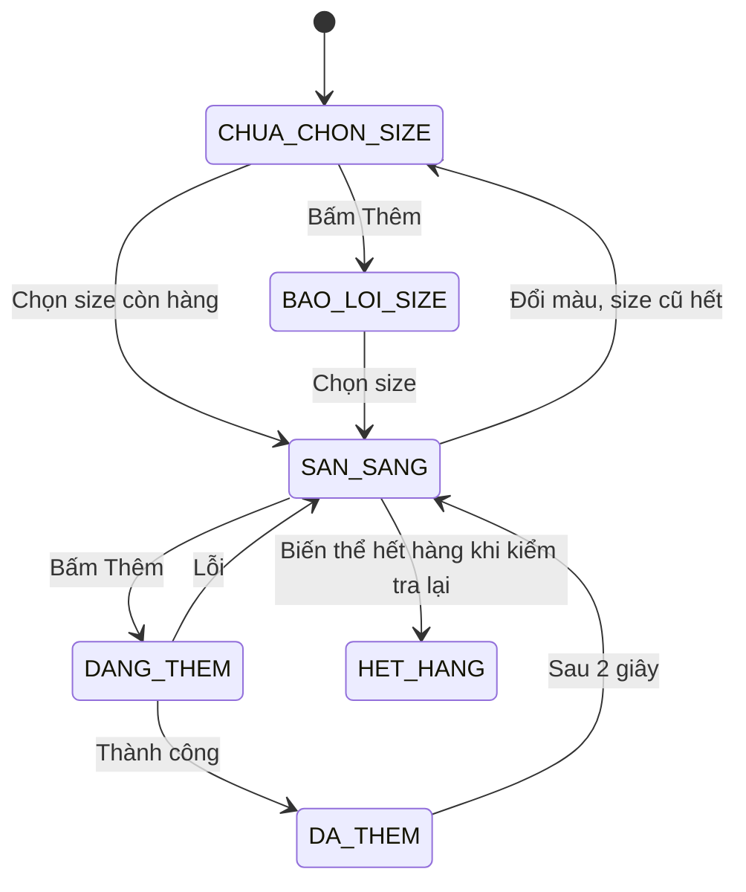
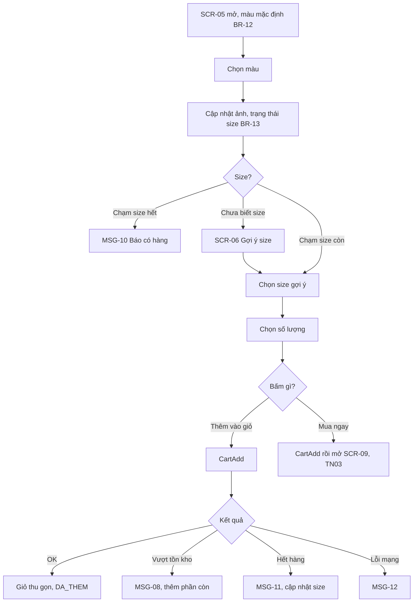
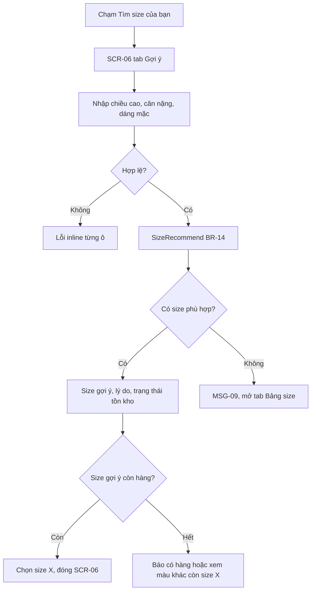
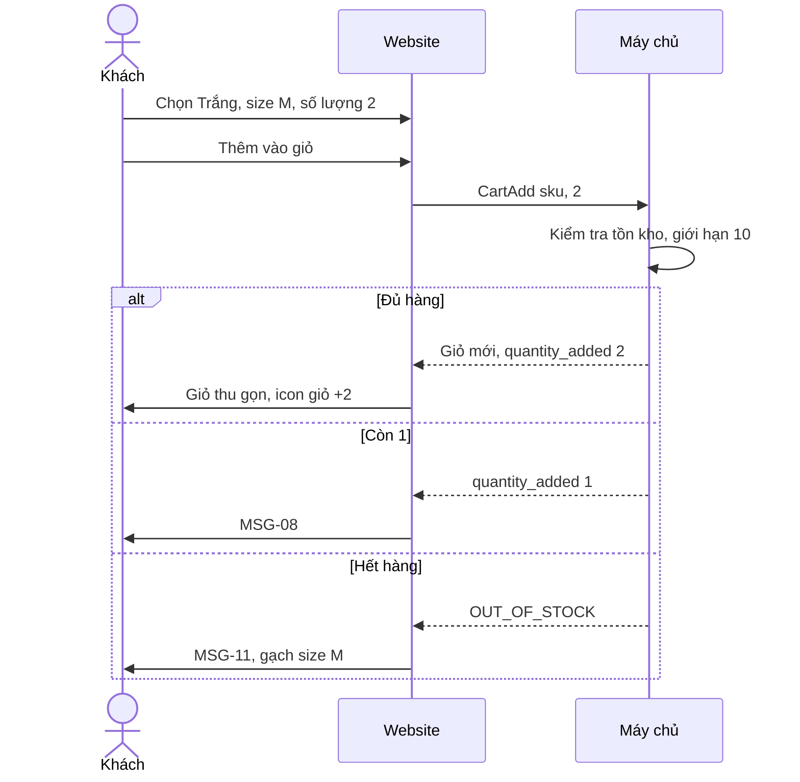

> **Mã:** DE03-TN02-SRS · **Trạng thái:** đã chốt · **Người viết:** Design · **PRD:** [PRD.md](PRD.md)

# UC-DE03-02 - Chi tiết sản phẩm và chọn size

> SRS này mô tả trang chi tiết, gợi ý size, thêm vào giỏ và yêu thích; giỏ hàng và thanh toán xem [SRS TN03](../TN03-gio-hang-thanh-toan/SRS.md).

## 1. Tổng quan

| **Mục** | **Nội dung** |
| --- | --- |
| Mục tiêu | Khách hiểu sản phẩm, chọn đúng màu và size, thêm vào giỏ hoặc lưu yêu thích |
| Actor | Khách · Website · Máy chủ · Dịch vụ email |
| Phạm vi | Ảnh, thông tin, chọn biến thể, tồn kho, gợi ý size, bảng size, thêm giỏ, mua ngay, yêu thích, báo có hàng, sản phẩm tương tự |
| Ngoài phạm vi | Đánh giá, hỏi đáp, thử đồ ảo, mua theo set |
| Nền tảng | Website desktop và mobile |

## 2. User Story

| **ID** | **As a** | **I want** | **So that** |
| --- | --- | --- | --- |
| US-06 | Khách | Xem ảnh theo màu và thông tin chất liệu | Hình dung món đồ |
| US-07 | Khách | Thấy size nào còn hàng ở màu đang chọn | Không chọn phải size đã hết |
| US-08 | Khách | Được gợi ý size từ chiều cao, cân nặng | Mua đúng size, không phải đổi |
| US-09 | Khách | Thêm vào giỏ và thấy phản hồi rõ | Biết món đã vào giỏ |
| US-10 | Khách | Lưu món yêu thích, được báo khi có hàng | Không mất món muốn mua |

## 3. Business Rules

| **Mã** | **Quy tắc** |
| --- | --- |
| BR-11 | **Biến thể** = sản phẩm × màu × size, mỗi biến thể có SKU, tồn kho, có thể có giá riêng. Giá hiển thị là giá của biến thể đang chọn; chưa chọn size thì hiện giá thấp nhất của màu, nếu các size khác giá thì ghi "Từ {giá}" |
| BR-12 | **Màu mặc định** khi mở trang: màu từ URL (nếu có) → màu đầu tiên còn hàng → màu đầu tiên. **Size mặc định**: size từ lọc ở TN01 nếu còn hàng; ngược lại để trống |
| BR-13 | **Trạng thái size**: `CON_HANG` (tồn > 5), `SAP_HET` (1–5, hiện "Chỉ còn {n}"), `HET_HANG` (0, gạch chéo, chạm mở **SCR-06** phần báo có hàng hoặc popup MSG-10). Tồn kho đọc lại mỗi khi đổi màu |
| BR-14 | **Gợi ý size**: đầu vào chiều cao 140–200 cm, cân nặng 35–120 kg, dáng mặc Ôm / Vừa / Rộng. Hệ thống ước tính số đo cơ thể theo bảng chuẩn của shop, so với bảng size của mẫu, cộng độ rộng theo dáng mặc (Ôm 0 cm, Vừa +2 cm, Rộng +4 cm vòng ngực); chọn size nhỏ nhất vừa mọi số đo. Không có size phù hợp → MSG-09. Mẫu chưa có bảng size → ẩn gợi ý |
| BR-15 | **Số đo đã nhập** lưu trên trình duyệt; đã đăng nhập thì lưu vào hồ sơ. Lần sau mở mẫu khác hiện ngay "Size gợi ý cho bạn: {x}" cạnh khu chọn size |
| BR-16 | **Số lượng** mỗi lần thêm 1–10; tổng số lượng SKU trong giỏ không vượt min(10, tồn kho) (TN03 BR-21). Vượt → chỉ thêm phần còn được, MSG-08 |
| BR-17 | **Thêm vào giỏ** yêu cầu đã chọn màu và size; không giữ tồn kho. **Mua ngay** = thêm vào giỏ rồi mở **SCR-09** chỉ với các món đang được tích chọn gồm món này |
| BR-18 | **Yêu thích** theo sản phẩm (không theo size), tối đa 100. Khách vãng lai lưu trên trình duyệt 90 ngày; đăng nhập → gộp vào tài khoản, bỏ trùng, giữ 100 món thêm gần nhất |
| BR-19 | **Báo có hàng** theo biến thể, cần email hợp lệ; mỗi email × biến thể đăng ký 1 lần; gửi 1 email khi tồn kho từ 0 lên > 0; hết hạn sau 60 ngày; email có link huỷ đăng ký |
| BR-20 | **Sản phẩm tương tự**: tối đa 8 sản phẩm cùng danh mục cấp 2, còn hàng, giá trong khoảng ±30%, ưu tiên còn size đang chọn |

## 4. Trạng thái

### 4.1 Trạng thái nút "Thêm vào giỏ"

### 4.2 Hiển thị nút theo trạng thái

| **Trạng thái** | **Hiển thị** |
| --- | --- |
| `CHUA_CHON_SIZE` | "Thêm vào giỏ" bật; bấm thì chuyển `BAO_LOI_SIZE` |
| `BAO_LOI_SIZE` | Khu size viền đỏ, MSG-07, cuộn tới khu size |
| `SAN_SANG` | "Thêm vào giỏ", "Mua ngay" |
| `DANG_THEM` | Spinner, disabled |
| `DA_THEM` | "✓ Đã thêm" 2 giây; giỏ thu gọn mở |
| `HET_HANG` | "Hết hàng", nút "Báo tôi khi có hàng" thay "Mua ngay" |

## 5. Use Case

### UC-03 Chọn biến thể và thêm vào giỏ

| **Mục** | **Nội dung** |
| --- | --- |
| Tiền điều kiện | Sản phẩm đang bán |
| Hậu điều kiện thành công | SKU đã vào giỏ với số lượng đã chọn; icon giỏ cập nhật |
| Hậu điều kiện thất bại | Giỏ không đổi; khách thấy lỗi tại chỗ |

**Luồng chính**

| **Bước** | **Actor** | **Mô tả** |
| --- | --- | --- |
| 1 | Website | Gọi \[ProductDetail\]; hiện **SCR-05** với màu mặc định |
| 2 | Khách | Chọn màu; ảnh và trạng thái size đổi theo |
| 3 | Khách | Chọn size còn hàng, chọn số lượng |
| 4 | Khách | Bấm "Thêm vào giỏ" |
| 5 | Website | Gọi \[CartAdd\] với SKU, số lượng |
| 6 | Máy chủ | Kiểm tra tồn kho (BR-16), cập nhật giỏ |
| 7 | Website | Mở giỏ thu gọn: ảnh, tên, màu, size, số lượng, tạm tính, nút "Xem giỏ hàng" và "Thanh toán" |

**Luồng thay thế**

| **Mã** | **Điều kiện** | **Xử lý** |
| --- | --- | --- |
| A1 | Bấm Thêm khi chưa chọn size | `BAO_LOI_SIZE`, MSG-07 |
| A2 | Bấm Mua ngay | Như bước 5–6 rồi mở **SCR-09** (BR-17) |
| A3 | Đổi màu mà size đang chọn hết ở màu mới | Bỏ chọn size, `CHUA_CHON_SIZE` |
| A4 | Đã có số đo (BR-15) | Hiện "Size gợi ý cho bạn: {x}" cạnh khu size |

**Luồng lỗi**

| **Mã** | **Điều kiện** | **Xử lý** |
| --- | --- | --- |
| E1 | Vượt số lượng cho phép | MSG-08 |
| E2 | Biến thể vừa hết hàng | MSG-11, gạch size đó |
| E3 | Sản phẩm ngừng bán | Trang hiện "Sản phẩm đã ngừng bán" + sản phẩm tương tự; ẩn nút mua |
| E4 | Lỗi mạng | MSG-12, nút trở về `SAN_SANG` |

### UC-04 Gợi ý size

| **Mục** | **Nội dung** |
| --- | --- |
| Tiền điều kiện | Mẫu có bảng size |
| Hậu điều kiện thành công | Size gợi ý được chọn trên **SCR-05**; số đo được lưu (BR-15) |
| Hậu điều kiện thất bại | Không chọn size; khách xem bảng size |

**Luồng chính**

| **Bước** | **Actor** | **Mô tả** |
| --- | --- | --- |
| 1 | Khách | Chạm "Tìm size của bạn" cạnh khu chọn size |
| 2 | Website | Mở **SCR-06** tab Gợi ý; điền sẵn số đo đã lưu |
| 3 | Khách | Nhập chiều cao, cân nặng, chọn dáng mặc; bấm "Xem size" |
| 4 | Website | Gọi \[SizeRecommend\]; hiện "Bạn nên chọn size {x}" và lý do ("Vòng ngực ước tính 88 cm, size M rộng 92 cm") |
| 5 | Khách | Bấm "Chọn size {x}" |
| 6 | Website | Đóng **SCR-06**, chọn size {x} trên **SCR-05** |

**Luồng thay thế**

| **Mã** | **Điều kiện** | **Xử lý** |
| --- | --- | --- |
| A1 | Size gợi ý hết hàng ở màu đang chọn | Liệt kê màu còn size đó; hoặc nút Báo có hàng |
| A2 | Khách mở tab Bảng size | Hiện bảng số đo của mẫu + hình hướng dẫn đo |

**Luồng lỗi**

| **Mã** | **Điều kiện** | **Xử lý** |
| --- | --- | --- |
| E1 | Số đo ngoài khoảng cho phép | Lỗi inline "Chiều cao từ 140 đến 200 cm" |
| E2 | Không có size phù hợp | MSG-09 |
| E3 | \[SizeRecommend\] lỗi | MSG-12; tab Bảng size vẫn dùng được |

### UC-05 Yêu thích và báo có hàng

**Luồng chính**

| **Bước** | **Actor** | **Mô tả** |
| --- | --- | --- |
| 1 | Khách | Chạm trái tim trên thẻ hoặc **SCR-05** |
| 2 | Website | Đổi trái tim sang tô đậm ngay; gọi \[WishlistToggle\] (đăng nhập) hoặc lưu trình duyệt (BR-18) |
| 3 | Khách | Mở **SCR-07** từ header |
| 4 | Website | Hiện các món yêu thích, giá hiện tại, món hết hàng ghi rõ |

**Luồng thay thế**

| **Mã** | **Điều kiện** | **Xử lý** |
| --- | --- | --- |
| A1 | Đạt 100 món | MSG-13, không thêm |
| A2 | Chạm size hết hàng → "Báo tôi khi có hàng" | Popup nhập email (điền sẵn nếu đăng nhập) → \[RestockSubscribe\] → MSG-10 |
| A3 | "Thêm vào giỏ" ở **SCR-07** | Mở popup chọn màu, size rồi theo UC-03 |
| A4 | Đăng nhập khi đang có yêu thích trên trình duyệt | Gộp theo BR-18 |

## 6. Điểm vào

| **Điểm vào** | **Dẫn tới** | **Ghi chú** |
| --- | --- | --- |
| Chạm thẻ sản phẩm (TN01) | **SCR-05** | Mang theo size lọc nếu có |
| Gợi ý sản phẩm khi tìm kiếm | **SCR-05** | |
| Email báo có hàng | **SCR-05** chọn sẵn màu, size | |
| Chạm món trong giỏ (TN03) hoặc đơn hàng (TN04) | **SCR-05** | |
| Icon trái tim ở header | **SCR-07** | |

## 7. Mô tả màn hình

### SCR-05 Chi tiết sản phẩm

| **#** | **Thành phần** | **Loại** | **Hành vi** |
| --- | --- | --- | --- |
| 1 | Bộ ảnh | Gallery | Theo màu đang chọn; desktop cột ảnh dọc, mobile vuốt ngang có chấm; chạm phóng to toàn màn |
| 2 | Tên, mã sản phẩm | Text | |
| 3 | Giá | Text | BR-11; giá gốc gạch ngang, nhãn "-{x}%" |
| 4 | Chọn màu | Ô màu | Tên màu đang chọn hiện cạnh tiêu đề "Màu: Trắng" |
| 5 | Chọn size | Chips | Trạng thái theo BR-13; "Chỉ còn {n}" dưới size sắp hết |
| 6 | Tìm size của bạn | Link nổi bật | Mở **SCR-06**; có số đo thì hiện size gợi ý (BR-15) |
| 7 | Số lượng | Stepper | 1–10 (BR-16) |
| 8 | "Thêm vào giỏ", "Mua ngay" | Button | Mục 4.2; mobile dính đáy màn hình |
| 9 | Trái tim | Icon toggle | UC-05 |
| 10 | Người mẫu | Text | "Người mẫu cao 165 cm, nặng 50 kg, mặc size S" |
| 11 | Mô tả, chất liệu, giặt ủi | Accordion | Mở sẵn mục Mô tả |
| 12 | Chính sách | Text phụ | "Miễn phí đổi size trong 7 ngày", "Miễn phí giao đơn từ 499.000 ₫" (TN03, TN04) |
| 13 | Sản phẩm tương tự | Dải thẻ | BR-20 |
| 14 | Giỏ thu gọn | Drawer phải / bottom sheet | Mở sau khi thêm; tự đóng sau 5 giây trên desktop |

### SCR-06 Bảng size & gợi ý size

| **#** | **Thành phần** | **Loại** | **Bắt buộc** | **Validate / hành vi** |
| --- | --- | --- | --- | --- |
| 1 | Tab Gợi ý / Bảng size | Tabs | – | Mặc định Gợi ý nếu mẫu có bảng size |
| 2 | Chiều cao (cm) | Number | Có | 140–200 |
| 3 | Cân nặng (kg) | Number | Có | 35–120 |
| 4 | Dáng mặc | Segmented | Có | Ôm, Vừa (mặc định), Rộng |
| 5 | "Xem size" | Button | – | Disabled khi thiếu ô bắt buộc |
| 6 | Kết quả | Card | – | Size gợi ý, lý do, trạng thái tồn kho; nút "Chọn size {x}" |
| 7 | Bảng size | Table | – | Hàng = size, cột = số đo cm; tô đậm hàng size gợi ý |
| 8 | Hướng dẫn đo | Hình + text | – | Vòng ngực, eo, mông |

### SCR-07 Yêu thích

| **#** | **Thành phần** | **Loại** | **Hành vi** |
| --- | --- | --- | --- |
| 1 | Tiêu đề + số món | Text | "Yêu thích ({n})" |
| 2 | Lưới thẻ | Grid | Thẻ theo TN01 BR-02; trái tim tô đậm, chạm để bỏ |
| 3 | "Thêm vào giỏ" trên thẻ | Button | A3 |
| 4 | Nhắc đăng nhập | Banner | Khách vãng lai: "Đăng nhập để giữ danh sách trên mọi thiết bị" |
| 5 | Trạng thái rỗng | Empty state | "Chưa có món yêu thích. Chạm ♡ để lưu món bạn thích" |

## 8. API

| **API** | **Request chính** | **Response chính** | **Timeout / retry** |
| --- | --- | --- | --- |
| \[ProductDetail\] | product_id | Thông tin, ảnh theo màu, biến thể (SKU, giá, tồn kho), bảng size, người mẫu | 5s / 1 lần |
| \[VariantStock\] | product_id, color | Tồn kho từng size | 3s / 1 lần |
| \[SizeRecommend\] | product_id, height, weight, fit | size, lý do, null nếu không phù hợp | 3s / 1 lần |
| \[CartAdd\] | sku, quantity, cart_id | Giỏ sau khi thêm, quantity_added | 5s / 1 lần |
| \[WishlistToggle\] | product_id | in_wishlist, total | 3s / 1 lần |
| \[RestockSubscribe\] | sku, email | subscribed | 5s / 1 lần |
| \[SimilarProducts\] | product_id, size | Tối đa 8 thẻ | 3s / không retry |

**Map lỗi → thông báo**

| **Nhóm lỗi** | **Message** |
| --- | --- |
| Chưa chọn size | MSG-07 |
| Vượt số lượng cho phép | MSG-08 |
| Không có size phù hợp | MSG-09 |
| Đăng ký báo có hàng thành công | MSG-10 |
| Biến thể hết hàng | MSG-11 |
| Mất mạng, quá thời gian, lỗi máy chủ | MSG-12 |
| Yêu thích đầy | MSG-13 |

## 9. Danh sách thông báo

| **ID** | **Nơi hiện** | **Nội dung (VI)** |
| --- | --- | --- |
| MSG-07 | Inline khu size | Vui lòng chọn size |
| MSG-08 | Toast | Chỉ thêm được {n} sản phẩm. Mỗi mẫu tối đa {max} cái trong giỏ |
| MSG-09 | Inline **SCR-06** | Mẫu này có thể không vừa bạn. Xem bảng size để kiểm tra kỹ hơn |
| MSG-10 | Toast | Chúng tôi sẽ gửi email cho bạn khi size {size} có hàng lại |
| MSG-11 | Toast | Rất tiếc, size {size} vừa hết hàng |
| MSG-12 | Toast | Kết nối không ổn định, vui lòng thử lại |
| MSG-13 | Toast | Danh sách yêu thích đã đủ 100 món. Bỏ bớt để thêm món mới |

## 10. Yêu cầu phi chức năng

| **Mục** | **Yêu cầu** |
| --- | --- |
| Hiệu năng | Ảnh chính hiện ≤ 2 giây trên 4G; đổi màu cập nhật ảnh và size ≤ 300 ms; \[CartAdd\] ≤ 1 giây (p95) |
| Bảo mật, riêng tư | Số đo cơ thể chỉ người dùng thấy; không dùng cho quảng cáo; xoá được trong hồ sơ |
| SEO | URL sản phẩm thân thiện; dữ liệu có cấu trúc giá, tồn kho; mỗi màu có URL tham số riêng, canonical về URL gốc |
| Log / audit | Mỗi lần gợi ý size: đầu vào, size gợi ý, size khách chọn cuối (để đối chiếu đổi trả) |
| Tracking | Xem trang, đổi màu, chọn size, mở gợi ý size, chọn size gợi ý, thêm giỏ (nguồn), lỗi chưa chọn size, mua ngay, yêu thích, đăng ký báo có hàng |
| Accessibility | Ảnh có alt mô tả màu, góc chụp; chips size đọc được trạng thái ("Size M, chỉ còn 2"); size hết hàng không chỉ phân biệt bằng gạch chéo mà có nhãn chữ |
