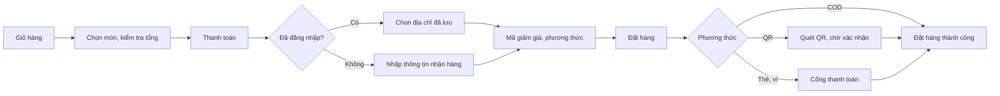

> **Mã:** DE03-TN03-PRD · **Trạng thái:** đã chốt · **Người viết:** Design · **SRS:** [SRS.md](SRS.md)

# PRD Giỏ hàng và thanh toán (Website mua quần áo)

## 1. Bối cảnh và vấn đề

### 1.1 Bối cảnh

Giỏ hàng và thanh toán biến ý định mua thành đơn hàng (xem [README](../../README.md)). Đây là chỗ shop mất khách nhiều nhất: khoảng 70% giỏ hàng bị bỏ dở. Phần lớn khách mua lần đầu, không muốn tạo tài khoản, và nhiều người vẫn quen trả tiền khi nhận hàng.

### 1.2 Vấn đề

| **Vấn đề** | **Hệ quả** |
| --- | --- |
| Bắt tạo tài khoản trước khi đặt | Khách bỏ đi ngay |
| Phí ship chỉ hiện ở bước cuối | Khách thấy bị "giấu phí", bỏ giỏ |
| Form địa chỉ dài, gõ sai tỉnh, phường | Giao chậm, giao thất bại |
| Đặt xong mới biết hết hàng | Shop phải gọi huỷ, khách mất niềm tin |
| Chuyển khoản xong không biết shop đã nhận chưa | Khách nhắn hỏi liên tục, shop xác nhận tay |
| Nhập mã giảm giá lỗi mà không biết vì sao | Khách bực, bỏ giỏ |

### 1.3 Mục tiêu

- Tỉ lệ từ mở trang Thanh toán tới đặt hàng thành công ≥ 55%.
- Thời gian hoàn tất thanh toán của khách vãng lai ≤ 2 phút (trung vị).
- ≥ 95% đơn chuyển khoản QR được xác nhận tự động, không cần nhân viên.

## 2. Người dùng

| **Nhóm** | **Nhu cầu với tính năng này** |
| --- | --- |
| Khách vãng lai mua lần đầu | Đặt không cần tài khoản, biết tổng tiền sớm, trả khi nhận hàng |
| Thành viên | Dùng lại địa chỉ đã lưu, đặt trong vài chạm |
| Khách săn mã giảm giá | Biết mã có dùng được không, vì sao không |
| Khách quen chuyển khoản | Quét QR, được xác nhận ngay |

## 3. Phạm vi

### 3.1 Trong phạm vi (MVP)

- Giỏ hàng: sửa số lượng, đổi size, xoá, chọn món để thanh toán, tạm tính, nhắc mức miễn phí giao.
- Thanh toán một trang: thông tin nhận hàng, phương thức giao, mã giảm giá, phương thức thanh toán, tổng tiền.
- Khách vãng lai đặt hàng không cần tài khoản; thành viên dùng sổ địa chỉ.
- Thanh toán: COD, chuyển khoản QR, thẻ hoặc ví điện tử qua cổng thanh toán.
- Trang đặt hàng thành công, trang chờ thanh toán QR.

### 3.2 Ngoài phạm vi

- Trả góp, mua trước trả sau.
- Điểm thưởng, hạng thành viên.
- Giao hàng hoả tốc trong 2 giờ, nhận tại cửa hàng → phase sau.
- Xuất hoá đơn VAT.
- Nhiều mã giảm giá cùng lúc.

## 4. Nguyên tắc sản phẩm

### 4.1 Không có phí bất ngờ

Phí giao ước tính hiện ngay ở giỏ hàng; tổng tiền luôn hiện ở mọi bước và cập nhật ngay khi khách đổi gì đó.

### 4.2 Không bắt đăng nhập

Khách vãng lai đặt được hàng. Đăng nhập chỉ là lối tắt cho người đã có tài khoản.

### 4.3 Hỏi ít, kiểm tra sớm

Một trang thanh toán, lỗi báo ngay tại ô sai, không đợi bấm Đặt hàng.

### 4.4 Đặt rồi là có hàng

Tồn kho được kiểm tra và giữ tại thời điểm đặt; đã báo đặt thành công thì shop phải có hàng.

## 5. Quy tắc nghiệp vụ

| **Quy tắc** | **Giá trị** |
| --- | --- |
| Giới hạn giỏ | Tối đa 10 cái mỗi SKU, 30 dòng sản phẩm |
| Phí giao | Nội thành Hà Nội, TP.HCM 25.000 ₫; tỉnh khác 35.000 ₫ |
| Miễn phí giao | Đơn có tạm tính sau giảm giá từ 499.000 ₫ |
| Mã giảm giá | 1 mã mỗi đơn; giảm %, giảm tiền, hoặc miễn phí giao |
| COD | Đơn có tổng tiền ≤ 5.000.000 ₫ |
| Giữ hàng chờ thanh toán online | 15 phút; quá hạn đơn tự huỷ |
| Giỏ của khách vãng lai | Lưu 30 ngày trên trình duyệt |

- Phí giao, ngưỡng miễn phí, ngưỡng COD là **cấu hình**, không cố định trong code.

## 6. Luồng trải nghiệm

| **Bước** | **Giai đoạn** | **Trải nghiệm** | **Đầu ra** |
| --- | --- | --- | --- |
| 1 | Giỏ hàng | Sửa số lượng, size; thấy tạm tính, phí giao ước tính, còn thiếu bao nhiêu để miễn phí giao | Danh sách món sẽ mua |
| 2 | Thông tin nhận hàng | Tên, điện thoại, địa chỉ; thành viên chọn từ sổ địa chỉ | Địa chỉ hợp lệ |
| 3 | Ưu đãi, thanh toán | Mã giảm giá, chọn COD, QR, thẻ, ví | Tổng tiền cuối |
| 4 | Đặt hàng | Bấm "Đặt hàng · {tổng}" | Đơn được tạo |
| 5 | Xác nhận | Mã đơn, thời gian giao dự kiến; QR thì chờ tiền về | Đơn chờ shop xác nhận |

## 7. Use Cases, User Stories và Acceptance Criteria

### UC1. Quản lý giỏ hàng

#### US1.1 Xem và sửa giỏ

User Story: Là khách, tôi muốn sửa số lượng, đổi size ngay trong giỏ để không phải quay lại trang sản phẩm.

AC01: Mỗi dòng: ảnh, tên, màu, size, đơn giá, số lượng, thành tiền, nút xoá.

AC02: Đổi size ngay trong dòng; size hết hàng bị gạch.

AC03: Xoá dòng có "Hoàn tác" trong 5 giây.

AC04: Món hết hàng hoặc đổi giá kể từ lúc thêm → đánh dấu rõ, món hết hàng không được chọn để thanh toán.

#### US1.2 Biết tổng tiền sớm

User Story: Là khách, tôi muốn thấy phí giao và mức miễn phí giao ngay trong giỏ để quyết định mua thêm hay không.

AC01: Hiện tạm tính, phí giao ước tính, tổng.

AC02: Chưa đủ ngưỡng → "Mua thêm {x} ₫ để được miễn phí giao" kèm thanh tiến độ.

AC03: Bỏ chọn món thì tổng cập nhật ngay.

### UC2. Thanh toán

#### US2.1 Đặt hàng không cần tài khoản

User Story: Là khách mua lần đầu, tôi muốn đặt hàng chỉ với tên, số điện thoại và địa chỉ.

AC01: Trang Thanh toán có lựa chọn "Đăng nhập" nhưng không bắt buộc.

AC02: Địa chỉ chọn Tỉnh/Thành phố → Phường/Xã, rồi nhập số nhà, tên đường.

AC03: Lỗi báo ngay khi rời ô (số điện thoại sai, thiếu địa chỉ).

AC04: Sau khi đặt, khách vãng lai được mời tạo tài khoản bằng số điện thoại vừa nhập (không bắt buộc).

#### US2.2 Dùng mã giảm giá

User Story: Là khách, tôi muốn biết mã giảm giá có dùng được không và vì sao không.

AC01: Áp mã thành công → hiện dòng giảm giá và tổng mới.

AC02: Mã không dùng được → nói rõ lý do (hết hạn, chưa đủ giá trị tối thiểu, đã hết lượt…).

AC03: Đổi giỏ khiến mã không còn hợp lệ → tự gỡ mã và báo.

#### US2.3 Chọn phương thức thanh toán

AC01: COD chỉ hiện khi tổng ≤ 5.000.000 ₫; nếu ẩn thì ghi lý do.

AC02: Chuyển khoản QR → sau khi đặt hiện QR có sẵn số tiền và nội dung; tiền về thì tự chuyển sang trang thành công.

AC03: Thẻ hoặc ví → chuyển sang cổng thanh toán; thất bại thì quay về, giữ đơn để thử lại trong thời gian giữ hàng.

#### US2.4 Đặt hàng an toàn

AC01: Bấm Đặt hàng nhiều lần chỉ tạo 1 đơn.

AC02: Hết hàng hoặc đổi giá lúc đặt → báo cụ thể món nào, không tạo đơn.

AC03: Đơn thanh toán online không trả tiền trong 15 phút → tự huỷ, gửi thông báo.

## 8. Chỉ số theo dõi

| **Chỉ số** | **Định nghĩa** | **Mục tiêu MVP** |
| --- | --- | --- |
| Tỉ lệ hoàn tất thanh toán | Đơn đặt thành công / phiên mở trang Thanh toán | ≥ 55% |
| Tỉ lệ bỏ giỏ | Giỏ có món không thành đơn trong 7 ngày / tổng giỏ có món | ≤ 65% |
| Thời gian thanh toán | Từ mở trang Thanh toán tới đặt hàng (khách vãng lai) | ≤ 2 phút (trung vị) |
| Tự động xác nhận QR | Đơn QR tự xác nhận / tổng đơn QR đã nhận tiền | ≥ 95% |
| Tỉ lệ lỗi mã giảm giá | Lượt áp mã lỗi / lượt áp mã | Theo dõi theo lý do |
| Giá trị đơn trung bình | Tổng tiền / số đơn | Theo dõi; kỳ vọng tăng nhờ nhắc miễn phí giao |

## 9. Phụ thuộc và rủi ro

| **Mục** | **Mô tả** | **Hướng xử lý** |
| --- | --- | --- |
| Cổng thanh toán thẻ, ví | Lỗi, chậm, kết quả về trễ | Đơn giữ `CHO_THANH_TOAN`, đối soát theo thông báo từ cổng |
| Nhận tiền chuyển khoản | Khách chuyển sai số tiền, sai nội dung | Tự khớp theo nội dung; không khớp → hàng đợi vận hành xử lý |
| Dữ liệu địa giới hành chính | Thay đổi sau sắp xếp đơn vị hành chính | Dùng danh mục 2 cấp Tỉnh, Phường/Xã cập nhật từ nguồn chính thức |
| Đơn ảo COD | Đặt bừa, không nhận hàng | Giới hạn COD theo giá trị; theo dõi số điện thoại hoàn hàng nhiều |

## 10. Câu hỏi mở

> Mọi câu hỏi dưới đây đã được PO chốt ngày 20/11/2026; quyết định ghi sau mỗi câu và đã cập nhật vào SRS.

- Có cho thanh toán một phần giỏ không? → **Đã chốt:** Có. Giỏ có ô chọn từng món, mặc định chọn tất cả món còn hàng (SRS BR-22).
- Thời điểm trừ tồn kho? → **Đã chốt:** Khi tạo đơn. COD trừ ngay; online giữ 15 phút rồi nhả nếu không thanh toán (SRS BR-27).
- Khách vãng lai tra cứu đơn bằng gì? → **Đã chốt:** Mã đơn + số điện thoại, xem SRS TN04.
- Có hỏi email bắt buộc không? → **Đã chốt:** Không. Email tuỳ chọn để nhận xác nhận đơn; tin nhắn SMS xác nhận gửi theo số điện thoại (SRS BR-28).
