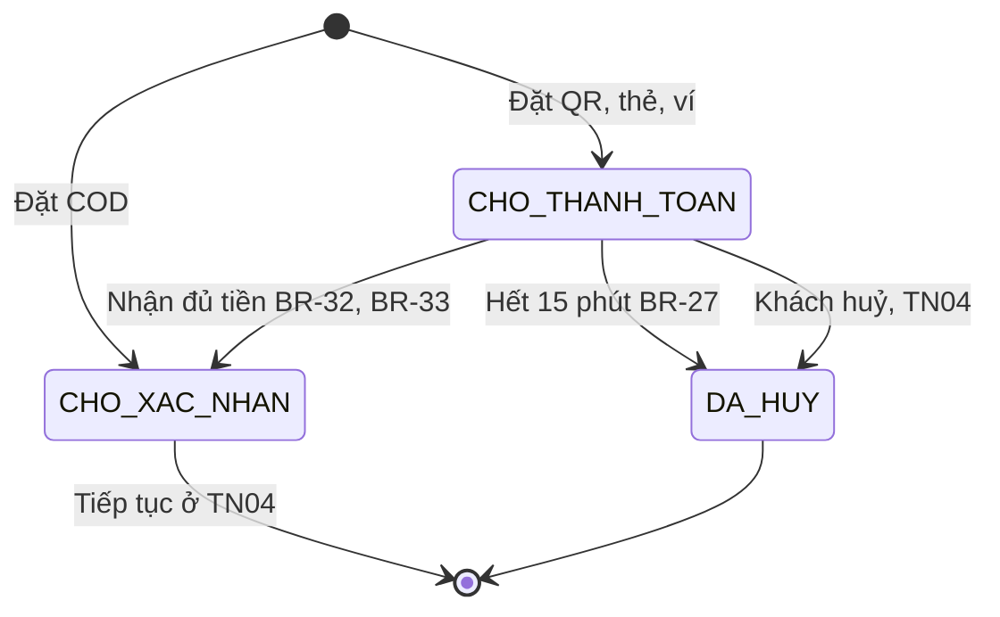
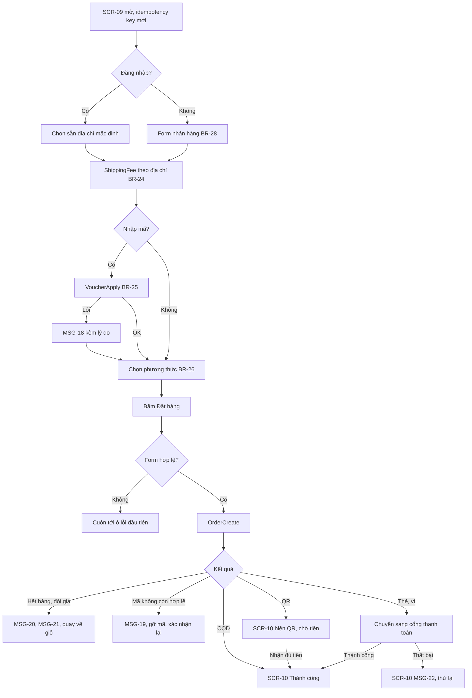

> **Mã:** DE03-TN03-SRS · **Trạng thái:** đã chốt · **Người viết:** Design · **PRD:** [PRD.md](PRD.md)

# UC-DE03-03 - Giỏ hàng và thanh toán

> SRS này mô tả từ giỏ hàng tới khi đơn được tạo ở `CHO_XAC_NHAN` (hoặc `CHO_THANH_TOAN` với thanh toán online); theo dõi đơn, huỷ và đổi trả xem [SRS TN04](../TN04-don-hang-doi-tra/SRS.md).

## 1. Tổng quan

| **Mục** | **Nội dung** |
| --- | --- |
| Mục tiêu | Khách xem lại giỏ, nhập thông tin nhận hàng, áp mã, chọn phương thức thanh toán và đặt hàng |
| Actor | Khách · Website · Máy chủ · Cổng thanh toán · Ngân hàng nhận tiền |
| Phạm vi | Giỏ hàng, giỏ thu gọn, trang thanh toán, sổ địa chỉ, phí giao, mã giảm giá, COD, QR, thẻ/ví, tạo đơn, trang kết quả |
| Ngoài phạm vi | Trả góp, điểm thưởng, giao hoả tốc, nhận tại cửa hàng, hoá đơn VAT |
| Nền tảng | Website desktop và mobile |

## 2. User Story

| **ID** | **As a** | **I want** | **So that** |
| --- | --- | --- | --- |
| US-11 | Khách | Sửa số lượng, size, xoá món ngay trong giỏ | Không phải quay lại trang sản phẩm |
| US-12 | Khách | Thấy phí giao và tổng tiền từ sớm | Không bị bất ngờ |
| US-13 | Khách vãng lai | Đặt hàng không cần tài khoản | Mua nhanh |
| US-14 | Thành viên | Chọn địa chỉ đã lưu | Đặt trong vài chạm |
| US-15 | Khách | Biết vì sao mã giảm giá không dùng được | Không bực mình |
| US-16 | Khách | Chuyển khoản QR và được xác nhận tự động | Không phải nhắn hỏi shop |

## 3. Business Rules

| **Mã** | **Quy tắc** |
| --- | --- |
| BR-21 | **Giới hạn giỏ**: mỗi SKU 1–min(10, tồn kho); tối đa 30 dòng. Giỏ khách vãng lai gắn `cart_id` trên trình duyệt, hết hạn 30 ngày không hoạt động. Đăng nhập → gộp giỏ trình duyệt vào giỏ tài khoản, cùng SKU thì cộng số lượng (không vượt giới hạn) |
| BR-22 | **Chọn món thanh toán**: mỗi dòng có ô chọn, mặc định chọn mọi dòng còn hàng. Dòng hết hàng không chọn được. Tạm tính, phí giao, tổng chỉ tính trên dòng được chọn. Dòng không chọn vẫn ở lại giỏ sau khi đặt |
| BR-23 | **Kiểm tra lại giỏ** mỗi khi mở **SCR-08**, **SCR-09** và lúc đặt: giá thay đổi kể từ lúc thêm → nhãn "Giá đã thay đổi" và giá mới; tồn kho thấp hơn số lượng → giảm về tồn kho, MSG-15; hết hàng → bỏ chọn, nhãn "Hết hàng" |
| BR-24 | **Phí giao**: nội thành Hà Nội, TP.HCM 25.000 ₫, giao 1–2 ngày; tỉnh khác 35.000 ₫, giao 3–5 ngày. Miễn phí khi tạm tính sau giảm giá ≥ 499.000 ₫. Ở **SCR-08** chưa có địa chỉ thì hiện phí theo địa chỉ mặc định (thành viên) hoặc "Từ 25.000 ₫" |
| BR-25 | **Mã giảm giá**: 1 mã mỗi đơn, không phân biệt hoa thường. Loại: giảm % có trần, giảm số tiền, miễn phí giao. Điều kiện: thời hạn, giá trị đơn tối thiểu, tổng lượt dùng, lượt mỗi khách (theo số điện thoại), danh mục áp dụng, có áp cho hàng đang giảm giá hay không. Giảm giá không vượt tạm tính. Giỏ thay đổi → kiểm tra lại, không còn hợp lệ thì gỡ mã, MSG-19 |
| BR-26 | **Phương thức thanh toán**: COD (tổng ≤ 5.000.000 ₫), Chuyển khoản QR, Thẻ / ví qua cổng thanh toán. Thành viên nhớ phương thức dùng lần trước |
| BR-27 | **Tạo đơn và giữ hàng**: tạo đơn trừ tồn kho ngay. COD → `CHO_XAC_NHAN`. QR, thẻ/ví → `CHO_THANH_TOAN`, giữ hàng 15 phút; hết hạn chưa nhận tiền → `DA_HUY` lý do "Quá hạn thanh toán", trả tồn kho, gửi SMS |
| BR-28 | **Thông tin nhận hàng**: họ tên 2–50 ký tự; số điện thoại di động Việt Nam 10 số bắt đầu bằng 0; địa chỉ 2 cấp Tỉnh/Thành phố → Phường/Xã + số nhà, tên đường 5–200 ký tự; email tuỳ chọn; ghi chú cho shop tối đa 200 ký tự. Xác nhận đơn gửi SMS tới số điện thoại và email nếu có |
| BR-29 | **Sổ địa chỉ** của thành viên tối đa 5 địa chỉ, 1 mặc định; địa chỉ nhập mới có ô "Lưu vào sổ địa chỉ" (bật sẵn) |
| BR-30 | **Tổng tiền** = tạm tính − giảm giá + phí giao (sau miễn phí, giảm phí). Đơn vị VND, không số lẻ. Nút đặt hàng ghi "Đặt hàng · {tổng} ₫" |
| BR-31 | **Đặt hàng** gửi kèm idempotency key cho mỗi lần mở **SCR-09**; bấm nhiều lần hoặc mạng gửi lại chỉ tạo 1 đơn. Mã đơn dạng `DH` + 8 chữ số |
| BR-32 | **Chuyển khoản QR**: QR chuẩn VietQR có sẵn số tài khoản shop, số tiền = tổng, nội dung = mã đơn. Ngân hàng báo có khớp nội dung và đủ số tiền → đơn `CHO_XAC_NHAN` tự động. Thiếu tiền, thừa tiền hoặc sai nội dung → giữ `CHO_THANH_TOAN`, đưa vào hàng đợi vận hành; hết 15 phút không huỷ đơn có giao dịch đang chờ xử lý |
| BR-33 | **Thẻ / ví**: chuyển hướng sang cổng thanh toán với số tiền và mã đơn; kết quả lấy theo thông báo máy chủ–máy chủ từ cổng, không tin kết quả trên URL trả về. Thất bại → về **SCR-10** trạng thái chờ, cho thử lại hoặc đổi sang QR trong thời gian giữ hàng |
| BR-34 | **Đổi phương thức sau khi đặt**: chỉ khi đơn còn `CHO_THANH_TOAN`, giữa QR và thẻ/ví; không đổi sang COD. Thời gian giữ hàng không được gia hạn |

## 4. Trạng thái

### 4.1 Trạng thái đơn trong phạm vi tính năng



### 4.2 Trạng thái thanh toán của đơn online

| **Trạng thái** | **Điều kiện** | **Hiển thị trên SCR-10** |
| --- | --- | --- |
| `CHUA_THANH_TOAN` | Vừa tạo đơn | QR hoặc nút "Thanh toán lại"; đếm ngược thời gian giữ hàng |
| `DA_THANH_TOAN` | Nhận đủ tiền | Chuyển sang "Đặt hàng thành công" |
| `CAN_XU_LY` | Sai số tiền, sai nội dung | MSG-24, số hotline; không đếm ngược nữa |
| `HET_HAN` | Quá 15 phút | MSG-23, nút "Đặt lại giỏ này" |

## 5. Use Case

### UC-06 Xem và sửa giỏ hàng

| **Mục** | **Nội dung** |
| --- | --- |
| Tiền điều kiện | Giỏ có ít nhất 1 món |
| Hậu điều kiện thành công | Giỏ phản ánh thay đổi; tổng đúng theo dòng được chọn |
| Hậu điều kiện thất bại | Giỏ giữ nguyên với thông báo lỗi |

**Luồng chính**

| **Bước** | **Actor** | **Mô tả** |
| --- | --- | --- |
| 1 | Khách | Mở **SCR-08** từ icon giỏ hoặc giỏ thu gọn |
| 2 | Website | Gọi \[CartGet\]; kiểm tra lại theo BR-23; hiện dòng, tạm tính, phí giao ước tính (BR-24), nhắc miễn phí giao |
| 3 | Khách | Tăng, giảm số lượng; đổi size; bỏ chọn một món |
| 4 | Website | Gọi \[CartUpdate\]; cập nhật tổng ngay |
| 5 | Khách | Bấm "Thanh toán ({n} món)" → **SCR-09** |

**Luồng thay thế**

| **Mã** | **Điều kiện** | **Xử lý** |
| --- | --- | --- |
| A1 | Xoá dòng | Dòng ẩn, snackbar MSG-14 có "Hoàn tác" 5 giây |
| A2 | Đổi size sang size hết hàng | Không cho chọn (gạch) |
| A3 | Đổi size trùng SKU đã có trong giỏ | Gộp 2 dòng, cộng số lượng theo BR-21 |
| A4 | Giỏ rỗng | Empty state + Hàng mới về |
| A5 | Không dòng nào được chọn | Nút Thanh toán disabled, gợi ý "Chọn ít nhất 1 món" |

**Luồng lỗi**

| **Mã** | **Điều kiện** | **Xử lý** |
| --- | --- | --- |
| E1 | Số lượng vượt tồn kho | Giảm về tồn kho, MSG-15 |
| E2 | Lỗi mạng | MSG-26, trả giá trị cũ |

### UC-07 Thanh toán và đặt hàng

| **Mục** | **Nội dung** |
| --- | --- |
| Tiền điều kiện | Có ít nhất 1 dòng được chọn, còn hàng |
| Hậu điều kiện thành công | Đơn được tạo, tồn kho bị trừ, các dòng đã đặt rời khỏi giỏ; mở **SCR-10** |
| Hậu điều kiện thất bại | Không tạo đơn; ở lại **SCR-09** với lỗi cụ thể |



**Luồng chính**

| **Bước** | **Actor** | **Mô tả** |
| --- | --- | --- |
| 1 | Website | Mở **SCR-09** với các dòng được chọn; sinh idempotency key |
| 2 | Khách | Nhập họ tên, số điện thoại, chọn Tỉnh/Thành phố, Phường/Xã, nhập địa chỉ |
| 3 | Website | Kiểm tra từng ô khi rời ô; gọi \[ShippingFee\] khi có Tỉnh; cập nhật tóm tắt đơn |
| 4 | Khách | Nhập mã giảm giá (tuỳ chọn), bấm Áp dụng |
| 5 | Website | Gọi \[VoucherApply\]; hiện dòng giảm giá và tổng mới |
| 6 | Khách | Chọn COD; bấm "Đặt hàng · {tổng} ₫" |
| 7 | Website | Gọi \[OrderCreate\]; nút loading |
| 8 | Máy chủ | Kiểm tra lại giá, tồn kho, mã (BR-23, BR-25); trừ tồn kho; tạo đơn `CHO_XAC_NHAN`; gửi SMS, email |
| 9 | Website | Mở **SCR-10** "Đặt hàng thành công" với mã đơn, thời gian giao dự kiến |

**Luồng thay thế**

| **Mã** | **Điều kiện** | **Xử lý** |
| --- | --- | --- |
| A1 | Thành viên có sổ địa chỉ | Chọn từ danh sách; "Thêm địa chỉ mới" mở form (BR-29) |
| A2 | Đăng nhập ngay trên **SCR-09** | Popup đăng nhập bằng số điện thoại + OTP; xong thì điền sẵn địa chỉ, gộp giỏ (BR-21) |
| A3 | Chọn Chuyển khoản QR | Sau bước 8, đơn `CHO_THANH_TOAN`; **SCR-10** hiện QR, số tiền, nội dung, đếm ngược 15 phút; gọi \[PaymentStatus\] mỗi 5 giây |
| A4 | Chọn Thẻ / ví | Sau bước 8, chuyển sang cổng thanh toán (BR-33) |
| A5 | Tổng > 5.000.000 ₫ | Ẩn COD, ghi chú MSG-17 |
| A6 | Khách vãng lai đặt xong | **SCR-10** có khối "Tạo tài khoản để theo dõi đơn dễ hơn" (tuỳ chọn) |
| A7 | Thanh toán thất bại ở cổng | **SCR-10** trạng thái chờ, MSG-22, nút "Thanh toán lại" và "Đổi sang QR" (BR-34) |

**Luồng lỗi**

| **Mã** | **Điều kiện** | **Xử lý** |
| --- | --- | --- |
| E1 | Thiếu hoặc sai thông tin nhận hàng | Lỗi inline (MSG-16), cuộn tới ô lỗi đầu tiên |
| E2 | Món hết hàng lúc đặt | MSG-20 nêu tên món; không tạo đơn; về **SCR-08** |
| E3 | Giá đổi lúc đặt | MSG-21; cập nhật giá trên **SCR-09**, khách bấm đặt lại |
| E4 | Mã giảm giá hết lượt lúc đặt | MSG-19; gỡ mã, cập nhật tổng, khách bấm đặt lại |
| E5 | Lỗi mạng khi đặt | Gửi lại cùng idempotency key; vẫn lỗi → MSG-26 |
| E6 | Hết 15 phút chưa thanh toán | MSG-23 (BR-27) |
| E7 | Chuyển khoản sai số tiền hoặc nội dung | MSG-24 (BR-32) |

## 6. Điểm vào

| **Điểm vào** | **Dẫn tới** | **Ghi chú** |
| --- | --- | --- |
| Icon giỏ ở header | **SCR-08** | Số món trên icon = tổng số lượng |
| "Xem giỏ hàng" ở giỏ thu gọn (TN02) | **SCR-08** | |
| "Thanh toán" ở giỏ thu gọn | **SCR-09** | |
| "Mua ngay" ở **SCR-05** (TN02) | **SCR-09** | BR-17 |
| Link trong SMS đơn chờ thanh toán | **SCR-10** của đơn đó | Còn trong thời gian giữ hàng |
| "Mua lại" ở đơn cũ (TN04) | **SCR-08** với các món của đơn đó | |

## 7. Mô tả màn hình

### SCR-08 Giỏ hàng

| **#** | **Thành phần** | **Loại** | **Hành vi** |
| --- | --- | --- | --- |
| 1 | Chọn tất cả | Checkbox | Chọn, bỏ chọn mọi dòng còn hàng |
| 2 | Dòng sản phẩm | List item | Ô chọn, ảnh, tên, "Màu · Size" (chạm để đổi size), đơn giá, stepper số lượng, thành tiền, nút xoá; nhãn "Giá đã thay đổi", "Hết hàng" (BR-23) |
| 3 | Nhắc miễn phí giao | Progress bar | "Mua thêm {x} ₫ để được miễn phí giao"; đủ thì "Bạn được miễn phí giao" |
| 4 | Tóm tắt | Card | Tạm tính, phí giao ước tính, tổng; desktop cột phải, mobile dính đáy |
| 5 | "Thanh toán ({n} món)" | Button | Disabled theo A5 |
| 6 | Trạng thái rỗng | Empty state | "Giỏ hàng đang trống" + Hàng mới về |

### SCR-09 Thanh toán

| **#** | **Thành phần** | **Loại** | **Bắt buộc** | **Validate / hành vi** |
| --- | --- | --- | --- | --- |
| 1 | Đăng nhập | Link | – | "Đã có tài khoản? Đăng nhập" (A2) |
| 2 | Họ tên | Text | Có | 2–50 ký tự |
| 3 | Số điện thoại | Tel | Có | 10 số, bắt đầu bằng 0 |
| 4 | Email | Email | Không | Đúng định dạng nếu nhập |
| 5 | Tỉnh/Thành phố | Select có tìm | Có | Danh mục hành chính 2 cấp |
| 6 | Phường/Xã | Select có tìm | Có | Lọc theo tỉnh đã chọn |
| 7 | Số nhà, tên đường | Text | Có | 5–200 ký tự |
| 8 | Sổ địa chỉ | Radio list | – | Thành viên; thay cho 2–7 |
| 9 | Phương thức giao | Read-only | – | "Giao tiêu chuẩn · {1–2 ngày} · {phí}" |
| 10 | Mã giảm giá | Text + Button | Không | Áp dụng → BR-25; có mã thì hiện chip mã + "Gỡ" |
| 11 | Phương thức thanh toán | Radio list | Có | COD, Chuyển khoản QR, Thẻ / ví (BR-26); COD ẩn theo A5 |
| 12 | Ghi chú cho shop | Textarea | Không | ≤ 200 ký tự |
| 13 | Tóm tắt đơn | Card | – | Ảnh nhỏ từng món, tạm tính, giảm giá, phí giao, tổng |
| 14 | "Đặt hàng · {tổng} ₫" | Button | – | Loading khi gửi; mobile dính đáy |
| 15 | Điều khoản | Text phụ | – | "Bằng việc đặt hàng, bạn đồng ý với Chính sách đổi trả" |

### SCR-10 Kết quả đặt hàng

| **#** | **Thành phần** | **Loại** | **Hành vi** |
| --- | --- | --- | --- |
| 1 | Biểu tượng + tiêu đề | Header | "Đặt hàng thành công" hoặc "Chờ thanh toán" theo mục 4.2 |
| 2 | Mã đơn | Text + Copy | `DH…` |
| 3 | QR chuyển khoản | Image | Chỉ đơn QR chưa thanh toán; kèm ngân hàng, số tài khoản, chủ tài khoản, số tiền, nội dung (mỗi dòng có nút sao chép); nút "Tải ảnh QR" |
| 4 | Đếm ngược | Timer | "Giữ hàng trong {mm:ss}" (BR-27) |
| 5 | Thanh toán lại / Đổi sang QR | Button | Đơn thẻ/ví thất bại (A7) |
| 6 | Thông tin giao | Card | Người nhận, địa chỉ, dự kiến giao |
| 7 | Tạo tài khoản | Card | Khách vãng lai (A6) |
| 8 | "Xem đơn hàng", "Tiếp tục mua sắm" | Button | Mở **SCR-12** (TN04) hoặc trang chủ |

## 8. API

| **API** | **Request chính** | **Response chính** | **Timeout / retry** |
| --- | --- | --- | --- |
| \[CartGet\] | cart_id | Dòng, giá hiện tại, tồn kho, cờ đổi giá, hết hàng | 5s / 1 lần |
| \[CartUpdate\] | cart_id, line_id, sku, quantity, selected | Giỏ mới | 5s / 1 lần |
| \[AdminUnits\] | province_id (tuỳ chọn) | Danh sách tỉnh hoặc phường/xã | 3s / 1 lần; cache 1 ngày |
| \[ShippingFee\] | province_id, subtotal | fee, eta_days | 3s / 1 lần |
| \[VoucherApply\] | code, lines, phone, shipping_fee | discount, free_shipping hoặc mã lỗi | 3s / không retry |
| \[OrderCreate\] | lines, receiver, address, voucher, payment_method, note, idempotency_key | order_id, status, total, payment (QR hoặc redirect_url), hold_expires_at | 10s / gửi lại cùng key |
| \[PaymentStatus\] | order_id | payment_status mục 4.2 | 3s / gọi mỗi 5 giây khi mở **SCR-10** |
| \[PaymentRetry\] | order_id, method | redirect_url hoặc QR mới | 5s / 1 lần |
| \[BankWebhook\] | Ngân hàng → máy chủ: số tiền, nội dung, mã giao dịch | – | Khớp theo BR-32 |

```mermaid
sequenceDiagram
  actor K as Khách
  participant W as Website
  participant API as Máy chủ
  participant B as Ngân hàng nhận tiền
  K->>W: Đặt hàng, Chuyển khoản QR
  W->>API: OrderCreate idempotency_key
  API->>API: Kiểm tra giá, tồn kho, mã; trừ tồn kho
  API-->>W: order_id, CHO_THANH_TOAN, QR, hold 15 phút
  W->>K: SCR-10 QR, đếm ngược
  K->>B: Quét QR, chuyển tiền
  B->>API: BankWebhook số tiền, nội dung DH...
  API->>API: Khớp đơn, đủ tiền → CHO_XAC_NHAN
  loop Mỗi 5 giây
    W->>API: PaymentStatus
  end
  API-->>W: DA_THANH_TOAN
  W->>K: Đặt hàng thành công
```

**Map lỗi → thông báo**

| **Nhóm lỗi** | **Message** |
| --- | --- |
| Xoá dòng | MSG-14 |
| Số lượng vượt tồn kho | MSG-15 |
| Thông tin nhận hàng không hợp lệ | MSG-16 |
| COD không khả dụng | MSG-17 |
| Mã giảm giá không dùng được | MSG-18 |
| Mã bị gỡ do giỏ đổi hoặc hết lượt | MSG-19 |
| Hết hàng lúc đặt | MSG-20 |
| Giá đổi lúc đặt | MSG-21 |
| Thanh toán thẻ, ví thất bại | MSG-22 |
| Quá hạn thanh toán | MSG-23 |
| Chuyển khoản cần xử lý | MSG-24 |
| Thanh toán thành công | MSG-25 |
| Mất mạng, quá thời gian, lỗi máy chủ | MSG-26 |

## 9. Danh sách thông báo

| **ID** | **Nơi hiện** | **Nội dung (VI)** |
| --- | --- | --- |
| MSG-14 | Snackbar | Đã xoá {tên sản phẩm} khỏi giỏ. \[Hoàn tác\] |
| MSG-15 | Inline dòng | Chỉ còn {n} sản phẩm, số lượng đã được điều chỉnh |
| MSG-16 | Inline | Lỗi theo từng ô, ví dụ: Số điện thoại cần 10 chữ số, bắt đầu bằng 0 |
| MSG-17 | Inline phương thức | Thanh toán khi nhận hàng áp dụng cho đơn đến 5.000.000 ₫ |
| MSG-18 | Inline mã | Theo lý do: Mã đã hết hạn · Đơn cần tối thiểu {x} ₫ để dùng mã này · Mã đã hết lượt sử dụng · Mã không áp dụng cho sản phẩm đang giảm giá · Mã không tồn tại |
| MSG-19 | Toast | Mã {mã} không còn áp dụng cho đơn này và đã được gỡ |
| MSG-20 | Popup | {tên sản phẩm} size {size} vừa hết hàng. Vui lòng kiểm tra lại giỏ. \[Về giỏ hàng\] |
| MSG-21 | Popup | Giá một số sản phẩm vừa thay đổi. Tổng mới: {tổng} ₫. \[Đặt với giá mới\] \[Xem lại\] |
| MSG-22 | Banner **SCR-10** | Thanh toán chưa thành công. Đơn được giữ tới {giờ}. \[Thanh toán lại\] \[Đổi sang QR\] |
| MSG-23 | Banner **SCR-10** | Đơn {mã đơn} đã huỷ do quá thời gian thanh toán. \[Đặt lại giỏ này\] |
| MSG-24 | Banner **SCR-10** | Chúng tôi đã nhận được chuyển khoản nhưng số tiền hoặc nội dung chưa khớp. Nhân viên sẽ liên hệ bạn trong 2 giờ làm việc. Hotline {số} |
| MSG-25 | Toast | Đã nhận thanh toán cho đơn {mã đơn} |
| MSG-26 | Toast | Kết nối không ổn định, vui lòng thử lại |

## 10. Yêu cầu phi chức năng

| **Mục** | **Yêu cầu** |
| --- | --- |
| Hiệu năng | \[OrderCreate\] ≤ 2 giây (p95); xác nhận QR hiện trên **SCR-10** ≤ 10 giây sau khi ngân hàng báo có |
| Bảo mật | Website không nhận, không lưu số thẻ (cổng thanh toán xử lý); mọi trang thanh toán qua HTTPS; kết quả thanh toán chỉ tin thông báo máy chủ–máy chủ có chữ ký |
| Tính đúng | Không bao giờ bán vượt tồn kho: trừ tồn kho trong giao dịch tạo đơn; giữ hàng hết hạn phải trả tồn kho trong ≤ 1 phút |
| Riêng tư | Số điện thoại, địa chỉ chỉ dùng cho giao hàng và chăm sóc đơn; khách vãng lai không bị tự tạo tài khoản |
| Log / audit | Mỗi đơn: giá từng dòng tại thời điểm đặt, mã giảm giá, phí giao, idempotency key, mọi sự kiện thanh toán |
| Tracking | Mở giỏ, sửa giỏ, mở thanh toán, đăng nhập tại thanh toán, áp mã (kết quả, lý do), chọn phương thức, đặt hàng (kết quả), thanh toán (kết quả), hết hạn |
| Accessibility | Form có nhãn rõ, lỗi liên kết với ô và đọc được bằng trình đọc màn hình; QR có thông tin chuyển khoản dạng chữ để sao chép; đếm ngược không là cách duy nhất báo hết hạn |
