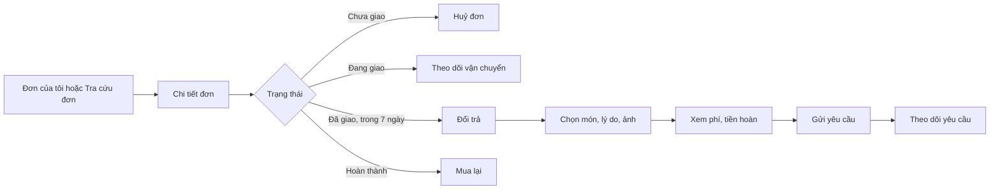

> **Mã:** DE03-TN04-PRD · **Trạng thái:** đã chốt · **Người viết:** Design · **SRS:** [SRS.md](SRS.md)

# PRD Đơn hàng, huỷ và đổi trả (Website mua quần áo)

## 1. Bối cảnh và vấn đề

### 1.1 Bối cảnh

Sau khi đặt hàng, khách cần biết đơn đang ở đâu, và khi không vừa ý thì đổi size hoặc trả hàng (xem [README](../../README.md)). Với quần áo, đổi trả là chuyện bình thường; một chính sách đổi trả dễ hiểu và một quy trình gọn khiến khách dám mua lần đầu và quay lại lần sau.

### 1.2 Vấn đề

| **Vấn đề** | **Hệ quả** |
| --- | --- |
| Khách không biết đơn đang ở bước nào | Gọi, nhắn hỏi shop; tổng đài quá tải |
| Muốn huỷ đơn vừa đặt nhầm nhưng không có nút huỷ | Phải nhắn shop, đôi khi hàng đã gửi đi |
| Đổi size phải nhắn tin, gửi ảnh, chờ phản hồi | Mất 2–3 ngày, khách bực |
| Không rõ đổi trả mất phí không, bao lâu nhận tiền | Khách ngại mua |
| Khách vãng lai không có tài khoản để xem đơn | Không tự tra cứu được |

### 1.3 Mục tiêu

- Giảm 40% cuộc gọi, tin nhắn hỏi "đơn của tôi đâu".
- ≥ 80% yêu cầu đổi trả được khách tự tạo trên web, không qua tổng đài.
- Thời gian từ khi kho nhận hàng trả tới khi hoàn tiền ≤ 3 ngày làm việc.

## 2. Người dùng

| **Nhóm** | **Nhu cầu với tính năng này** |
| --- | --- |
| Thành viên | Xem mọi đơn, mua lại nhanh |
| Khách vãng lai | Tra cứu đơn bằng mã đơn và số điện thoại |
| Khách chọn sai size | Đổi size nhanh, không mất phí |
| Khách nhận hàng lỗi, giao sai | Báo lỗi có ảnh, được hoàn tiền hoặc đổi mới, shop chịu phí |

## 3. Phạm vi

### 3.1 Trong phạm vi (MVP)

- Đơn của tôi (thành viên), tra cứu đơn (khách vãng lai).
- Chi tiết đơn: trạng thái, mốc thời gian, mã vận đơn, món, số tiền.
- Huỷ đơn trước khi giao cho đơn vị vận chuyển.
- Yêu cầu đổi size, màu hoặc trả hàng hoàn tiền trong 7 ngày kể từ khi nhận.
- Theo dõi yêu cầu đổi trả, hoàn tiền.
- Mua lại đơn cũ.

### 3.2 Ngoài phạm vi

- Trang quản trị cho nhân viên xử lý đơn và duyệt đổi trả (đề chỉ mô tả kết quả khách thấy).
- Đánh giá sản phẩm sau khi nhận → phase sau.
- Đổi sang mẫu khác giá, bù trừ chênh lệch.
- Chat với nhân viên trong trang đơn.

## 4. Nguyên tắc sản phẩm

### 4.1 Trạng thái nói bằng ngôn ngữ của khách

"Đang giao, dự kiến thứ Năm 21/11" thay cho mã trạng thái kỹ thuật. Mỗi trạng thái nói rõ khách cần làm gì (nếu có).

### 4.2 Khách tự làm được thì không bắt gọi

Huỷ, đổi size, trả hàng đều tự làm trên web. Chỉ cần tổng đài khi ngoại lệ.

### 4.3 Chính sách đọc một lần là hiểu

Trước khi gửi yêu cầu, khách thấy rõ: có mất phí không, nhận lại tiền bao nhiêu, bao lâu.

### 4.4 Công bằng khi lỗi do shop

Hàng lỗi, giao sai → shop chịu mọi phí, không hỏi vặn.

## 5. Quy tắc nghiệp vụ

| **Quy tắc** | **Giá trị** |
| --- | --- |
| Tự huỷ | Khi đơn chưa được shop xác nhận; đã xác nhận nhưng chưa giao vận chuyển thì gửi yêu cầu huỷ |
| Thời hạn đổi trả | 7 ngày kể từ khi giao thành công |
| Không đổi trả | Đồ lót, đồ bơi, khuyên tai; hàng giảm từ 50% chỉ được đổi size, không trả |
| Điều kiện hàng | Còn tem mác, chưa giặt, chưa sử dụng |
| Phí đổi size | Miễn phí lần đầu mỗi đơn |
| Phí trả hàng do đổi ý | 30.000 ₫, trừ vào tiền hoàn |
| Hàng lỗi, giao sai | Shop chịu phí hai chiều |
| Hoàn tiền | ≤ 3 ngày làm việc sau khi kho nhận hàng trả |

## 6. Luồng trải nghiệm

| **Bước** | **Giai đoạn** | **Trải nghiệm** | **Đầu ra** |
| --- | --- | --- | --- |
| 1 | Tìm đơn | Thành viên vào Đơn của tôi; khách vãng lai nhập mã đơn + số điện thoại | Chi tiết đơn |
| 2 | Theo dõi | Thanh tiến trình, mốc thời gian, dự kiến giao | Khách yên tâm |
| 3 | Huỷ (nếu cần) | Chọn lý do, xác nhận; thấy tiền hoàn về đâu | Đơn huỷ hoặc yêu cầu huỷ |
| 4 | Đổi trả | Chọn món, đổi size hay trả, lý do, ảnh; xem phí và tiền hoàn | Yêu cầu đổi trả |
| 5 | Kết thúc | Nhận hàng đổi hoặc tiền hoàn | Yêu cầu hoàn tất |

## 7. Use Cases, User Stories và Acceptance Criteria

### UC1. Xem và theo dõi đơn

#### US1.1 Danh sách đơn

User Story: Là thành viên, tôi muốn xem mọi đơn theo trạng thái để biết đơn nào đang giao.

AC01: Tab: Tất cả, Đang xử lý, Đang giao, Đã giao, Đã huỷ, Đổi trả.

AC02: Mỗi đơn: mã đơn, ngày đặt, ảnh món đầu + "và {n} món khác", tổng tiền, trạng thái bằng chữ.

#### US1.2 Tra cứu đơn khi không có tài khoản

User Story: Là khách vãng lai, tôi muốn xem đơn bằng mã đơn và số điện thoại.

AC01: Nhập đúng mã đơn và số điện thoại → mở chi tiết đơn.

AC02: Nhập sai nhiều lần → tạm khoá tra cứu và báo thời gian thử lại.

#### US1.3 Chi tiết đơn

AC01: Thanh tiến trình: Đã đặt → Đã xác nhận → Đang giao → Đã giao.

AC02: Mốc thời gian từng trạng thái, mã vận đơn, link tra cứu của đơn vị vận chuyển.

AC03: Món, giá, giảm giá, phí giao, tổng, phương thức thanh toán, địa chỉ.

AC04: Nút theo trạng thái: Huỷ đơn, Thanh toán lại, Đổi trả, Mua lại.

### UC2. Huỷ đơn

#### US2.1 Huỷ đơn chưa giao

User Story: Là khách, tôi muốn tự huỷ đơn vừa đặt nhầm.

AC01: Đơn chưa được xác nhận → huỷ ngay sau khi chọn lý do.

AC02: Đơn đã xác nhận, chưa giao vận chuyển → gửi yêu cầu huỷ, shop phản hồi trong 2 giờ làm việc.

AC03: Đơn đã thanh toán → hiện số tiền hoàn và nơi nhận tiền trước khi xác nhận.

AC04: Đơn đang giao trở đi → không có nút huỷ; hướng dẫn từ chối nhận hàng.

### UC3. Đổi trả

#### US3.1 Đổi size

User Story: Là khách mặc không vừa, tôi muốn đổi size khác của cùng mẫu mà không mất phí.

AC01: Chỉ hiện khi đơn đã giao ≤ 7 ngày và món được phép đổi.

AC02: Chọn size mới; size mới hết hàng thì gợi ý trả hàng hoàn tiền.

AC03: Lần đổi size đầu tiên của đơn miễn phí.

#### US3.2 Trả hàng hoàn tiền

User Story: Là khách, tôi muốn trả món không ưng và biết chính xác nhận lại bao nhiêu tiền.

AC01: Chọn món, số lượng, lý do; lý do lỗi hoặc giao sai bắt buộc có ảnh.

AC02: Trước khi gửi hiện: phí (nếu có), tiền hoàn dự kiến, phương thức nhận tiền.

AC03: Đơn COD → khách nhập tài khoản ngân hàng nhận tiền hoàn.

#### US3.3 Theo dõi yêu cầu

AC01: Trạng thái yêu cầu: Chờ duyệt, Chờ lấy hàng, Đang kiểm tra, Hoàn tất, Từ chối (có lý do).

AC02: Mỗi lần đổi trạng thái gửi SMS (và email nếu có).

## 8. Chỉ số theo dõi

| **Chỉ số** | **Định nghĩa** | **Mục tiêu MVP** |
| --- | --- | --- |
| Liên hệ hỏi đơn | Cuộc gọi, tin nhắn hỏi trạng thái đơn / số đơn | Giảm 40% so với trước |
| Tỉ lệ tự tạo đổi trả | Yêu cầu tạo trên web / tổng yêu cầu | ≥ 80% |
| Thời gian hoàn tiền | Kho nhận hàng trả → tiền về khách | ≤ 3 ngày làm việc |
| Tỉ lệ từ chối đổi trả | Yêu cầu bị từ chối / tổng yêu cầu | ≤ 10% |
| Tỉ lệ đổi trả theo lý do | Phân bổ theo lý do | Theo dõi; báo cho TN02 về sai size |
| Mua lại | Đơn tạo từ nút Mua lại / tổng đơn | Theo dõi |

## 9. Phụ thuộc và rủi ro

| **Mục** | **Mô tả** | **Hướng xử lý** |
| --- | --- | --- |
| Đơn vị vận chuyển | Trạng thái cập nhật chậm, sai | Đồng bộ qua webhook; hiện "Cập nhật lúc {giờ}" |
| Lạm dụng đổi trả | Mặc rồi trả | Kho kiểm tra tem mác; từ chối có ảnh làm bằng chứng |
| Hoàn tiền COD | Khách nhập sai số tài khoản | Tra tên chủ tài khoản trước khi lưu |
| Tra cứu đơn | Dò mã đơn để xem địa chỉ người khác | Bắt buộc khớp số điện thoại; giới hạn số lần thử |

## 10. Câu hỏi mở

> Mọi câu hỏi dưới đây đã được PO chốt ngày 20/11/2026; quyết định ghi sau mỗi câu và đã cập nhật vào SRS.

- Tính 7 ngày đổi trả từ lúc nào? → **Đã chốt:** Từ thời điểm đơn vị vận chuyển báo giao thành công, tính theo ngày lịch (SRS BR-38).
- Hoàn tiền đơn có mã giảm giá thế nào? → **Đã chốt:** Giảm giá phân bổ theo tỉ lệ giá trị từng món; hoàn theo giá đã trả thực tế của món (SRS BR-43).
- Đổi size có giữ hàng size mới không? → **Đã chốt:** Có, giữ ngay khi yêu cầu được duyệt, tới khi gửi hàng mới (SRS BR-42).
- Khách vãng lai có cần OTP để tra cứu? → **Đã chốt:** Không. Mã đơn + số điện thoại; tạo yêu cầu đổi trả hoặc huỷ thì phải xác thực OTP gửi tới số điện thoại đó (SRS BR-45).
