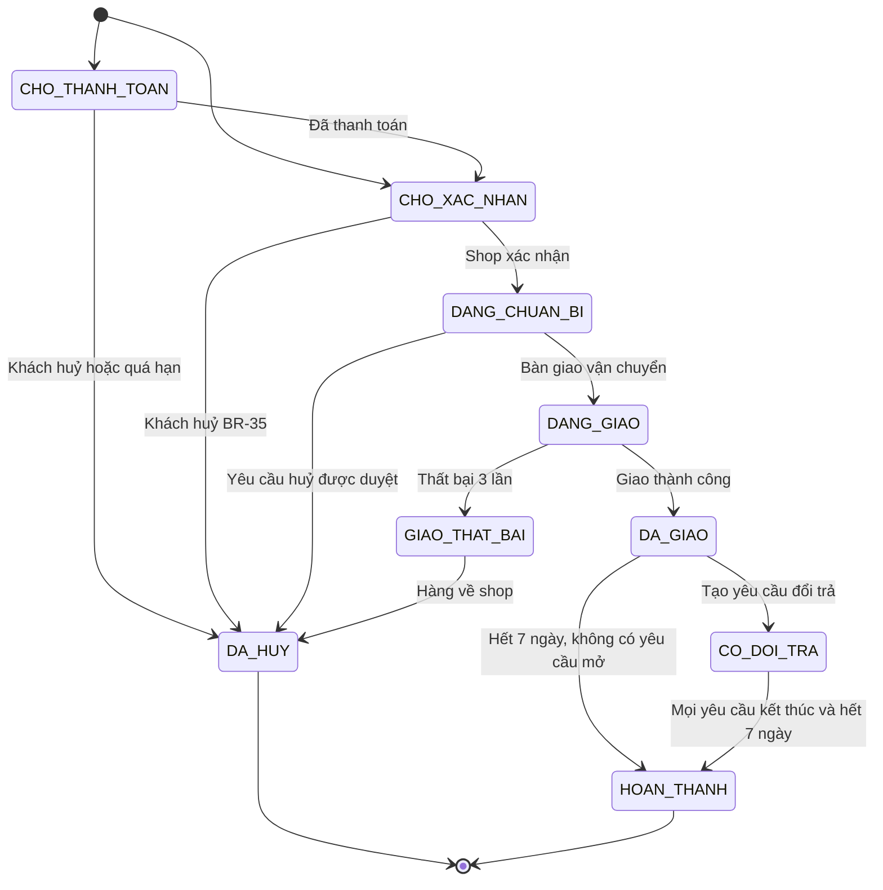
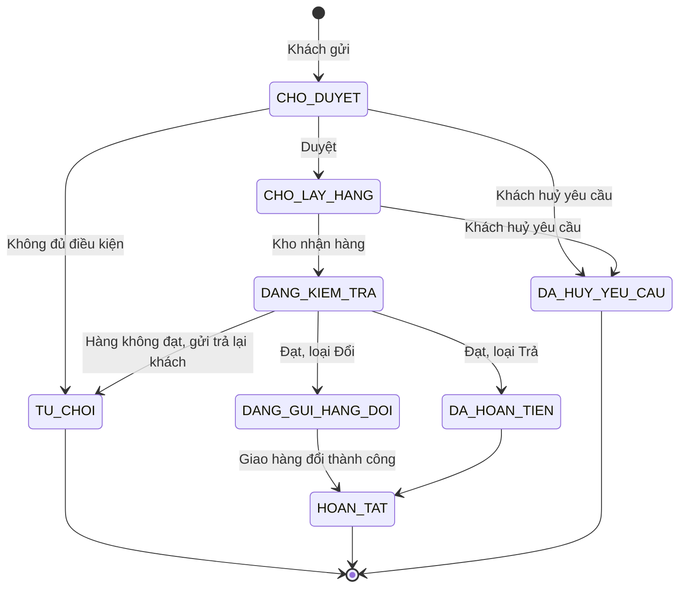
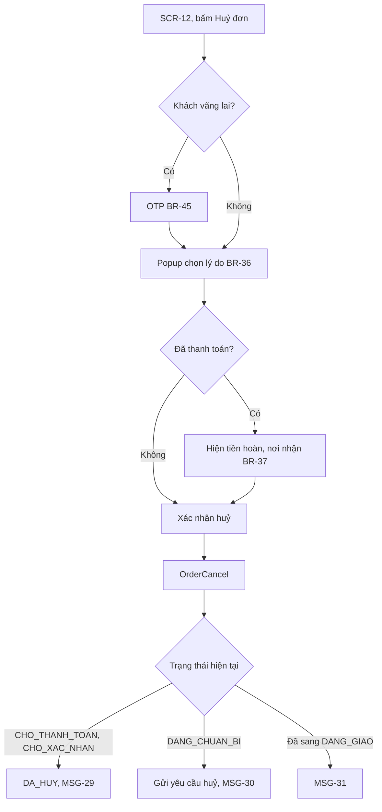
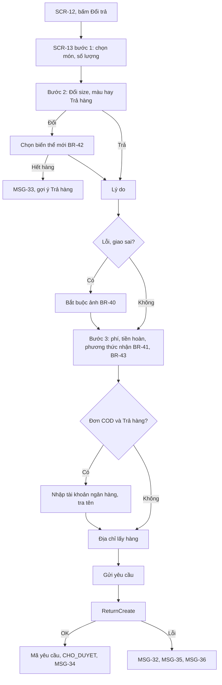
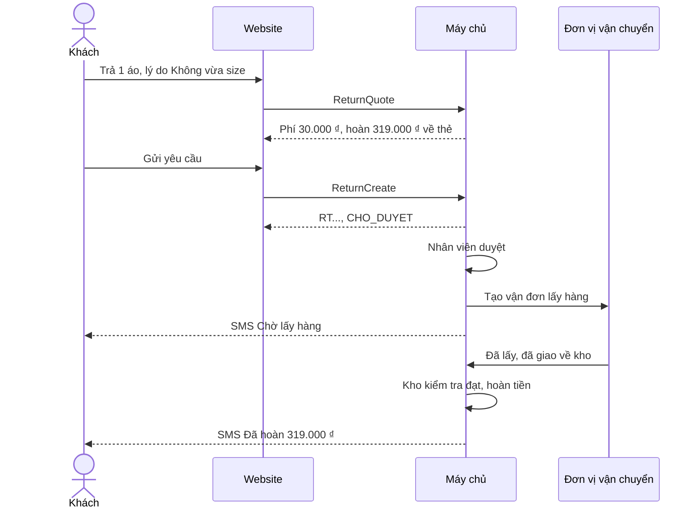

> **Mã:** DE03-TN04-SRS · **Trạng thái:** đã chốt · **Người viết:** Design · **PRD:** [PRD.md](PRD.md)

# UC-DE03-04 - Đơn hàng, huỷ và đổi trả

> SRS này mô tả đơn sau khi tạo (xem [SRS TN03](../TN03-gio-hang-thanh-toan/SRS.md)) cho tới khi hoàn thành, huỷ, hoặc đổi trả xong. Các bước của shop và đơn vị vận chuyển do hệ thống cập nhật; đề chỉ thiết kế phía khách.

## 1. Tổng quan

| **Mục** | **Nội dung** |
| --- | --- |
| Mục tiêu | Khách xem, theo dõi đơn; tự huỷ đơn; tự tạo và theo dõi yêu cầu đổi size, trả hàng hoàn tiền |
| Actor | Khách · Website · Máy chủ · Đơn vị vận chuyển · Nhân viên chăm sóc khách (xử lý ở hệ thống nội bộ) |
| Phạm vi | Đơn của tôi, tra cứu đơn, chi tiết đơn, huỷ đơn, yêu cầu đổi trả, theo dõi yêu cầu, hoàn tiền, mua lại |
| Ngoài phạm vi | Trang quản trị, đánh giá sản phẩm, đổi sang mẫu khác giá, chat |
| Nền tảng | Website desktop và mobile |

## 2. User Story

| **ID** | **As a** | **I want** | **So that** |
| --- | --- | --- | --- |
| US-17 | Thành viên | Xem mọi đơn theo trạng thái | Biết đơn nào đang giao |
| US-18 | Khách vãng lai | Tra cứu đơn bằng mã đơn và số điện thoại | Không cần tài khoản |
| US-19 | Khách | Tự huỷ đơn chưa giao | Không phải gọi shop |
| US-20 | Khách | Đổi size miễn phí | Có đồ vừa người |
| US-21 | Khách | Trả hàng và biết trước tiền hoàn | Yên tâm khi mua |
| US-22 | Khách | Theo dõi yêu cầu đổi trả | Biết bao giờ nhận hàng, nhận tiền |

## 3. Business Rules

| **Mã** | **Quy tắc** |
| --- | --- |
| BR-35 | **Huỷ đơn**: `CHO_THANH_TOAN`, `CHO_XAC_NHAN` → khách huỷ ngay. `DANG_CHUAN_BI` → gửi yêu cầu huỷ, đơn có cờ "Đang yêu cầu huỷ"; shop duyệt hoặc từ chối trong 2 giờ làm việc; đã bàn giao vận chuyển thì từ chối. `DANG_GIAO` trở đi → không huỷ, hiện hướng dẫn từ chối nhận hàng |
| BR-36 | **Lý do huỷ** bắt buộc chọn 1: Đặt nhầm sản phẩm, size · Muốn đổi địa chỉ · Muốn dùng mã giảm giá khác · Tìm được giá tốt hơn · Không còn nhu cầu · Khác (nhập ≤ 200 ký tự). Huỷ thì trả tồn kho; mã giảm giá được trả lại lượt nếu còn hạn |
| BR-37 | **Hoàn tiền khi huỷ** đơn đã thanh toán: thẻ/ví → hoàn về nguồn, 3–7 ngày làm việc tuỳ ngân hàng; QR → hoàn về tài khoản đã chuyển, 1 ngày làm việc. Số tiền = toàn bộ đã trả |
| BR-38 | **Thời hạn đổi trả**: 7 ngày lịch kể từ thời điểm `DA_GIAO`. Hết hạn → đơn `HOAN_THANH`, ẩn nút đổi trả. Đơn có yêu cầu đang mở thì chưa `HOAN_THANH` |
| BR-39 | **Món được đổi trả**: không áp dụng cho đồ lót, đồ bơi, khuyên tai (cờ trên sản phẩm). Món mua khi giảm ≥ 50% chỉ được đổi size. Hàng phải còn tem mác, chưa giặt, chưa sử dụng (kho kiểm tra) |
| BR-40 | **Loại yêu cầu**: Đổi size/màu (cùng mẫu, cùng giá) hoặc Trả hàng hoàn tiền. Lý do: Không vừa size · Không giống ảnh · Sản phẩm lỗi · Giao sai sản phẩm · Đổi ý. Lý do Sản phẩm lỗi, Giao sai bắt buộc 1–5 ảnh, mỗi ảnh ≤ 10 MB, JPG/PNG/HEIC |
| BR-41 | **Phí**: lỗi do shop (Sản phẩm lỗi, Giao sai) → 0 ₫. Đổi size/màu lần đầu mỗi đơn → 0 ₫, từ lần thứ 2 → 30.000 ₫. Trả hàng vì Không vừa size, Không giống ảnh, Đổi ý → 30.000 ₫ trừ vào tiền hoàn |
| BR-42 | **Đổi size/màu**: khi yêu cầu được duyệt, giữ 1 biến thể mới; size mới hết hàng lúc tạo yêu cầu → không chọn được, gợi ý Trả hàng hoàn tiền. Hàng mới gửi đi sau khi kho nhận hàng cũ, trừ lỗi do shop thì gửi ngay |
| BR-43 | **Tiền hoàn** = giá đã trả của món − phí BR-41. Giá đã trả = giá bán − phần giảm giá phân bổ theo tỉ lệ giá trị món trong đơn. Phí giao ban đầu chỉ hoàn khi trả toàn bộ đơn vì lỗi do shop. Hoàn về phương thức gốc; COD → tài khoản ngân hàng khách khai báo (tra tên chủ tài khoản trước khi lưu). Hoàn trong ≤ 3 ngày làm việc kể từ khi kho xác nhận đạt |
| BR-44 | **Phạm vi yêu cầu**: 1 yêu cầu gồm 1 hoặc nhiều món của cùng đơn; mỗi đơn vị sản phẩm chỉ thuộc 1 yêu cầu. Đơn vị vận chuyển đến lấy hàng tại địa chỉ giao ban đầu (đổi được khi tạo yêu cầu) |
| BR-45 | **Tra cứu đơn** (khách vãng lai): mã đơn + số điện thoại đặt hàng phải khớp. Sai 5 lần trong 15 phút từ cùng trình duyệt → khoá 15 phút. Xem chi tiết không cần OTP; huỷ đơn, tạo đổi trả cần OTP 6 số gửi tới số điện thoại đặt hàng, hiệu lực 5 phút. Địa chỉ trên trang tra cứu che bớt (chỉ hiện Phường/Xã, Tỉnh) |
| BR-46 | **Theo dõi vận chuyển**: cập nhật qua webhook đơn vị vận chuyển; hiện mã vận đơn, mốc thời gian, "Cập nhật lúc {giờ}". Giao thất bại 3 lần → `GIAO_THAT_BAI` → hàng hoàn về shop → `DA_HUY`, hoàn tiền nếu đã thanh toán (BR-37) |

## 4. Trạng thái

### 4.1 Vòng đời đơn (phía khách thấy)

| **Trạng thái** | **Khách thấy** | **Nút** |
| --- | --- | --- |
| `CHO_THANH_TOAN` | Chờ thanh toán · giữ hàng tới {giờ} | Thanh toán lại, Huỷ đơn |
| `CHO_XAC_NHAN` | Đã đặt, chờ shop xác nhận | Huỷ đơn |
| `DANG_CHUAN_BI` | Shop đang đóng gói | Yêu cầu huỷ |
| `DANG_GIAO` | Đang giao · dự kiến {ngày} | Tra cứu vận đơn |
| `GIAO_THAT_BAI` | Giao chưa thành công, hàng đang hoàn về shop | Liên hệ |
| `DA_GIAO` | Đã giao {ngày} · đổi trả tới {ngày} | Đổi trả, Mua lại |
| `CO_DOI_TRA` | Đã giao · có yêu cầu đổi trả | Xem yêu cầu, Mua lại |
| `HOAN_THANH` | Hoàn thành | Mua lại |
| `DA_HUY` | Đã huỷ · lý do · tình trạng hoàn tiền | Mua lại |

### 4.2 Vòng đời yêu cầu đổi trả

Duyệt yêu cầu trong ≤ 1 ngày làm việc; yêu cầu lỗi do shop có ảnh hợp lệ được duyệt tự động.

## 5. Use Case

### UC-08 Xem và tra cứu đơn

| **Mục** | **Nội dung** |
| --- | --- |
| Tiền điều kiện | Thành viên đã đăng nhập, hoặc khách có mã đơn và số điện thoại |
| Hậu điều kiện thành công | Hiện **SCR-12** của đơn |
| Hậu điều kiện thất bại | Ở lại **SCR-14** với thông báo |

**Luồng chính**

| **Bước** | **Actor** | **Mô tả** |
| --- | --- | --- |
| 1 | Thành viên | Mở Tài khoản → **SCR-11** Đơn của tôi |
| 2 | Website | Gọi \[OrderList\]; hiện tab và danh sách đơn mới nhất trước |
| 3 | Thành viên | Chạm một đơn |
| 4 | Website | Gọi \[OrderDetail\]; hiện **SCR-12** với tiến trình, mốc thời gian, nút theo mục 4.1 |

**Luồng thay thế**

| **Mã** | **Điều kiện** | **Xử lý** |
| --- | --- | --- |
| A1 | Khách vãng lai | Footer → "Tra cứu đơn hàng" → **SCR-14**; nhập mã đơn, số điện thoại → \[OrderLookup\] → **SCR-12** (địa chỉ che bớt, BR-45) |
| A2 | Mở từ link trong SMS | Link có token ký số → mở thẳng **SCR-12**, không cần nhập lại |
| A3 | Bấm "Mua lại" | Thêm mọi món còn bán vào giỏ (cùng màu, size; hết hàng thì bỏ qua và báo) → **SCR-08** |

**Luồng lỗi**

| **Mã** | **Điều kiện** | **Xử lý** |
| --- | --- | --- |
| E1 | Mã đơn và số điện thoại không khớp | MSG-27 |
| E2 | Sai 5 lần trong 15 phút | MSG-28 |
| E3 | Lỗi mạng | MSG-36 |

### UC-09 Huỷ đơn

| **Mục** | **Nội dung** |
| --- | --- |
| Tiền điều kiện | Đơn ở `CHO_THANH_TOAN`, `CHO_XAC_NHAN` hoặc `DANG_CHUAN_BI`; khách vãng lai đã qua OTP |
| Hậu điều kiện thành công | Đơn `DA_HUY` hoặc có cờ "Đang yêu cầu huỷ" |
| Hậu điều kiện thất bại | Đơn giữ nguyên trạng thái |

**Luồng chính**

| **Bước** | **Actor** | **Mô tả** |
| --- | --- | --- |
| 1 | Khách | Bấm "Huỷ đơn" ở **SCR-12** |
| 2 | Website | Popup lý do huỷ; nếu đã thanh toán hiện số tiền hoàn và nơi nhận |
| 3 | Khách | Chọn lý do, bấm "Xác nhận huỷ" |
| 4 | Website | Gọi \[OrderCancel\] |
| 5 | Máy chủ | Kiểm tra trạng thái hiện tại (BR-35); huỷ, trả tồn kho, trả lượt mã, tạo lệnh hoàn tiền nếu cần |
| 6 | Website | Cập nhật **SCR-12**: "Đã huỷ", tình trạng hoàn tiền; MSG-29 |

**Luồng thay thế**

| **Mã** | **Điều kiện** | **Xử lý** |
| --- | --- | --- |
| A1 | Đơn `DANG_CHUAN_BI` | Gửi yêu cầu huỷ, MSG-30; kết quả báo qua SMS |
| A2 | Yêu cầu huỷ bị từ chối | Cờ bỏ đi, đơn tiếp tục; SMS kèm lý do |

**Luồng lỗi**

| **Mã** | **Điều kiện** | **Xử lý** |
| --- | --- | --- |
| E1 | Trạng thái đã đổi sang `DANG_GIAO` khi bấm | MSG-31; tải lại **SCR-12** |
| E2 | Lỗi mạng | MSG-36 |

### UC-10 Tạo yêu cầu đổi trả

| **Mục** | **Nội dung** |
| --- | --- |
| Tiền điều kiện | Đơn `DA_GIAO` hoặc `CO_DOI_TRA`, còn trong 7 ngày (BR-38), có ít nhất 1 món đủ điều kiện (BR-39) |
| Hậu điều kiện thành công | Yêu cầu `CHO_DUYET`; đơn `CO_DOI_TRA`; khách nhận mã yêu cầu |
| Hậu điều kiện thất bại | Không tạo yêu cầu |

**Luồng chính**

| **Bước** | **Actor** | **Mô tả** |
| --- | --- | --- |
| 1 | Khách | Bấm "Đổi trả" ở **SCR-12** |
| 2 | Website | Mở **SCR-13**; liệt kê món, món không đủ điều kiện làm mờ kèm lý do |
| 3 | Khách | Chọn món, số lượng; chọn Trả hàng hoàn tiền; chọn lý do "Không vừa size" |
| 4 | Website | Gọi \[ReturnQuote\]; hiện phí 30.000 ₫, tiền hoàn dự kiến, nơi nhận tiền, thời gian |
| 5 | Khách | Kiểm tra địa chỉ lấy hàng; bấm "Gửi yêu cầu" |
| 6 | Website | Gọi \[ReturnCreate\] |
| 7 | Máy chủ | Tạo yêu cầu `CHO_DUYET`; đơn `CO_DOI_TRA`; gửi SMS |
| 8 | Website | Hiện mã yêu cầu, các bước tiếp theo, MSG-34 |

**Luồng thay thế**

| **Mã** | **Điều kiện** | **Xử lý** |
| --- | --- | --- |
| A1 | Chọn Đổi size/màu | Chọn biến thể mới; phí theo BR-41; không có tiền hoàn |
| A2 | Lý do lỗi hoặc giao sai | Tải 1–5 ảnh; phí 0 ₫; duyệt tự động (mục 4.2) |
| A3 | Đơn COD, Trả hàng | Nhập ngân hàng, số tài khoản → \[BankAccountVerify\] hiện tên chủ tài khoản để khách xác nhận |
| A4 | Khách huỷ yêu cầu khi còn `CHO_DUYET` hoặc `CHO_LAY_HANG` | Nút "Huỷ yêu cầu" ở **SCR-12**; nhả biến thể đang giữ |
| A5 | Khách vãng lai | OTP trước bước 2 (BR-45) |

**Luồng lỗi**

| **Mã** | **Điều kiện** | **Xử lý** |
| --- | --- | --- |
| E1 | Quá 7 ngày | Nút ẩn; nếu gửi đúng lúc hết hạn → MSG-32 |
| E2 | Size mới hết hàng | MSG-33 |
| E3 | Thiếu ảnh bắt buộc, ảnh sai định dạng hoặc quá 10 MB | Lỗi inline, MSG-35 |
| E4 | Không tra được tên chủ tài khoản | Lỗi inline "Không tìm thấy tài khoản, kiểm tra lại số tài khoản và ngân hàng" |
| E5 | Lỗi mạng | MSG-36; giữ dữ liệu đã nhập |

## 6. Điểm vào

| **Điểm vào** | **Dẫn tới** | **Ghi chú** |
| --- | --- | --- |
| Tài khoản → Đơn của tôi | **SCR-11** | Thành viên |
| Footer "Tra cứu đơn hàng" | **SCR-14** | Khách vãng lai |
| "Xem đơn hàng" ở **SCR-10** (TN03) | **SCR-12** | |
| Link trong SMS, email | **SCR-12** hoặc yêu cầu đổi trả | A2 UC-08 |
| Tab Đổi trả ở **SCR-11** | Danh sách yêu cầu | |

## 7. Mô tả màn hình

### SCR-11 Đơn của tôi

| **#** | **Thành phần** | **Loại** | **Hành vi** |
| --- | --- | --- | --- |
| 1 | Tab trạng thái | Tabs | Tất cả, Đang xử lý (`CHO_THANH_TOAN`, `CHO_XAC_NHAN`, `DANG_CHUAN_BI`), Đang giao, Đã giao, Đã huỷ, Đổi trả |
| 2 | Thẻ đơn | Card | Mã đơn, ngày đặt, ảnh món đầu, "và {n} món khác", tổng, trạng thái bằng chữ (mục 4.1) |
| 3 | Nút nhanh | Button | Một nút chính theo trạng thái |
| 4 | Tải thêm | Pagination | 10 đơn mỗi lần |
| 5 | Trạng thái rỗng | Empty state | "Bạn chưa có đơn nào" + "Mua sắm ngay" |

### SCR-12 Chi tiết đơn

| **#** | **Thành phần** | **Loại** | **Hành vi** |
| --- | --- | --- | --- |
| 1 | Trạng thái | Header | Câu trạng thái mục 4.1, dự kiến giao hoặc hạn đổi trả |
| 2 | Tiến trình | Stepper | Đã đặt → Đã xác nhận → Đang giao → Đã giao; huỷ thì hiện bước huỷ màu đỏ |
| 3 | Mốc thời gian | Timeline | Trạng thái đơn và vận chuyển, "Cập nhật lúc {giờ}" (BR-46) |
| 4 | Vận chuyển | Card | Đơn vị, mã vận đơn (sao chép), link tra cứu |
| 5 | Danh sách món | List | Ảnh, tên, màu, size, số lượng, giá đã trả; chạm mở **SCR-05** |
| 6 | Thanh toán | Card | Tạm tính, giảm giá, phí giao, tổng, phương thức, tình trạng hoàn tiền |
| 7 | Nhận hàng | Card | Người nhận, số điện thoại, địa chỉ (che bớt với khách vãng lai) |
| 8 | Yêu cầu đổi trả | Card | Mã, loại, trạng thái mục 4.2, tiền hoàn, nút Huỷ yêu cầu |
| 9 | Nút hành động | Button | Theo mục 4.1 |

### SCR-13 Yêu cầu đổi trả

| **#** | **Thành phần** | **Loại** | **Bắt buộc** | **Validate / hành vi** |
| --- | --- | --- | --- | --- |
| 1 | Bước | Stepper | – | 1 Chọn món · 2 Hình thức & lý do · 3 Xác nhận |
| 2 | Chọn món | Checkbox list + stepper | Có | Món không đủ điều kiện làm mờ kèm lý do (BR-39) |
| 3 | Hình thức | Radio | Có | Đổi size/màu, Trả hàng hoàn tiền; món giảm ≥ 50% chỉ có Đổi |
| 4 | Biến thể mới | Chips màu, size | Có khi Đổi | Hết hàng gạch chéo (BR-42) |
| 5 | Lý do | Radio | Có | BR-40 |
| 6 | Mô tả | Textarea | Không | ≤ 500 ký tự |
| 7 | Ảnh | Upload | Có khi lỗi, giao sai | 1–5 ảnh, ≤ 10 MB |
| 8 | Tóm tắt phí | Card | – | Phí, tiền hoàn dự kiến, nơi nhận tiền, thời gian (BR-41, BR-43) |
| 9 | Tài khoản nhận hoàn | Select ngân hàng + Text | Có khi COD và Trả | Tra tên chủ tài khoản (A3) |
| 10 | Địa chỉ lấy hàng | Card | Có | Mặc định địa chỉ giao; đổi được |
| 11 | Chính sách | Text | – | Tóm tắt điều kiện hàng (còn tem mác, chưa giặt) |
| 12 | "Gửi yêu cầu" | Button | – | Disabled khi thiếu ô bắt buộc |

### SCR-14 Tra cứu đơn

| **#** | **Thành phần** | **Loại** | **Bắt buộc** | **Validate / hành vi** |
| --- | --- | --- | --- | --- |
| 1 | Mã đơn | Text | Có | `DH` + 8 số; không phân biệt hoa thường |
| 2 | Số điện thoại | Tel | Có | 10 số |
| 3 | "Tra cứu" | Button | – | Loading khi gọi; khoá theo BR-45 |
| 4 | Gợi ý | Text | – | "Mã đơn có trong SMS xác nhận" |

## 8. API

| **API** | **Request chính** | **Response chính** | **Timeout / retry** |
| --- | --- | --- | --- |
| \[OrderList\] | status_tab, cursor | Danh sách thẻ đơn | 5s / 1 lần |
| \[OrderDetail\] | order_id hoặc token | Đơn, món, thanh toán, vận chuyển, yêu cầu đổi trả, hành động được phép | 5s / 1 lần |
| \[OrderLookup\] | order_code, phone | token xem đơn hoặc lỗi; số lần còn lại | 5s / không retry |
| \[OtpSend\], \[OtpVerify\] | phone, purpose; otp | Phiên được phép thao tác 15 phút | 5s / không retry |
| \[OrderCancel\] | order_id, reason, note | Trạng thái mới, refund (số tiền, nơi nhận) | 5s / 1 lần, idempotent theo order_id |
| \[ReturnQuote\] | order_id, items, type, reason, new_sku | fee, refund_amount, refund_method, eligible | 3s / 1 lần |
| \[BankAccountVerify\] | bank_code, account_no | account_name | 5s / 1 lần |
| \[ReturnCreate\] | order_id, items, type, reason, note, photos, new_sku, refund_account, pickup_address, idempotency_key | return_id, status | 10s / gửi lại cùng key |
| \[ReturnCancel\] | return_id | status | 5s / 1 lần |
| \[CarrierWebhook\] | Đơn vị vận chuyển → máy chủ: mã vận đơn, trạng thái, thời điểm | – | BR-46 |

**Map lỗi → thông báo**

| **Nhóm lỗi** | **Message** |
| --- | --- |
| Tra cứu không khớp | MSG-27 |
| Tra cứu bị khoá | MSG-28 |
| Huỷ thành công | MSG-29 |
| Đã gửi yêu cầu huỷ | MSG-30 |
| Đơn đã giao vận chuyển, không huỷ được | MSG-31 |
| Hết hạn đổi trả | MSG-32 |
| Biến thể đổi hết hàng | MSG-33 |
| Gửi yêu cầu đổi trả thành công | MSG-34 |
| Ảnh không hợp lệ | MSG-35 |
| Mất mạng, quá thời gian, lỗi máy chủ | MSG-36 |

## 9. Danh sách thông báo

| **ID** | **Nơi hiện** | **Nội dung (VI)** |
| --- | --- | --- |
| MSG-27 | Inline **SCR-14** | Không tìm thấy đơn với mã và số điện thoại này. Bạn còn {n} lần thử |
| MSG-28 | Inline **SCR-14** | Bạn đã thử quá nhiều lần. Vui lòng thử lại sau {m} phút |
| MSG-29 | Toast | Đã huỷ đơn {mã đơn}. {Nếu đã thanh toán: Tiền hoàn {số tiền} ₫ sẽ về {nơi nhận} trong {thời gian}} |
| MSG-30 | Toast | Đã gửi yêu cầu huỷ. Shop sẽ phản hồi trong 2 giờ làm việc |
| MSG-31 | Popup | Đơn đã được giao cho đơn vị vận chuyển nên không huỷ được nữa. Bạn có thể từ chối nhận hàng khi shipper giao tới |
| MSG-32 | Popup | Đơn đã quá 7 ngày kể từ khi nhận hàng nên không thể đổi trả |
| MSG-33 | Inline | Size {size} màu {màu} đã hết hàng. Bạn có thể chọn trả hàng hoàn tiền |
| MSG-34 | Toast | Đã gửi yêu cầu {mã yêu cầu}. Chúng tôi sẽ duyệt trong 1 ngày làm việc |
| MSG-35 | Inline | Ảnh cần định dạng JPG, PNG hoặc HEIC, tối đa 10 MB, từ 1 đến 5 ảnh |
| MSG-36 | Toast | Kết nối không ổn định, vui lòng thử lại |

## 10. Yêu cầu phi chức năng

| **Mục** | **Yêu cầu** |
| --- | --- |
| Hiệu năng | \[OrderDetail\] ≤ 1 giây (p95); trạng thái vận chuyển hiện trên web ≤ 5 phút sau khi đơn vị vận chuyển cập nhật |
| Bảo mật, riêng tư | Tra cứu có giới hạn số lần (BR-45); link trong SMS dùng token ký số hết hạn sau 30 ngày; số tài khoản hoàn tiền che bớt khi hiển thị lại |
| Lưu trữ | Ảnh đổi trả lưu 1 năm; lịch sử đơn lưu theo quy định kế toán |
| Log / audit | Mọi thay đổi trạng thái đơn và yêu cầu: ai, khi nào, lý do; mọi lệnh hoàn tiền: số tiền, nơi nhận, kết quả |
| Tracking | Xem đơn, tra cứu (kết quả), huỷ (lý do, kết quả), bắt đầu và gửi đổi trả (loại, lý do), bỏ dở ở bước nào, mua lại |
| Accessibility | Tiến trình đơn đọc được bằng chữ ("Bước 3 trên 4: Đang giao"); upload ảnh dùng được bằng bàn phím; trạng thái không chỉ phân biệt bằng màu |
